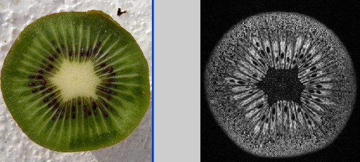
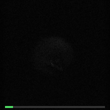
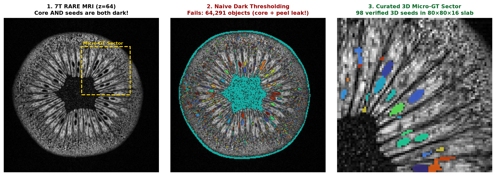

# Lab 4: The Kiwi Fruit 3D Seed Segmentation Challenge

*Updated for BMED365 Spring 2027 (`bmed365-2027` kernel / Google Colab) — Arvid Lundervold*

## Overview: One Simple Fruit, Six Weeks of Computational Thinking

Everyone knows what the inside of a kiwifruit looks like. Yet teaching a computer to accurately **find, separate, and count every single seed in 3D** from a real Magnetic Resonance Imaging (MRI) scan turns out to be surprisingly challenging — and closely mirrors real clinical tasks in biomedical imaging.

In **BMED365**, the Kiwi Challenge serves as a **recurring benchmark problem** ("red thread") from the first lecture in January to **Lab 4 (Computational Imaging)** in February:

- **Intuitive biology, real MRI physics:** No medical jargon is needed on Day 1, yet the 3D scan exhibits partial-volume blurring, intensity shading, closely packed instances, and dark fibrous structures that mimic seeds.
- **Clinical analogy:** Replace the kiwifruit with the **human brain** and the seeds with **multiple sclerosis (MS) white-matter plaques**, **cerebral microbleeds**, or **micrometastases** (or replace the MRI with 3D microscopy of **cell nuclei**). The computational questions are identical.
- **Methodological playground:** You can attack the exact same 3D dataset with rule-based filters, classical machine learning, graph/spatial priors, deep learning, vision foundation models, neurosymbolic rules, and AI coding agents.

Slides & visual teasers:
- **[Lecture 1 Teaser Slides (Beamer PDF, 10 min)](https://github.com/arvidl/BMED365-2027/blob/main/Lab4-Comp-Imag/Kiwi-challenge/Beamer/main.pdf)** *(source: [`./Beamer/main.tex`](./Beamer/main.tex))*
- **[Original Problem Formulation (Google Slides)](https://docs.google.com/presentation/d/1B_E-Pcwfvj3hgG2o02vsxmez_Bm6x72uI5tzIu0dymU/edit?usp=sharing)**

  

---

## The Challenge Tasks

Starting from the 3D 7T MRI scan of an intact kiwifruit:

1. **3D Seed Segmentation & Counting:**
   Segment the dark seeds from the surrounding fruit tissue and estimate the **total number of seeds** ($N$) in the kiwifruit. If your method has tunable parameters or probabilistic outputs, provide an **uncertainty / sensitivity range** for your count.
2. **Biomedical Biomarker Analogy ("Lesion Load"):**
   Treat the whole kiwifruit as a "brain" and the segmented seeds as focal pathological lesions (e.g., [MS plaques](https://pubmed.ncbi.nlm.nih.gov/23084503/)). Using the physical voxel dimensions of the scan, estimate:
   - Whole-fruit volume $V_{\text{kiwi}}$ ($\text{mm}^3$ or $\text{cm}^3$)
   - Total seed volume $V_{\text{seeds}}$ ($\text{mm}^3$) and mean single-seed volume ($\text{mm}^3$)
   - **"Lesion load"** ([volume fraction](https://journals.plos.org/plosone/article?id=10.1371/journal.pone.0120754)): $V_{\text{seeds}} / V_{\text{kiwi}}$
3. **Verification Without Complete Ground Truth:**
   Nobody manually segmented all ~700–1,200 seeds across all 128 slices, and the physical fruit from 2005 was never dissected to count the seeds. **How can you verify whether your count and segmentation are trustworthy?** (See [Evaluation & Semi-Verifiability](#evaluation--semi-verifiability-how-do-we-know-an-answer-is-right) below.)

---

## Data & Notebooks

All data files are included directly in [`./data/`](./data/) — no external downloads are required.

### Dataset Summary

The 3D dataset was acquired on **17 February 2005** using the preclinical **7 T [Bruker Pharmascan](https://www.bruker.com/en/products-and-solutions/preclinical-imaging/mri/pharmascan-new.html)** (`Pharmascan300`) MRI scanner at the *Molecular Imaging Center* (MIC / Vivarium), University of Bergen.

| Property | Value | Why it matters for segmentation |
|:---------|:------|:--------------------------------|
| **Pulse sequence** | 2D RARE (Rapid Acquisition with Relaxation Enhancement) | $T_2$-weighted contrast: water-rich locular gel is bright; seeds, dense central core (*columella*), radial septa, and peel appear dark |
| **Sequence parameters** | `TR = 18,520.8 ms`, `TE = 63.9 ms`, `ETL = 8`, `Flip Angle = 180°`, `Averages = 2` | High in-plane SNR, but slight smooth intensity shading across the field of view |
| **Volume matrix** | `256 × 256 × 128` voxels | 128 transaxial slices along the long axis of the fruit (`8,388,608` voxels total) |
| **Voxel spacing** | `0.2344 × 0.2344 × 0.5000 mm³` (`≈ 0.0275 mm³/voxel`) | **Anisotropic voxels:** slice thickness (`0.5 mm`) is more than twice the in-plane pixel size (`0.234 mm`), causing partial-volume averaging between slices |
| **Files in [`data/`](./data/)** | [`kiwi_20050217191129_131073_RARE_high_res_axial.nii.gz`](./data/kiwi_20050217191129_131073_RARE_high_res_axial.nii.gz) [`kiwi_20050217191129_131073_RARE_high_res_axial.json`](./data/kiwi_20050217191129_131073_RARE_high_res_axial.json) [`kiwi_micro_gt_labels.nii.gz`](./data/kiwi_micro_gt_labels.nii.gz) & [`kiwi_micro_gt_roi.json`](./data/kiwi_micro_gt_roi.json) [`dicom/`](./data/dicom/) (128 files) & [`kiwi_064.png`](./data/kiwi_064.png) | Ready for Python (`nibabel`, `pydicom`, `SimpleITK`, `MONAI`, `scikit-image`) as well as [3D Slicer](https://www.slicer.org/), [ITK-SNAP](http://www.itksnap.org/), or [Fiji/ImageJ](https://imagej.net/software/fiji/). Includes a reproducible semi-automated (*"silver-standard"*) `80 × 80 × 16` **3D Micro-Ground-Truth** label volume (`98` 3D seed instances, generated by [`scripts/curate_micro_gt.py`](./scripts/curate_micro_gt.py)) aligned to the scan affine |

### Notebook Trilogy

The three notebooks form a step-by-step progression and run in the main course `uv` environment (`bmed365-2027` kernel) or directly in Google Colab *(note: in Colab, `resolve_kiwi_file(...)` downloads data and Micro-GT files automatically from the `main` branch)*:

| Notebook | Description | 1-Click Notebook |
|:---------|:------------|:-----------------|
| [01-kiwi-explore.ipynb](https://github.com/arvidl/BMED365-2027/blob/main/Lab4-Comp-Imag/Kiwi-challenge/notebooks/01-kiwi-explore.ipynb) | **Part 1:** Load the 3D NIfTI / DICOM kiwi scan, inspect header metadata, voxel geometry, and affine coordinate systems |  |
| [02-kiwi-seeds-explore.ipynb](https://github.com/arvidl/BMED365-2027/blob/main/Lab4-Comp-Imag/Kiwi-challenge/notebooks/02-kiwi-seeds-explore.ipynb) | **Part 2:** 2D single-slice filtering, thresholding, unsupervised K-means clustering, & the 2011–2012 Dagstuhl / CUHK 3D variational milestone |  |
| [03-kiwi-paradigms-and-verification.ipynb](https://github.com/arvidl/BMED365-2027/blob/main/Lab4-Comp-Imag/Kiwi-challenge/notebooks/03-kiwi-paradigms-and-verification.ipynb) | **Part 3 (Lab 4 Live Walkthrough):** Full 3D segmentation ladder (Rung 1 → Rung 2B → Foundation Models & Agents), quantitative "lesion load", Curated 3D Micro-GT scoring (`P/R/F1` + calibrated count), & the **4-Panel Semi-Verifiability Dashboard** |  |

---

## A Spectrum of Approaches Across the Course

As we progress through BMED365, consider how each family of methods handles (or fails on) the kiwi seeds:

1. **Classical Rule-Based & Signal Processing (2D vs. 3D):**
   - Global or adaptive thresholding, background bias-field correction, morphological opening/closing, distance-transform watershed, Laplacian/Difference of Gaussians (LoG/DoG) blob detection, or 3D ellipsoidal template matching.
   - *Watch out for:* Dark peel voxels, radial vascular bundles, and adjacent seeds merging into single large connected components.
2. **Classical Machine Learning & Radiomics (cf. [Lab 0](../../Lab0-ML/README.md)):**
   - Stack filtered volumes (intensity, gradient magnitude, Hessian/blobness at seed scale, distance from fruit center) into a multi-feature matrix for unsupervised clustering (K-means, GMM) or supervised pixel/voxel classification (Random Forest / XGBoost, or interactive tools like [ilastik](https://www.ilastik.org/)).
3. **Spatial Graphs & Structural Priors (cf. [Lab 1](../../Lab1-NetworkSci-PSN/README.md)):**
   - Kiwifruit seeds are not scattered at random: they are arranged inside bright radial locules surrounding the central fibrous core (*columella*, which looks white optically but appears dark in $T_2$-weighted MRI). Representing candidate seed centroids as a 3D spatial graph helps spot outliers and merged clusters.
4. **Deep Learning, Self-Supervised & Foundation Models (cf. [Lab 2](../../Lab2-DL) & [Lab 4](../README.md)):**
   - Train a compact 2D/3D U-Net on a handful of manually labeled slices, apply biomedical instance segmenters ([StarDist](https://github.com/stardist/stardist), [Cellpose](https://www.cellpose.org/)), or test zero-shot / promptable vision foundation models ([SAM 2](https://github.com/facebookresearch/sam2), [MedSAM](https://github.com/bowang-lab/MedSAM), [MicroSAM](https://github.com/computational-cell-analytics/micro-sam)).
5. **Neurosymbolic / Prior-Constrained Segmentation:**
   - Combine neural seed proposals with explicit botanical and physical constraints (anatomical pericarp ring mask, non-overlapping 3D ellipsoids, plausible single-seed volume in $\text{mm}^3$).
6. **AI-Assisted Coding & Agentic Workflows (cf. [Quick Start](../../Lab-QuickStart/README.md) & [Lab 3](../../Lab3-GenAI-LLM)):**
   - Ask a multimodal LLM directly *"How many seeds are in `kiwi_064.png`?"* and observe why raw visual counting fails.
   - Then use an **AI coding partner or agent** (Gemini, Claude, ChatGPT, Cursor) to write a 3D Python pipeline, inspect diagnostic overlay plots, check physical constraints, and iteratively refine the algorithm.

---

## Evaluation & Semi-Verifiability: How Do We Know an Answer Is Right?

In many real biomedical problems — and in AI-assisted coding — running code that produces *a number* is easy; **verifying** that the number reflects biological reality is the hard part. Because complete voxel-by-voxel ground truth does not exist for this scan, the Kiwi Challenge is **semi-verifiable** through multiple independent checks:

- **Curated 3D Sub-Volume Audit ("Micro-Ground-Truth" — Silver → Gold Standard):** [`data/kiwi_micro_gt_labels.nii.gz`](./data/kiwi_micro_gt_labels.nii.gz) and [`data/kiwi_micro_gt_roi.json`](./data/kiwi_micro_gt_roi.json) provide a reproducible **semi-automated ("silver-standard")** `80 × 80 × 16` equatorial validation sector (`x=[128, 208), y=[128, 208), z=[56, 72)`, `98` 3D seed instances, `75` strictly interior) generated by [`scripts/curate_micro_gt.py`](./scripts/curate_micro_gt.py) (padded multi-scale 3D LoG + anisotropic grey closing + watershed + physical-mm K-means pair splitting, refined across multi-slice visual audits). Notebook `03` computes 3D instance **Precision, Recall, F1**, and a **bias-calibrated whole-fruit seed count** ($\hat{N}_{\text{cal}} = \hat{N} \cdot \text{Precision} / \text{Recall}$). Because the `uint16` NIfTI shares the exact `256 × 256 × 128` grid and affine of the MRI scan, you can inspect or manually refine it into a human-certified **gold standard** in 4 quick steps:
  1. **Load main MRI:** Open [`data/kiwi_20050217191129_131073_RARE_high_res_axial.nii.gz`](./data/kiwi_20050217191129_131073_RARE_high_res_axial.nii.gz) as the *Main Image* in **[ITK-SNAP](http://www.itksnap.org/)** (*File → Open Main Image*) or **[3D Slicer](https://www.slicer.org/)** (*Add Data → Volume*).
  2. **Overlay 3D seed labels:** Load [`data/kiwi_micro_gt_labels.nii.gz`](./data/kiwi_micro_gt_labels.nii.gz) as a **Segmentation** (*ITK-SNAP: Segmentation → Open Segmentation*; *3D Slicer: Add Data → Description = Segmentation*).
  3. **Jump to the Micro-GT sector:** Navigate the cursor to voxel **`(x=168, y=168, z=64)`** (center of `x=128..207, y=128..207, z=56..71`) and click *Update 3D* / *Show 3D* to inspect all 98 labeled 3D seeds across axial, coronal, and sagittal views.
  4. **Verify, edit, or add a second wedge:** Use the 3D paintbrush/polygon tool to refine boundary voxels, split/merge any label IDs, or annotate an independent polar wedge (`z=25..40`), then save as a new `.nii.gz` segmentation to test generalization!
- **Physical Volume Sanity Checks:** At `0.0275 mm³/voxel`, a realistic kiwifruit seed (`~1–3 mm³`) spans roughly **35–110 voxels**. Plotting the histogram of connected-component volumes immediately reveals tiny noise specks (`< 10 voxels`) and fused multi-seed blobs (`> 200 voxels`).
- **Anatomical Zone Constraints:** Seeds only exist in the inner pericarp ring — zero detections should fall in the central fibrous columella, the outer skin, or air outside the fruit.
- **3D Multi-Planar Consistency:** A real seed spans ~3–5 consecutive axial slices and remains compact when viewed in **coronal** and **sagittal** cross-sections.
- **Perturbation & Cross-Method Consensus:** Does changing a threshold by 5% double your seed count? Do two very different methods (e.g., 3D LoG blob detection vs. a deep instance segmenter) agree on the same seed locations?

---

## How We Use This Challenge in BMED365

- **Lecture 1 → Lab 4 Thought Experiment:** Keep this dataset in mind throughout Block 1 as you learn ML, networks, deep learning, and prompt/agentic engineering. In **Lab 4 (Mon 8 Feb 2027)**, we compare approaches side-by-side — from naive thresholding failures to modern foundation-model and agentic pipelines — and examine how each method is evaluated.
- **Optional [Individual Project](../../Individual-project/README.md) Topic (Block 2):** If you are looking for a concrete, self-contained dataset for your Block 2 digital poster and speed-poster presentation, you are welcome to use the Kiwi Challenge (for example, benchmarking classical vs. deep/agentic segmentation methods and designing a rigorous validation protocol).

---

## Additional Background & Visualizations

- **Dagstuhl / CUHK 3D Variational Segmentation (2011–2012):** Following a November 2011 Dagstuhl Seminar discussion with Prof. Raymond H. Chan (The Chinese University of Hong Kong), PhD student Xiaohao Cai applied their two-stage convex Mumford–Shah variational segmentation method (cf. Cai, Chan & Zeng, *SIAM J. Imaging Sci.*, 2013) to this 3D kiwi dataset — see [`./assets/kiwi_3d_cai_chan_2012.jpg`](./assets/kiwi_3d_cai_chan_2012.jpg) and the historical discussion in [`02-kiwi-seeds-explore.ipynb`](./notebooks/02-kiwi-seeds-explore.ipynb).
- **3D Volume Rendering (Dept. of Informatics, UiB):** Example 3D rendering from the UiB visualization group in [`./assets/kiwi-stian-eikeland-vis-video-to-gif.png`](./assets/kiwi-stian-eikeland-vis-video-to-gif.png) (visualizations originally created by Ove Daae Lampe, Stian Eikeland, and Veronika Šoltészová).
- **Botanical background:** [All about kiwi seeds (Zespri)](https://www.zespri.com/en-IN/blogdetail/all-about-kiwi-seeds) | [Kiwifruit (*Actinidia deliciosa*) morphology](https://en.wikipedia.org/wiki/Kiwifruit)
