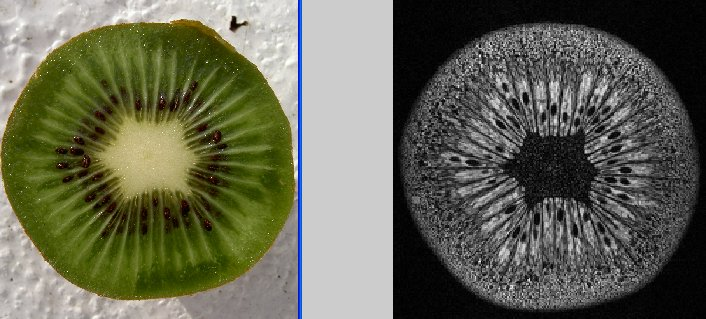
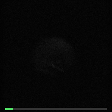
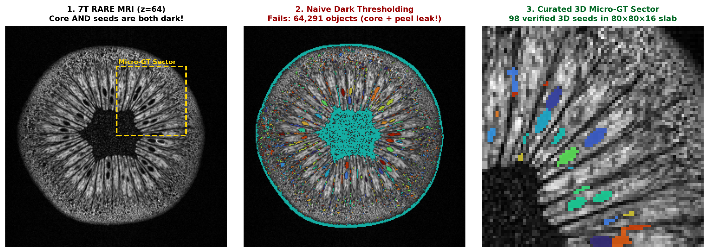

# Lab 4: The Kiwi Fruit 3D Seed Segmentation Challenge

*Updated for BMED365 Spring 2027 (`bmed365-2027` kernel / Google Colab) — Arvid Lundervold*  
*Printable version: **[Lab4-Kiwi-challenge-README.pdf](./Lab4-Kiwi-challenge-README.pdf)** ([LaTeX source](./Lab4-Kiwi-challenge-README.tex))*

## Overview: One Simple Fruit, Six Weeks of Computational Thinking

Everyone knows what the inside of a kiwifruit looks like. Yet teaching a computer to accurately **find, separate, and count every single seed in 3D** from a real Magnetic Resonance Imaging (MRI) scan turns out to be surprisingly challenging — and closely mirrors real clinical tasks in biomedical imaging.

In **BMED365**, the Kiwi Challenge serves as a **recurring benchmark problem** ("red thread") from the first lecture in January to **Lab 4 (Computational Imaging)** in February:

- **Intuitive biology, real MRI physics:** No medical jargon is needed on Day 1, yet the 3D scan exhibits partial-volume blurring, intensity shading, closely packed instances, and dark fibrous structures that mimic seeds.
- **Clinical analogy:** Replace the kiwifruit with the **human brain** and the seeds with **multiple sclerosis (MS) white-matter plaques**, **cerebral microbleeds**, or **micrometastases** (or replace the MRI with 3D microscopy of **cell nuclei**). The computational questions are identical.
- **Methodological playground:** You can attack the exact same 3D dataset with rule-based filters, classical machine learning, graph/spatial priors, deep learning, vision foundation models, neurosymbolic rules, and AI coding agents.

Slides & visual teasers:
- **[Lecture 1 Teaser Slides (Beamer PDF, 10 min)](https://github.com/arvidl/BMED365-2027/blob/main/Lab4-Comp-Imag/Kiwi-challenge/Beamer/main.pdf)** *(source: [`./Beamer/main.tex`](./Beamer/main.tex))*
- **[Original Problem Formulation (Google Slides)](https://docs.google.com/presentation/d/1B_E-Pcwfvj3hgG2o02vsxmez_Bm6x72uI5tzIu0dymU/edit?usp=sharing)**

  

---

## The Challenge Tasks

Starting from the 3D 7T MRI scan of an intact kiwifruit:

1. **3D Seed Segmentation & Counting:**
   Segment the dark seeds from the surrounding fruit tissue and estimate the **total number of seeds** ($N$) in the kiwifruit. If your method has tunable parameters or probabilistic outputs, provide an **uncertainty / sensitivity range** for your count.
2. **Biomedical Biomarker Analogy ("Lesion Load"):**
   Treat the whole kiwifruit as a "brain" and the segmented seeds as focal pathological lesions (e.g., [MS plaques](https://pubmed.ncbi.nlm.nih.gov/23084503/)). Using the physical voxel dimensions of the scan, estimate:
   - Whole-fruit volume $V_{\text{kiwi}}$ ($\text{mm}^3$ or $\text{cm}^3$)
   - Total seed volume $V_{\text{seeds}}$ ($\text{mm}^3$) and mean single-seed volume ($\text{mm}^3$)
   - **"Lesion load"** ([volume fraction](https://journals.plos.org/plosone/article?id=10.1371/journal.pone.0120754)): $V_{\text{seeds}} / V_{\text{kiwi}}$
3. **Verification Without Complete Ground Truth:**
   Nobody manually segmented all ~700–1,200 seeds across all 128 slices, and the physical fruit from 2005 was never dissected to count the seeds. **How can you verify whether your count and segmentation are trustworthy?** (See [Evaluation & Semi-Verifiability](#evaluation--semi-verifiability-how-do-we-know-an-answer-is-right) below.)

---

## Data & Notebooks

All data files are included directly in [`./data/`](./data/) — no external downloads are required.

### Dataset Summary

The 3D dataset was acquired on **17 February 2005** using the preclinical **7 T [Bruker Pharmascan](https://www.bruker.com/en/products-and-solutions/preclinical-imaging/mri/pharmascan-new.html)** (`Pharmascan300`) MRI scanner at the *Molecular Imaging Center* (MIC / Vivarium), University of Bergen.

| Property | Value | Why it matters for segmentation |
|:---------|:------|:--------------------------------|
| **Pulse sequence** | 2D RARE (Rapid Acquisition with Relaxation Enhancement) | $T_2$-weighted contrast: water-rich locular gel is bright; seeds, dense central core (*columella*), radial septa, and peel appear dark |
| **Sequence parameters** | `TR = 18,520.8 ms`, `TE = 63.9 ms`, `ETL = 8`, `Flip Angle = 180°`, `Averages = 2` | High in-plane SNR, but slight smooth intensity shading across the field of view |
| **Volume matrix** | `256 × 256 × 128` voxels | 128 transaxial slices along the long axis of the fruit (`8,388,608` voxels total) |
| **Voxel spacing** | `0.2344 × 0.2344 × 0.5000 mm³` (`≈ 0.0275 mm³/voxel`) | **Anisotropic voxels:** slice thickness (`0.5 mm`) is more than twice the in-plane pixel size (`0.234 mm`), causing partial-volume averaging between slices |
| **Files in [`data/`](./data/)** | [`kiwi_20050217191129_131073_RARE_high_res_axial.nii.gz`](./data/kiwi_20050217191129_131073_RARE_high_res_axial.nii.gz) [`kiwi_20050217191129_131073_RARE_high_res_axial.json`](./data/kiwi_20050217191129_131073_RARE_high_res_axial.json) [`kiwi_micro_gt_labels.nii.gz`](./data/kiwi_micro_gt_labels.nii.gz) & [`kiwi_micro_gt_roi.json`](./data/kiwi_micro_gt_roi.json) [`dicom/`](./data/dicom/) (128 files) & [`kiwi_064.png`](./data/kiwi_064.png) | Ready for Python (`nibabel`, `pydicom`, `SimpleITK`, `MONAI`, `scikit-image`) as well as [3D Slicer](https://www.slicer.org/), [ITK-SNAP](http://www.itksnap.org/), or [Fiji/ImageJ](https://imagej.net/software/fiji/). Includes a reproducible semi-automated (*"silver-standard"*) `80 × 80 × 16` **3D Micro-Ground-Truth** label volume (`98` 3D seed instances, generated by [`scripts/curate_micro_gt.py`](./scripts/curate_micro_gt.py)) aligned to the scan affine |

### Notebook Sequence & Interactive Workshop

The notebooks form a step-by-step progression and run in the main course `uv` environment (`bmed365-2027` kernel) or directly in Google Colab *(note: in Colab, `resolve_kiwi_file(...)` and `resolve_kiwi_dicom_dir()` download the DICOM, NIfTI, and Micro-GT files automatically from the `main` branch)*. Every notebook includes tiered **MSc & PhD Learning Outcomes**, **Imaging ↔ Clinical Glossaries**, **paired intuitive & rigorous mathematical definitions**, **post-figure diagnostic interpretations**, and collapsible **`
` "Check Your Understanding" Q&As**:

| Notebook | Description | 1-Click Notebook |
|:---------|:------------|:-----------------|
| [00-kiwi-dicom-to-nifti.ipynb](https://github.com/arvidl/BMED365-2027/blob/main/Lab4-Comp-Imag/Kiwi-challenge/notebooks/00-kiwi-dicom-to-nifti.ipynb) | **Part 0:** History of medical image formats (`XITE/BIFF` → `DICOM` → `NIfTI` & `BIDS`), reading the 128 Bruker 7T DICOM slices, Larmor $B_0$ & privacy tags, homogeneous $4\times 4$ `RAS+` affine synthesis, avoiding 3 classic geometry bugs, & converting `DICOM → NIfTI` (`pydicom`, `SimpleITK`, `dcm2niix`) |  |
| [01-kiwi-explore.ipynb](https://github.com/arvidl/BMED365-2027/blob/main/Lab4-Comp-Imag/Kiwi-challenge/notebooks/01-kiwi-explore.ipynb) | **Part 1:** Volumetric NIfTI inspection, optical vs. 7T $T_2$-weighted RARE spin-echo contrast, anisotropic voxel geometry (`0.234 × 0.234 × 0.500 mm³`), partial-volume physics, & $4\times 4$ `sform` affine world coordinates |  |
| [02-kiwi-seeds-explore.ipynb](https://github.com/arvidl/BMED365-2027/blob/main/Lab4-Comp-Imag/Kiwi-challenge/notebooks/02-kiwi-seeds-explore.ipynb) | **Part 2:** Quantitative 16-bit vs. 8-bit LUT integrity, 2D stereological overcounting (*Wicksell's fallacy*), Otsu vs. morphological attribute (`diameter_closing`) top-hat filtering, standardized multispectral $K$-means, & the 2011–2012 Dagstuhl / CUHK convex Mumford–Shah milestone |  |
| [03-kiwi-paradigms-and-verification.ipynb](https://github.com/arvidl/BMED365-2027/blob/main/Lab4-Comp-Imag/Kiwi-challenge/notebooks/03-kiwi-paradigms-and-verification.ipynb) | **Part 3 (Lab 4 Live Walkthrough):** Full 3D segmentation ladder (Rung 1 → Rung 2B → Foundation Models & Agents), quantitative "lesion load", Curated 3D Micro-GT scoring (`P/R/F1` + calibrated count), & the **4-Panel Semi-Verifiability Dashboard** |  |
| [03b-kiwi-interactive-gt-and-interrater.ipynb](https://github.com/arvidl/BMED365-2027/blob/main/Lab4-Comp-Imag/Kiwi-challenge/notebooks/03b-kiwi-interactive-gt-and-interrater.ipynb) | **Part 3b (Interactive GT & Inter-Rater Workshop):** In-notebook 3D Jupyter-Widget seed delineator (native anisotropic, `SimpleITK` isotropic resampled, or Silver-GT template), personal `MyStuff/` NIfTI export, **human inter-rater variability**, **Semantic vs. Instance ($\text{PQ} = \text{SQ} \times \text{RQ}$)**, & **STAPLE consensus** |  |
| [04-kiwi-semantic-vs-instance.ipynb](https://github.com/arvidl/BMED365-2027/blob/main/Lab4-Comp-Imag/Kiwi-challenge/notebooks/04-kiwi-semantic-vs-instance.ipynb) | **Part 4 (Semantic, Instance & Panoptic Deep Dive):** Formal definitions & label-permutation symmetry, head-to-head **3D PyTorch Semantic U-Net vs. Multi-Task Distance/Cellpose-Flow Instance U-Net**, & fast offline prompt-and-track baseline |  |
| [05-kiwi-promptable-foundation-models.ipynb](https://github.com/arvidl/BMED365-2027/blob/main/Lab4-Comp-Imag/Kiwi-challenge/notebooks/05-kiwi-promptable-foundation-models.ipynb) | **Part 5 (Promptable Vision Foundation Models Workshop):** Live **`SAM 2.1` vs. `MedSAM`** inference via Hugging Face `transformers` — ViT token-stride physics & **Patch-Zooming**, box-only vs. multi-mask ambiguity, **1-Click `Sam2VideoModel` 3D slice-memory propagation** (unbounded vs. physically gated), & **zero-training neurosymbolic whole-kiwi seed census** |  |
| [06-kiwi-frontier-ai-paradigms.ipynb](https://github.com/arvidl/BMED365-2027/blob/main/Lab4-Comp-Imag/Kiwi-challenge/notebooks/06-kiwi-frontier-ai-paradigms.ipynb) | **Part 6 (Frontier Biomedical AI Capstone):** Completing the 6-pillar SOTA taxonomy in pure PyTorch — **3D Self-Supervised Learning (`Models Genesis` / `MAE` + `34`-param few-shot probing)**, **Selective State-Space Models (`3D U-Mamba` via $\mathcal{O}(\log L)$ parallel associative scan)**, **Conditional Flow-Matching Diffusion (`MedSegDiff` / `CIMD` posterior count uncertainty $P(N \mid \mathbf{X})$)**, & **Differentiable Neurosymbolic AI (`Logic Tensor Networks` + `Lab 5` hard-core split curing whole-organ `OOD` collapse)** |  |
| [07-kiwi-neurosymbolic-ai.ipynb](https://github.com/arvidl/BMED365-2027/blob/main/Lab4-Comp-Imag/Kiwi-challenge/notebooks/07-kiwi-neurosymbolic-ai.ipynb) | **Part 7 (Differentiable Neurosymbolic AI Deep Dive):** Focused educational deep dive into NB `06`'s winning paradigm — empirically auditing botanical, 7T $T_2$ core/rim, & `Lab 5` hard-core priors on Micro-GT, proving the `InstanceNorm3d` coordinate-erasure trap, deriving LTN $p$-mean quantifiers ($p=3$), running a controlled **5-model ablation** with an explicit **Bayes Log-Odds `Organ-GPS`** + leakage-free threshold calibration (`0` polar cap FPs, `-99.92%` OOD voxels), auditing neural–symbolic division of labor & error anatomy, and translating every lesson to clinical medical imaging (`CMB`, `MS`, `BraTS`, `IMC`) |  |

> **Shared `Lab 4 ↔ Lab 5` Visual Anatomy, Histology & MRI Contrast Atlas:** Wonder *what* every bright and dark zone in the 7T scan is microscopically — or *why* the white central *columella* turns **dark** in $T_2$ MRI while translucent *locular mucilage* turns **brightest**? Open the companion illustrated atlas **[`00a-kiwi-anatomical-and-physiological-atlas.ipynb`](https://github.com/arvidl/BMED365-2027/blob/main/Lab5-Comp-Mod/Kiwi-challenge/notebooks/00a-kiwi-anatomical-and-physiological-atlas.ipynb)** () in [`Lab5-Comp-Mod/Kiwi-challenge/`](../../Lab5-Comp-Mod/Kiwi-challenge/README.md)!

> **Methodological Deep Dives (`docs/`):**
> - **[`docs/promptable-foundation-models.md`](./docs/promptable-foundation-models.md)** (**[Printable PDF](./docs/promptable-foundation-models.pdf)**): Rigorous MSc/PhD guide and Apple Silicon `mps` benchmark of SOTA promptable vision foundation models (`SAM 2.1`, `MedSAM`, `MedSAM2`, `MicroSAM`, `nnInteractive`, `SAM 3`) — starting from an LLM-to-Vision Transformer bridge and covering ViT patch-stride physics, Patch-Zooming, 2D-to-3D slice memory drift, and ready-to-run `transformers` recipes.
> - **[`docs/frontier-ai-paradigms.md`](./docs/frontier-ai-paradigms.md)** (**[Printable PDF](./docs/frontier-ai-paradigms.pdf)**): Companion MSc/PhD guide to Notebook `06` covering **3D Self-Supervised Learning (`SSL`)**, **Selective State-Space Models (`U-Mamba` / `SegMamba`)**, **Conditional Diffusion & Flow Matching (`MedSegDiff` / `CIMD` / `AnoDDPM`)**, **Differentiable Neurosymbolic AI (`Logic Tensor Networks`)**, plus **Implicit Neural Fields (`INRs`)**, **Graph Neural Networks (`GNNs`)**, and **Object-Query Decoders (`Mask2Former`)**.

> **Runtime & Platform Notes:**
> - **Notebooks `00`–`03b` (CPU-only):** Run on any CPU in `~5–50 s` each with modest memory use (`< 2 GB` RAM). No GPU is needed.
> - **Notebook `04` (PyTorch 3D U-Net, zero external downloads):** Automatically picks `cuda` (NVIDIA GPU), `mps` (Apple Silicon GPU), or `cpu`. Training both 3D U-Nets (`~340k` parameters each, 95 epochs) takes **`~3 s` on CUDA** (verified on Ubuntu + NVIDIA RTX A5000) and **`~11 s` on Apple Silicon MPS** (verified on MacBook Pro M4 Max); CPU fallback also works if no GPU is available.
> - **Notebook `05` (`SAM 2.1` & `MedSAM` via `transformers`):** Downloads ungated checkpoints (`facebook/sam2.1-hiera-small`, `~184 MB`, and `wanglab/medsam-vit-base`, `~375 MB`) on first run and executes all 2D/3D ablations + the whole-fruit scan in **`~45 s` on Apple Silicon MPS** (verified on MacBook Pro M4 Max) or CUDA / Colab T4 GPU.
> - **Notebook `06` (Frontier AI Capstone — 100% pure PyTorch, zero external downloads):** Runs all four frontier paradigms (`3D SSL`, `3D U-Mamba`, `Conditional Flow-Diffusion`, `LTN Neurosymbolic`) + whole-fruit OOD audit in **`~70 s` on Apple Silicon MPS** (verified on MacBook Pro M4 Max) or CUDA / Colab T4 GPU, with zero extra packages beyond `pyproject.toml`.
> - **Notebook `07` (Differentiable Neurosymbolic AI Deep Dive — 100% pure PyTorch, zero external downloads):** Runs empirical prior audits, `InstanceNorm3d` erasure proof, 5-model controlled ablation (`SSL` warm-start + `Baseline`, `CoordConv3D`, `p=1`, `p=3`, & `Train-Calibrated Bayes Organ-GPS + Hard-Core Split`), and mechanistic interpretability audits in **`~95 s` on Apple Silicon MPS** (verified on MacBook Pro M4 Max) or CUDA / Colab T4 GPU.
> - **Google Colab:** All nine notebooks download the required DICOM/NIfTI/Micro-GT files automatically from `main` via `resolve_kiwi_file(...)` / `resolve_kiwi_dicom_dir()`. Default CPU runtime is fine for `00`–`03b`; for `04`–`07`, select **Runtime → Change runtime type → T4 GPU**.

---

## A Spectrum of Approaches Across the Course

As we progress through BMED365, consider how each family of methods handles (or fails on) the kiwi seeds:

1. **Classical Rule-Based & Signal Processing (2D vs. 3D):**
   - Global or adaptive thresholding, background bias-field correction, morphological opening/closing, distance-transform watershed, Laplacian/Difference of Gaussians (LoG/DoG) blob detection, or 3D ellipsoidal template matching.
   - *Watch out for:* Dark peel voxels, radial vascular bundles, and adjacent seeds merging into single large connected components.
2. **Classical Machine Learning & Radiomics (cf. [Lab 0](../../Lab0-ML/README.md)):**
   - Stack filtered volumes (intensity, gradient magnitude, Hessian/blobness at seed scale, distance from fruit center) into a multi-feature matrix for unsupervised clustering (K-means, GMM) or supervised pixel/voxel classification (Random Forest / XGBoost, or interactive tools like [ilastik](https://www.ilastik.org/)).
3. **Spatial Graphs & Structural Priors (cf. [Lab 1](../../Lab1-NetworkSci-PSN/README.md)):**
   - Kiwifruit seeds are not scattered at random: they are arranged inside bright radial locules surrounding the central fibrous core (*columella*, which looks white optically but appears dark in $T_2$-weighted MRI). Representing candidate seed centroids as a 3D spatial graph (`GNN` / `torch_geometric`) helps spot outliers and merged clusters.
4. **Supervised 3D ConvNets, Self-Supervised Learning & Foundation Models (cf. [Lab 2](../../Lab2-DL), [Lab 4](../README.md), [`docs/promptable-foundation-models.md`](./docs/promptable-foundation-models.md), & [`docs/frontier-ai-paradigms.md`](./docs/frontier-ai-paradigms.md)):**
   - Train a compact 2D/3D U-Net (`NB 04`), pretrain a **3D Masked Context Self-Supervised (`SSL`)** encoder across unlabeled whole-organ blocks (`NB 06` Step 1), apply biomedical instance segmenters ([StarDist](https://github.com/stardist/stardist), [Cellpose](https://www.cellpose.org/)), or test promptable vision foundation models ([SAM 2](https://github.com/facebookresearch/sam2), [MedSAM](https://github.com/bowang-lab/MedSAM), [MicroSAM](https://github.com/computational-cell-analytics/micro-sam), [nnInteractive](https://huggingface.co/MIC-DKFZ/nnInteractive) in `NB 05`).
5. **Selective State-Space Models (`U-Mamba`) & Generative Conditional Diffusion (`NB 06` Steps 2–3):**
   - Capture $\mathcal{O}(N)$ global volumetric context at fine CNN resolution via **Tri-Oriented 3D `U-Mamba` / `SegMamba`** ($\mathcal{O}(\log L)$ associative scan), and quantify **aleatoric boundary & count uncertainty** $P(N \mid \mathbf{X})$ on partial-volume and kissing seeds via **Conditional Flow-Matching / Diffusion (`MedSegDiff` / `CIMD`)**.
6. **Differentiable Neurosymbolic & Prior-Constrained AI (`NB 05` Step 4, `NB 06` Step 4, & `NB 07` Deep Dive):**
   - Upgrade from pipeline-level botanical masking to **Logic Tensor Networks (`LTN`)**: compiling anatomical radial compartments, Bloch $T_2$ contrast invariants, and `Lab 5` Matérn hard-core steric repulsion ($d_{\min} \ge 0.88\text{ mm}$) into differentiable real-logic losses on unlabeled slices to eliminate spatial out-of-distribution (`OOD`) false positives.
7. **AI-Assisted Coding & Agentic Workflows (cf. [Quick Start](../../Lab-QuickStart/README.md) & [Lab 3](../../Lab3-GenAI-LLM)):**
   - Ask a multimodal LLM directly *"How many seeds are in `kiwi_064.png`?"* and observe why raw visual counting fails.
   - Then use an **AI coding partner or agent** (Gemini, Claude, ChatGPT, Cursor) to write a 3D Python pipeline, inspect diagnostic overlay plots, check physical constraints, and iteratively refine the algorithm.

---

## Evaluation & Semi-Verifiability: How Do We Know an Answer Is Right?

In many real biomedical problems — and in AI-assisted coding — running code that produces *a number* is easy; **verifying** that the number reflects biological reality is the hard part. Because complete voxel-by-voxel ground truth does not exist for this scan, the Kiwi Challenge is **semi-verifiable** through multiple independent checks:

- **Curated 3D Sub-Volume Audit ("Micro-Ground-Truth" — Silver → Gold Standard):** [`data/kiwi_micro_gt_labels.nii.gz`](./data/kiwi_micro_gt_labels.nii.gz) and [`data/kiwi_micro_gt_roi.json`](./data/kiwi_micro_gt_roi.json) provide a reproducible **semi-automated ("silver-standard")** `80 × 80 × 16` equatorial validation sector (`x=[128, 208), y=[128, 208), z=[56, 72)`, `98` 3D seed instances, `75` strictly interior) generated by [`scripts/curate_micro_gt.py`](./scripts/curate_micro_gt.py) (padded multi-scale 3D LoG + anisotropic grey closing + watershed + physical-mm K-means pair splitting, refined across multi-slice visual audits). Notebook `03` computes 3D instance **Precision, Recall, F1**, and a **bias-calibrated whole-fruit seed count** ($\hat{N}_{\text{cal}} = \hat{N} \cdot \text{Precision} / \text{Recall}$). Because the `uint16` NIfTI shares the exact `256 × 256 × 128` grid and affine of the MRI scan, you can inspect or manually refine it into a human-certified **gold standard** in 4 quick steps:
  1. **Load main MRI:** Open [`data/kiwi_20050217191129_131073_RARE_high_res_axial.nii.gz`](./data/kiwi_20050217191129_131073_RARE_high_res_axial.nii.gz) as the *Main Image* in **[ITK-SNAP](http://www.itksnap.org/)** (*File → Open Main Image*) or **[3D Slicer](https://www.slicer.org/)** (*Add Data → Volume*).
  2. **Overlay 3D seed labels:** Load [`data/kiwi_micro_gt_labels.nii.gz`](./data/kiwi_micro_gt_labels.nii.gz) as a **Segmentation** (*ITK-SNAP: Segmentation → Open Segmentation*; *3D Slicer: Add Data → Description = Segmentation*).
  3. **Jump to the Micro-GT sector:** Navigate the cursor to voxel **`(x=168, y=168, z=64)`** (center of `x=128..207, y=128..207, z=56..71`) and click *Update 3D* / *Show 3D* to inspect all 98 labeled 3D seeds across axial, coronal, and sagittal views.
  4. **Verify, edit, or add a second wedge (in ITK-SNAP/Slicer or directly in Notebook `03b`):** Use the 3D paintbrush/polygon tool — or the zero-install Jupyter-Widget 3D tri-planar editor in [`03b-kiwi-interactive-gt-and-interrater.ipynb`](./notebooks/03b-kiwi-interactive-gt-and-interrater.ipynb) — to refine boundary voxels, save personal rater NIfTI masks to `MyStuff/kiwi-gt/`, measure **inter-rater Dice / Cohen's $\kappa$ / Instance F1**, and build a multi-rater **STAPLE consensus** standard!
- **Physical Volume Sanity Checks:** At `0.0275 mm³/voxel`, a realistic kiwifruit seed (`~1–3 mm³`) spans roughly **35–110 voxels**. Plotting the histogram of connected-component volumes immediately reveals tiny noise specks (`< 10 voxels`) and fused multi-seed blobs (`> 200 voxels`).
- **Anatomical Zone Constraints:** Seeds only exist in the inner pericarp ring — zero detections should fall in the central fibrous columella, the outer skin, or air outside the fruit.
- **3D Multi-Planar Consistency:** A real seed spans ~3–5 consecutive axial slices and remains compact when viewed in **coronal** and **sagittal** cross-sections.
- **Perturbation & Cross-Method Consensus:** Does changing a threshold by 5% double your seed count? Do two very different methods (e.g., 3D LoG blob detection vs. a deep instance segmenter) agree on the same seed locations?

### Prospective Wet-Lab & In-Situ Ground Truth: How Would You Measure True Seed Count, Mass, and Volume?

Manual voxel painting in `ITK-SNAP`, `3D Slicer`, or `STAPLE` ([`03b`](./notebooks/03b-kiwi-interactive-gt-and-interrater.ipynb)) only measures **human image interpretation ("silver standard")** — it is still bounded by the scanner's `0.50 mm` slice thickness and partial-volume physics. In clinical imaging research, true **gold-standard validation** requires an **orthogonal physical, chemical, or histological measurement** (*radiology–pathology correlation*).

If you scan a fresh kiwifruit tomorrow to benchmark a segmentation pipeline, distinguish **two complementary classes of physical ground truth**:
- **Spatially Co-Registered 3D Ground Truth ($\{(x_i, y_i, z_i, v_i)\}$):** Preserves 3D seed coordinates inside the intact berry so every MRI prediction can be matched 1-to-1 (`Dice`, `Panoptic Quality`, `3D Instance F1`).
- **Global / Bulk Wet-Lab Ground Truth ($N_{\text{true}}, M_{\text{seeds}}, V_{\text{seeds}}, V_{\text{kiwi}}$):** Destructive *ex-situ* extraction sacrifices `(x, y, z)` positions, **but** delivers near-exact whole-organ seed count and parenchymal "lesion load" ($V_{\text{seeds}} / V_{\text{kiwi}}$) to expose systematic counting or partial-volume bias.

| Regime & Discipline | How to Measure $N_{\text{seeds}}$, $M_{\text{seeds}}$, or $V_{\text{seeds}}$ | What It Captures & Key Metrological Pitfalls to Avoid | Clinical / Biomedical Validation Parallel |
|:---|:---|:---|:---|
| **In-Situ Physical** *(Non-destructive 3D)* | **3D X-Ray Micro-CT (`10–25 μm` isotropic)** *(optionally contrast-enhanced via Lugol's $\text{I}_2/\text{KI}$ or `PTA`)* | Orthogonal electron-density contrast (`ρ_testa ≈ 1.18 g/cm³` vs. `ρ_gel ≈ 1.03 g/cm³`) at `~1,000×` finer voxel volume than 7T MRI; rigid/affine `MRI ↔ μCT` registration yields true 3D voxel/instance GT. *(Why optical/OCT & ultrasound fail in situ: Mie scattering blocks light past `~2–3 mm`, while hard outer seeds & hairy peel air pockets cast strong acoustic shadows.)* | *Ex vivo* specimen micro-CT or synchrotron `HiP-CT` validation of *in vivo* clinical MRI |
| **Semi-In-Situ Physical** *(Coordinate-preserving)* | **Fiducial-Guided Cryo-Sectioning / 3D-Printed Slicing Jig + Block-Face Photography** | Freeze berry with 3 MRI-visible fiducial tubes, slice at `0.5–1.0 mm` parallel to the MRI axial plane, and photograph each exposed block face. **Trap:** *Wicksell's corpuscle fallacy (1925)* — a `~2.2 mm` seed appears on 3–4 slices! Use **Sterio's physical disector** (count a seed *only* on the slice where its top pole first appears). | Patient-specific **3D-printed prostatectomy, mastectomy, or glioma slicing molds** co-registering `mpMRI` to whole-mount `H&E` |
| **Ex-Situ Biological / Enzymatic** *(Cleanest extraction!)* | **Pectinase + Cellulase Digestion** (*Aspergillus niger* food-grade enzymes, `pH 4.0–4.5`, `40 °C`, `45 min`) | Sticky locular **pectic mucilage** (`polygalacturonan`) glues seeds to pulp during mechanical sieving. Pectinase + cellulase liquefy the hydrogel and thin parenchymal walls into clear fluid while leaving **heavily lignified sclereid seed coats (*testa*) 100% intact**! *(24–48 h natural yeast/endogenous fermentation also works, but risks early water imbibition.)* | **Collagenase / dispase tissue dissociation** for single-cell FACS counting; **acid (`HCl`) maceration** for whole-kidney glomerular counting |
| **Ex-Situ Chemical** *(Clearing & viability sorting)* | **Warm `1–2%` $\text{Na}_2\text{CO}_3$ or `EDTA` Wash + `500 μm` Mesh Sieve + Sucrose Flotation (`ρ ≈ 1.10 g/cm³`)** | Chelates $\text{Ca}^{2+}$ "egg-box" cross-links in pectin so pulp flushes cleanly through a `500 μm` sieve (`mature seeds ~1.2 × 2.3 mm` are 100% retained). In `ρ ≈ 1.10 g/cm³` sucrose/glycerol, **viable filled seeds (`ρ ≈ 1.18 g/cm³`) sink** while hollow/aborted seed coats float! | `Ficoll` / `Percoll` density-gradient cell separation & chemical tissue decellularization |
| **Ex-Situ Physical Metrology** *(Exact $N, M, V$)* | **1. Count $N_{\text{true}}$:** Backlit `600 dpi` flatbed scan of dispersed non-touching monolayer (+ 100-seed gravimetric check $N \approx 100\,M_{\text{tot}}/m_{100}$) **2. Mass $M_{\text{seeds}}$:** Analytical balance (`±0.1 mg`) **3. Volume $V_{\text{seeds}}$:** **Ethanol / heptane liquid pycnometry** + 2D optical profilometry ($v_i = \frac{4}{3}\pi a_i b_i^2$) | **Three classic wet-lab metrology traps:** • **Hydration state (`M` & `V`):** Record **blotted "saturated surface-dry" (`SSD`) mass** (`~1.5–1.9 mg/seed`) immediately after brief extraction to match *in-situ* MRI hydration, before oven-drying (`60 °C, 24 h`, `~1.1–1.4 mg/seed`). • **Why ethanol (`ρ = 0.789 g/cm³`) or heptane instead of water in a pycnometer?** Water's high surface tension traps micro-air bubbles inside the honeycomb pits of the reticulated *testa* (inflating $V_{\text{seeds}}$) *and* triggers osmotic swelling! • **Total vs. individual volume:** Pycnometry gives exact bulk $V_{\text{seeds}}$, while `600 dpi` silhouette major/minor axes give the full single-seed distribution $v_i$ (`median` & `IQR`). | Archimedes whole-organ volumetry, gas/liquid pycnometry, & high-throughput digital pathology morphometry |

> **Hands-On Block 2 Student Benchmark Protocol (*"Scan → Segment → Pectinase Digest → Monolayer Scan & Ethanol Pycnometry"*, `< 90 min` wet lab):**
> 1. **Whole-organ physical baseline (*in situ*):** Weigh the intact kiwifruit (`±0.01 g`) and measure true whole-fruit volume $V_{\text{kiwi}}$ by Archimedes water displacement (briefly submerging the intact berry in a graduated cylinder / overflow vessel) **before** scanning — directly validating your 3D MRI foreground mask!
> 2. **Acquire 3D image & lock predictions:** Scan the intact berry (preclinical 7T MRI, clinical 3T MRI, or fiducial-guided serial optical slices) and pre-register your algorithm's predicted $\hat{N}$, $\hat{V}_{\text{kiwi}}$, $\hat{V}_{\text{seeds}}$, and lesion load $\hat{V}_{\text{seeds}}/\hat{V}_{\text{kiwi}}$ *before* opening the fruit (*blinding against experimenter bias!*).
> 3. **Enzymatic release:** Halve the berry, scoop all pulp into `100 mL` warm water (`40 °C`, `pH ~4.2`) with `0.5–1%` food-grade wine/juice **pectinase** (`45 min` gentle stirring), and rinse over a **`500 μm` sieve** until 100% clean seeds remain.
> 4. **SSD mass & ethanol pycnometry ($M_{\text{seeds}}, V_{\text{seeds}}$):** Gently blot seeds to **saturated surface-dry (`SSD`)** state on lint-free paper, weigh total $M_{\text{seeds,SSD}}$ (`±0.1 mg`), and measure displaced volume $V_{\text{seeds}}$ in a calibrated `10 mL` **ethanol pycnometer** at `20 °C`:
>
>    $$V_{\text{seeds}} = \frac{m_{\text{pyc+EtOH}} + M_{\text{seeds,SSD}} - m_{\text{pyc+EtOH+seeds}}}{\rho_{\text{EtOH}}(20\,^\circ\text{C})}$$
>
> 5. **Monolayer optical census ($N_{\text{true}}$ & $\{v_i\}$):** Spread all seeds without touching on a backlit glass/acrylic plate, scan at `600 dpi`, count exact $N_{\text{true}}$ (`±1` seed) + prolate-spheroid volumes $v_i = \frac{4}{3}\pi a_i b_i^2$, and audit where your 3D MRI pipeline over- or under-estimated reality!

---

## How We Use This Challenge in BMED365

- **Lecture 1 → Lab 4 Thought Experiment:** Keep this dataset in mind throughout Block 1 as you learn ML, networks, deep learning, and prompt/agentic engineering. In **Lab 4 (Mon 8 Feb 2027)**, we compare approaches side-by-side — from naive thresholding failures to modern foundation-model and agentic pipelines — and examine how each method is evaluated.
- **Lab 5 Companion Module — [Computational Morphogenesis & 7T MRI Digital Twin (`Lab5-Comp-Mod/Kiwi-challenge`)](../../Lab5-Comp-Mod/Kiwi-challenge/README.md):** In Lab 5, we reverse the direction (`Biology & Physics → 3D Form & Synthetic MRI`): modeling seed-hormone allometry, `XY` floral sex determination, 160-day turgor/carbohydrate ODEs, 1D Ring Turing locule patterning (`K = 33`), 2D paracrine diffusion PDEs, 3D spatial point-process repulsion (`R = 1.19`), Tikhonov PDE inverse problems, and a **generative 3D Bloch-MRI Digital Twin** with known ground-truth seeds — accompanied by two printable non-technical + methodological guides ([Part 1 PDF](../../Lab5-Comp-Mod/Kiwi-challenge/docs/foundations-atlas-and-morphogenesis.pdf) & [Part 2 PDF](../../Lab5-Comp-Mod/Kiwi-challenge/docs/inverse-problems-and-digital-twin.pdf)).
- **Optional [Individual Project](../../Individual-project/README.md) Topic (Block 2):** If you are looking for a concrete, self-contained dataset for your Block 2 digital poster and speed-poster presentation, you are welcome to use the Kiwi Challenge — either from the **3D segmentation & validation** side (`Lab 4`) or the **mechanistic morphogenesis & Digital Twin** side ([`Lab 5`](../../Lab5-Comp-Mod/Kiwi-challenge/README.md)).

---

## Additional Background & Visualizations

- **From 1990s `XITE/BIFF` (`<filename>.us`) to `DICOM`, `NIfTI`, and `BIDS`:** [`00-kiwi-dicom-to-nifti.ipynb`](./notebooks/00-kiwi-dicom-to-nifti.ipynb) traces how biomedical image formats evolved from early custom Unix/C pipelines — such as unpacking 12-bit/pixel frames from the 1992 **1.0 T Siemens Magnetom Impact** scanner at Haukeland University Hospital into 16-bit unsigned short **BIFF** files (`<filename>.us`) via UiO's **[XITE](https://www.mn.uio.no/ifi/english/research/groups/dsb/resources/software/xite/)** library (`xshow` + C / MATLAB 4.0; [Lundervold et al., *Int. J. Neurosci.*, 1995](https://www.tandfonline.com/doi/abs/10.3109/00207459509004883); [XITE User's Manual](https://www.mn.uio.no/ifi/english/research/groups/dsb/resources/software/xite/usersmanual.pdf)) — to clinical **DICOM 3.0** (`LPS`) and research **NIfTI-1** (`RAS+`) + **BIDS** sidecars.
- **Dagstuhl / CUHK 3D Variational Segmentation (2011–2012):** Following a November 2011 Dagstuhl Seminar discussion with Prof. Raymond H. Chan (The Chinese University of Hong Kong), PhD student Xiaohao Cai applied their two-stage convex Mumford–Shah variational segmentation method (cf. Cai, Chan & Zeng, *SIAM J. Imaging Sci.*, 2013) to this 3D kiwi dataset — see [`./assets/kiwi_3d_cai_chan_2012.jpg`](./assets/kiwi_3d_cai_chan_2012.jpg) and the historical discussion in [`02-kiwi-seeds-explore.ipynb`](./notebooks/02-kiwi-seeds-explore.ipynb).
- **3D Volume Rendering (Dept. of Informatics, UiB):** Example 3D rendering from the UiB visualization group in [`./assets/kiwi-stian-eikeland-vis-video-to-gif.png`](./assets/kiwi-stian-eikeland-vis-video-to-gif.png) (visualizations originally created by Ove Daae Lampe, Stian Eikeland, and Veronika Šoltészová).
- **Botanical, Histological & Physiological Reference Atlas:** **[`00a-kiwi-anatomical-and-physiological-atlas.ipynb`](../../Lab5-Comp-Mod/Kiwi-challenge/notebooks/00a-kiwi-anatomical-and-physiological-atlas.ipynb)** (macroscopic optical vs. 3-plane 7T MRI contrast inversion, $\mu\text{m}$-scale histology from [Guo et al., *Front. Plant Sci.* 2013 (`PMC3797463`)](https://pmc.ncbi.nlm.nih.gov/articles/PMC3797463/), dioecious `XY` life cycle, & `BBCH` ontogeny from [Richardson et al., *BMC Plant Biol.* 2011 (`PMC3261216`)](https://pmc.ncbi.nlm.nih.gov/articles/PMC3261216/)) | [All about kiwi seeds (Zespri)](https://www.zespri.com/en-IN/blogdetail/all-about-kiwi-seeds) | [Kiwifruit (*Actinidia deliciosa*) morphology](https://en.wikipedia.org/wiki/Kiwifruit)
