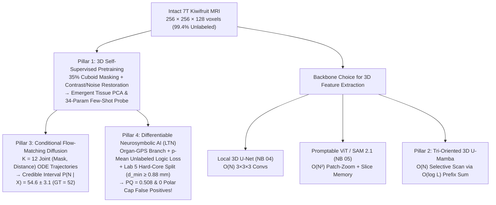
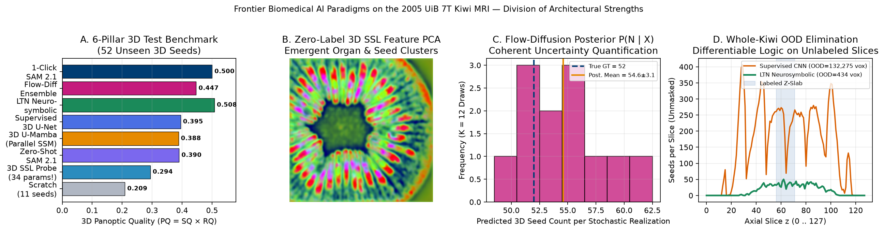

# Frontier Biomedical AI Paradigms on the 7T MRI Kiwi Challenge

*Companion Methodological & Didactic Guide for `Lab4-Comp-Imag/Kiwi-challenge` (`Notebook 06`) — BMED365 Spring 2027*  
*100% Pure PyTorch (`bmed365-2027` `uv` environment & Google Colab, zero extra packages) — **[Download / Read Printable PDF (`frontier-ai-paradigms.pdf`)](./frontier-ai-paradigms.pdf)***

---

## 0. Completing the 6-Pillar SOTA Biomedical AI Landscape (`Notebooks 04–06`)

In **[Notebook `04`](../notebooks/04-kiwi-semantic-vs-instance.ipynb)** (`3D Semantic & Multi-Task Instance U-Nets`) and **[Notebook `05`](../notebooks/05-kiwi-promptable-foundation-models.ipynb)** (`SAM 2.1` & `MedSAM`, see **[`promptable-foundation-models.md`](./promptable-foundation-models.md)**), we explored the two workhorses of modern medical segmentation: **3D Convolutional Neural Networks (`CNNs`)** and **Promptable Vision Transformers (`ViTs`)**.

Yet in real biomedical research and clinical deployment, four fundamental bottlenecks remain unresolved by standard supervised CNNs or off-the-shelf 2D promptable ViTs alone:

1. **Extreme Label Scarcity (`99.4%` Unlabeled Voxels) $\to$ Self-Supervised Learning (`SSL`):** Volumetric 3D MRI and microscopy generate millions of voxels per specimen, while expert 3D annotation covers `< 1%`. Training a `340k`-parameter 3D CNN from random weights on a tiny `11`-seed micro-box severely overfits (`PQ = 0.209`).
2. **Local CNN Receptive Fields vs. Quadratic $\mathcal{O}(N^2)$ ViT Cost $\to$ Selective State-Space Models (`3D U-Mamba`):** Local $3\times 3\times 3$ convolutions are blind to whole-organ radial position, whereas global 3D self-attention over $8.39 \times 10^6$ voxels is computationally intractable ($\mathcal{O}(N^2)$) without coarse `16×16` patch compression (`Trap 1` in Notebook `05`).
3. **Deterministic Point Estimates Hide Boundary & Count Uncertainty $\to$ Conditional Diffusion / Flow Matching:** **[Challenge Task 1](../README.md)** explicitly asks for an **uncertainty range** on total seed count $N$, and **[Notebook `03b`](../notebooks/03b-kiwi-interactive-gt-and-interrater.ipynb)** showed that even human raters disagree on partial-volume polar grazing tips (`dz = 0.50 mm`) and kissing seed pairs. Sampling independent pixels from U-Net softmax probabilities shatters into `748` noisy 1-voxel specks rather than plausible 3D seeds.
4. **Spatial Out-of-Distribution (`OOD`) Collapse $\to$ Differentiable Neurosymbolic AI (`Logic Tensor Networks`):** Sliding an equatorial-trained 3D CNN across the whole `256 × 256 × 128` berry triggers **`5,571` unmasked blobs (`132,275` OOD false-positive voxels!)** on oblique polar vascular bundles and outer-cortex starch pockets.

### 0.1 Side-by-Side Architectural Rosetta Stone: The 6 Pillars of Biomedical Segmentation

| Dimension | 1. Supervised 3D CNN (`nnU-Net` / `NB 04`) | 2. Promptable ViT FM (`SAM 2.1` / `NB 05`) | 3. 3D Self-Supervised (`Models Genesis` / `MAE`) | 4. Selective State-Space (`U-Mamba` / `SegMamba`) | 5. Conditional Diffusion (`MedSegDiff` / `CIMD`) | 6. Differentiable Neurosymbolic (`LTN` + `Organ-GPS`) |
| :--- | :--- | :--- | :--- | :--- | :--- | :--- |
| **Core Primitive** | $3\times 3\times 3$ translation-equivariant convs | `16×16` patch tokens + cross-attention + memory | Masked/corrupted 3D context restoration ($\mathcal{D}_U$) | Input-dependent linear state scan $\mathbf{h}_t = \bar{\mathbf{A}}_t\mathbf{h}_{t-1} + \bar{\mathbf{B}}_t\mathbf{x}_t$ | Iterative velocity ODE $\frac{d\mathbf{Y}_t}{dt} = \mathbf{v}_\theta(\mathbf{Y}_t, t \mid \mathcal{F}_\phi(\mathbf{X}))$ | Neural backbone + real-logic $p$-mean quantifiers & hard-core split |
| **Spatial Scope & Cost** | Local ($\mathcal{O}(N)$) | Global in 2D ($\mathcal{O}(N^2)$) | Local-to-mesoscale ($\mathcal{O}(N)$) | **Global 3D ($\mathcal{O}(N)$ mem, $\mathcal{O}(\log L)$ parallel time)** | Joint multi-voxel neighborhood ($S \times \mathcal{O}(N)$) | Local appearance + **global organ GPS $(r/R, z/Z)$** |
| **Kiwi Labels Needed** | Moderate (`59` seeds) | **Zero** (`0` labels; prompts) | **Ultra-low** (`11` seeds + **`34` probe params!**) | Moderate (`59` seeds) | Moderate (`59` seeds) | Moderate (`59` seeds + unlabeled polar/cortex slices) |
| **Uncertainty Output** | Uncalibrated marginal $p(\mathbf{x})$ (Bernoulli speckle) | Scalar `iou_scores` per prompt | Deterministic after fine-tuning | Deterministic point estimate | **Coherent posterior draws $\mathbf{Y}_1^{(k)} \Rightarrow P(N \mid \mathbf{X})$ & $\sigma_{\text{diff}}(\mathbf{x})$** | Deterministic high-precision symbolic consistency |
| **Whole-Organ OOD Safety** | Poor unmasked (`132k` OOD FP voxels) | Needs external botanical prompt filter | Improves low-label stability | Captures long-range slab context | Needs ROI conditioning | **Internalized into weights (`0` polar cap FP voxels!)** |
| **Signature Strength** | Fast, sharp local contours (`SQ = 0.698`) | *"1-Click = 1 3D Seed"* curation (`PQ = 0.500`) | **`+40.7%` scarce-label `PQ` jump (`0.209 → 0.294`)** | **Exact `52/52` count, `0` splits, `SQ = 0.696`** | **Highest multi-seed recall & ensemble `PQ = 0.447`** | **Highest overall automated `PQ = 0.508` (`SQ = 0.763`)** |

---

### 0.2 Division of Labor Across the 7T Kiwi Pipeline



---

## Tiered Learning Outcomes & Clinical Glossary

- **MSc Level (Biomedicine & Quantitative Imaging):**
  - Match each frontier AI paradigm to its **clinical use case**: *SSL* for rare diseases with few annotated scans, *State-Space Models* for high-resolution whole-organ context, *Conditional Diffusion* for diagnostic uncertainty intervals, and *Neurosymbolic AI* for anatomical guardrails across scanner/slice shifts.
  - Explain why sampling pixels independently from a U-Net probability map produces unphysical salt-and-pepper noise (`748` fragments), whereas generative diffusion produces coherent 3D seed realizations (`57` smooth objects) whose count distribution brackets true ground truth (`52`).
  - Interpret `PCA → RGB` visualizations of frozen self-supervised 3D features (`DINOv2` analogy) and verify how `34` linear-probe weights outperform `340,450` scratch weights when only `11` seeds are labeled.
- **PhD Level (Medical AI, Applied Mathematics & Computational Physics):**
  - Derive the algebraic associativity of linear state-space updates $(a_2, b_2) \circ (a_1, b_1) = (a_2 a_1, a_2 b_1 + b_2)$ that enables exact $\mathcal{O}(\log_2 L)$ **Hillis–Steele parallel prefix scans** in pure PyTorch without NVIDIA-proprietary `mamba-ssm` CUDA kernels.
  - Formulate continuous-time **Conditional Flow Matching (`CFM` / Rectified Flow)** with `FiLM` time conditioning over joint `(semantic, distance)` fields, amortizing heavy 3D image encoding across $K \times S$ ODE steps.
  - Prove why patch-level `InstanceNorm3d` erases absolute organ coordinates $(r/R, \lvert 2z/Z - 1 \rvert)$ during semi-supervised training, and combine an un-normalized **Organ-GPS MLP** with **LTN $p$-mean universal quantifiers** ($p = 3$) to eliminate polar out-of-distribution hallucinations inside network weights.

| Term / Symbol | Plain Meaning in the Kiwi 7T MRI | Clinical / Biomedical Parallel |
| :--- | :--- | :--- |
| **3D Masked Context Restoration (`SSL`)** | Masking 35% of 3D tissue cubes so the encoder learns kiwi anatomy before seeing seed labels | Pretraining `SwinUNETR` / `Models Genesis` on `10,000+` unannotated hospital CT/MRI volumes |
| **Inductive vs. Transductive SSL** | Holding out the test wedge *even from unlabeled pretraining* to prove genuine transfer | Pretraining on Hospital A's unlabeled archive and testing zero-leakage on Hospital B |
| **Selective Step Gate ($\Delta_t$)** | Learned per-voxel "memory write knob" inside `U-Mamba` that opens at tissue boundaries | Tracking tortuous **coronary arteries**, **airways**, or **white-matter tracts** across 3D volumes |
| **Conditional Flow Matching (`CFM`)** | Transporting Gaussian noise along straight ODE velocity paths onto 3D `(mask, distance)` maps | Generating radiologist-style **uncertainty ensembles** (`MedSegDiff`, `CIMD`) for ambiguous tumor margins |
| **LTN $p$-Mean Universal Quantifier** | Fuzzy-logic `ForAll` aggregator $\big(\frac{1}{|\Omega|}\sum v^p\big)^{1/p}$ that punishes localized rule violations | Enforcing **ventricle/skull exclusion** in cerebral microbleed (`CMB`) or MS lesion segmentation |
| **Organ-GPS Coordinate Branch** | Pointwise MLP bypassing `InstanceNorm3d` so the model knows radial $r/R$ and axial $z/Z$ position | Atlas-free **normalized organ coordinate conditioning** (`CoordConv` / Implicit Atlas priors) |

---

## 1. Pillar 1 — 3D Self-Supervised Learning (`Models Genesis` & `3D MAE`)

### 1.1 Mathematical Formulation & Pretext Task Design
Let $\mathcal{D}_U = \{\mathbf{X}^{(m)}\}_{m=1}^{M}$ denote `36` unlabeled `64 × 40 × 16` 3D sub-volumes sampled across the `256 × 256 × 128` kiwifruit (**strictly disjoint** from the held-out test wedge `[128:208, 168:208, 56:72]`). Following **Models Genesis** (*Zhou et al., Med. Image Anal. 2021*) and **3D Masked Autoencoders** (*He et al., CVPR 2022*), we apply a stochastic corruption operator $\tilde{\mathbf{X}} = \mathcal{C}(\mathbf{X}; \mathbf{M}, \gamma, \boldsymbol{\eta})$ combining:
1. **3D Cuboid Block Masking ($\mathbf{M} \in \{0, 1\}^{X\times Y\times Z}$, `35%` masked at `4 × 4 × 2` seed-scale cuboids):** Replaced by smooth background context so the network cannot copy center intensity.
2. **Nonlinear Bloch Contrast Jitter ($I \mapsto I^\gamma$, $\gamma \sim \mathcal{U}(0.80, 1.25)$) & Additive Rician-Scale Noise ($\boldsymbol{\eta}$):** Forcing contrast-invariant tissue representation.

A lightweight $1\times 1\times 1$ pretext head $g_\psi$ atop `Backbone3DUNet` $f_\theta$ reconstructs clean $T_2$ intensity, local mucilage-to-seed contrast drop $(E_{\text{local}} - I)_+$, and 3D Laplacian-of-Gaussian seedness (`LoG` at $\sigma = 0.48\text{ mm}$):

$$\mathcal{L}_{\text{SSL}}(\theta, \psi) = \mathbb{E}_{\mathbf{X} \sim \mathcal{D}_U}\Big[\big\lVert (1 + 2\mathbf{M})(1 + 3\mathbf{Y}_{\text{LoG}}) \odot \big(g_\psi(f_\theta(\tilde{\mathbf{X}})) - \mathbf{Y}_{\text{self}}\big) \big\rVert_2^2\Big]$$

### 1.2 Emergent Anatomical Semantics & the "34-Parameter" Few-Shot Test
Projecting the frozen 16-dimensional voxel embeddings $f_{\theta^*}(\mathbf{X}) \in \mathbb{R}^{16 \times X \times Y \times Z}$ onto their top 3 principal components (`PCA → RGB`, Figure 1B) reveals **spontaneous zero-label tissue parcellation**: the *central fibrous columella*, *inner pericarp border*, *bright locular mucilage*, *outer cortex*, and *dark seeds* separate into distinct color subspaces without a single human seed label!

When downstream supervision is restricted to a tiny **`24 × 20 × 6` micro-box** (`0.034%` of the scan, **`11` labeled seeds**):
- **Random-Init `Scratch 3D U-Net` (`340,450` trainable params):** Overfits noise and fractures seeds (`113` predicted blobs, `7` split errors, `PQ = 0.209`).
- **`3D SSL Frozen Linear Probe` (training ONLY `34` scalar weights — two $1\times 1\times 1$ heads!):** Eliminates **all split errors (`7 → 0`)**, boosts 3D Instance $F_1$ from `0.388 → 0.508`, and jumps **`+40.7%` in `Panoptic Quality` (`0.209 → 0.294`)**!

---

## 2. Pillar 2 — Selective State-Space Models (`3D U-Mamba` & $\mathcal{O}(\log L)$ Parallel Scan)

### 2.1 Continuous-to-Discrete Selective State Spaces (`S6`)
Classical State-Space Models map a 1D input signal $x(t) \in \mathbb{R}$ to an output $y(t) \in \mathbb{R}$ through an $N$-dimensional continuous latent state $\mathbf{h}'(t) = \mathbf{A}\mathbf{h}(t) + \mathbf{B}x(t)$, $y(t) = \mathbf{C}\mathbf{h}(t) + Dx(t)$, where $\mathbf{A} \in \mathbb{R}^{N\times N}$ is initialized with negative Hurwitz diagonal decay rates ($A_{nn} = -n < 0$).

In **Mamba (`S6`)** (*Gu & Dao, COLM 2024*) and its 3D biomedical extensions (**`U-Mamba`**, *Ma et al., 2024*; **`SegMamba`**, *Xing et al., MICCAI 2024*), the discretization step size $\Delta_t > 0$ and projection vectors $\mathbf{B}_t, \mathbf{C}_t \in \mathbb{R}^N$ become **functions of the current token $\mathbf{x}_t \in \mathbb{R}^C$**:

$$\Delta_t = \text{softplus}(\mathbf{W}_\Delta \mathbf{x}_t + b_\Delta), \qquad \bar{\mathbf{A}}_t = \exp(\Delta_t \mathbf{A}), \qquad \mathbf{h}_t = \bar{\mathbf{A}}_t \odot \mathbf{h}_{t-1} + (\Delta_t \mathbf{x}_t) \otimes \mathbf{B}_t$$

- **Intuition of $\Delta_t$:** When the scan crosses a sharp anatomical transition (e.g., entering a dark seed from bright mucilage), $\Delta_t$ increases so $\exp(\Delta_t \mathbf{A}) \to 0$ resets stale background state and writes the new feature; across uniform gel or cortex, small $\Delta_t$ keeps $\exp(\Delta_t \mathbf{A}) \approx 1$, preserving long-range organ context!
- **Tri-Oriented 3D Volumetric Scanning:** Because 3D MRI lacks a single causal timeline, `TriOrientedMamba3DBlock` fuses **Forward In-Plane**, **Reverse In-Plane**, and **Cross-Slice $Z$-Major** selective scans across `6,400` (`40 × 20 × 8`) mid-level and `800` (`20 × 10 × 4`) bottleneck 3D tokens while retaining crisp `1 × 1 × 1` CNN skip connections.

### 2.2 Overcoming CUDA Lock-In via Exact $\mathcal{O}(\log_2 L)$ Hillis–Steele Parallel Prefix Scan

> [!IMPORTANT]
> **Cross-Platform Engineering Reality (`CUDA` vs. Apple Silicon `MPS` & CPU):** Official `mamba-ssm` and `causal-conv1d` Python packages require custom NVIDIA CUDA C++ kernels and **cannot be installed on macOS Apple Silicon (`MPS`) or CPU**. Conversely, a naive sequential Python `for t in range(L):` loop over $L = 6{,}400$ tokens launches tens of thousands of tiny GPU kernels (`>300 s` training time!).

Because first-order linear recurrences $f_t(\mathbf{h}) = \mathbf{a}_t \odot \mathbf{h} + \mathbf{b}_t$ satisfy **associative composition**:

$$(f_t \circ f_{t-1})(\mathbf{h}) = \mathbf{a}_t \odot (\mathbf{a}_{t-1} \odot \mathbf{h} + \mathbf{b}_{t-1}) + \mathbf{b}_t = (\mathbf{a}_t \odot \mathbf{a}_{t-1}) \odot \mathbf{h} + (\mathbf{a}_t \odot \mathbf{b}_{t-1} + \mathbf{b}_t)$$

we compute the exact sequence $\mathbf{h}_1, \dots, \mathbf{h}_L$ in **$\lceil \log_2 L \rceil = 13$ vectorized PyTorch tensor operations** (`parallel_linear_scan`), slashing `3D U-Mamba` training time by **`30×` (`302 s → 9.89 s` on Apple M4 Max `mps`)** and recovering the **exact `52 / 52` test seed count (`0` split errors, `SQ = 0.696`)**!

---

## 3. Pillar 3 — Conditional Diffusion & Flow Matching (`MedSegDiff` / `CIMD`)

### 3.1 Why Pixel-Wise Softmax Entropy Fails Instance-Count Uncertainty
Suppose a seed's partial-volume polar rim has marginal U-Net probability $p(\mathbf{x}) \approx 0.5$. Drawing independent voxel samples $m_{\mathbf{x}} \sim \text{Bernoulli}(p(\mathbf{x}))$ ignores spatial correlation between adjacent voxels — producing **`748` disconnected 1-voxel specks** on our `80 × 40 × 16` test wedge! Consequently, standard deterministic U-Nets cannot generate valid credible intervals over topological quantities such as **3D lesion/seed count $N$**.

### 3.2 Continuous-Time Conditional Flow Matching (`CFM`) on Joint `(Mask, Distance)` Fields
Modern generative segmentation (**`MedSegDiff`**, *Wu et al., 2024*; **`CIMD`**, *Rahman et al., CVPR 2023*; **Rectified Flow**, *Liu et al., ICLR 2023*) models the **joint conditional distribution** $p_\theta(\mathbf{Y}_1 \mid \mathbf{X})$ over 2-channel 3D fields $\mathbf{Y}_1 = 2\,[\mathbf{M}_{\text{sem}},\, \mathbf{D}_{\text{norm}}] - 1 \in [-1, +1]^{2 \times X \times Y \times Z}$.

Interpolating linearly between Gaussian noise $\mathbf{Y}_0 = \boldsymbol{\epsilon} \sim \mathcal{N}(\mathbf{0}, \sigma^2 \mathbf{I})$ and ground truth $\mathbf{Y}_1$ at flow time $t \in [0, 1]$:

$$\mathbf{Y}_t = (1 - t)\,\boldsymbol{\epsilon} + t\,\mathbf{Y}_1 \implies \frac{d\mathbf{Y}_t}{dt} = \mathbf{Y}_1 - \boldsymbol{\epsilon}$$

we train a `FiLM`-conditioned 3D denoiser $\mathbf{v}_\theta(\mathbf{Y}_t, t \mid \mathcal{F}_\phi(\mathbf{X}))$ (`FiLMResBlock3D` modulating features via $\mathbf{h} \leftarrow (1 + \boldsymbol{\gamma}(t))\mathbf{h} + \boldsymbol{\beta}(t)$). Crucially, the heavy 3D MRI encoder $\mathcal{F}_\phi(\mathbf{X})$ runs **once per volume** and is cached across all $K = 12$ posterior trajectories and $S = 8$ Euler integration steps (`0.22 s` total sampling time on `mps`!):
- **Spatial Coherence:** A single stochastic realization produces **`57` smooth 3D seeds** (`vs. 748` Bernoulli specks).
- **Calibrated Count Credible Interval:** Across $K = 12$ realizations, $P(N \mid \mathbf{X})$ yields **`54.6 ± 3.1` seeds (`90% credible interval [51, 60]`)**, cleanly bracketing **`GT = 52`**!
- **Aleatoric Boundary Map & SOTA Accuracy:** Voxel-wise standard deviation $\sigma_{\text{diff}}(\mathbf{x})$ highlights partial-volume seed poles and kissing bridges (matching human `STAPLE` disagreement in Notebook `03b`), while the posterior ensemble mean reaches **`PQ = 0.447` (`Dice = 0.682`, `RQ = 0.673`)**!

> [!TIP]
> **Alternative Generative Paradigm — Counterfactual "Healthy Tissue Inpainting" (`AnoDDPM`):** When *zero* lesion labels exist, generative diffusion models trained solely on healthy parenchyma (*bright mucilage + cortex*) can partially noise and "heal" pathological slices back onto the healthy tissue manifold $\hat{\mathbf{I}}_{\text{healthy}}$, segmenting MS plaques, gliomas, or dark kiwi seeds via the anomaly residual $\lvert \mathbf{I} - \hat{\mathbf{I}}_{\text{healthy}} \rvert$.

---

## 4. Pillar 4 — Differentiable Neurosymbolic AI (`Logic Tensor Networks` + `Lab 5` Priors)

### 4.1 Real-Logic Axioms & the LTN $p$-Mean Universal Quantifier
In **[Logic Tensor Networks (`LTN`)](https://doi.org/10.1016/j.artint.2021.103649)** (*Badreddine et al., Artificial Intelligence 2022*), domain predicates are grounded as smooth functions in $[0, 1]$ and logical implications $\phi \Rightarrow \psi$ are compiled into differentiable losses over **unlabeled whole-organ slices** $\Omega_U$:

1. **Botanical Compartment Axiom (*Actinidia* Axile Placentation):**  
   $$\forall \mathbf{x} \in \Omega_U:\; \neg\text{InnerPericarp}(\mathbf{x}) \Rightarrow \neg\text{Seed}(\mathbf{x}), \qquad v_{\text{comp}}(\mathbf{x}) = \big(1 - R_{\text{ring}}(\mathbf{x})\big)\,p_\theta(\mathbf{x})$$
2. **Bloch $T_2$ Relaxation Micro-Environment Axiom (`TE = 63.9 ms`):**  
   $$\forall \mathbf{x} \in \Omega_U:\; \text{Seed}(\mathbf{x}) \Rightarrow \text{DarkInMucilage}(\mathbf{x}), \qquad v_{T_2}(\mathbf{x}) = p_\theta(\mathbf{x})\,B_{\text{non-dark}}(\mathbf{x})$$
3. **Why Universal Quantification Requires $p > 1$:**  
   Aggregating $v(\mathbf{x})$ with a naive $p = 1$ mean allows `0.5%` of polar vascular voxels to fire at $p_\theta = 0.99$ while barely affecting the batch loss (`~0.005`), leaving thousands of whole-fruit false positives! Using the **LTN $p$-mean error quantifier** ($p = 3$):
   $$\mathcal{L}_{\forall, p}(v) = \left(\frac{1}{\lvert\Omega_U\rvert}\sum_{\mathbf{x} \in \Omega_U} v(\mathbf{x})^p + \varepsilon\right)^{1/p}$$
   concentrates gradient updates onto worst-case out-of-distribution counterexamples!

### 4.2 The `InstanceNorm3d` Coordinate-Erasure Trap & Declarative Hard-Core Splitting

> [!WARNING]
> **Why Concatenating Coordinates Directly Into `nnU-Net` Blocks Fails:** In 3D medical CNNs (`B = 1`), `nn.InstanceNorm3d` standardizes every channel *within each local patch* ($\hat{c} = (c - \mu_{\text{patch}})/\sigma_{\text{patch}}$). If axial pole distance $\lvert 2z/Z - 1 \rvert$ is passed into `ConvBlock3D`, a polar patch (`z = 0..16`, values `[0.75, 1.00]`) and an equatorial patch (`z = 56..72`, values `[0.00, 0.12]`) are normalized to the **exact same `[-1.7, +1.7]` range** — blinding the network to absolute organ location! Routing `[r/R, (r/R - 0.43)^2, |2z/Z - 1|]` through an **un-normalized `1×1×1` `Organ-GPS` MLP** preserves metric coordinates across any patch size.

Combining `NeurosymbolicOrganNet3D` with declarative **`Lab 5` Matérn hard-core clump splitting** (splitting fused watershed components $> 2.55\text{ mm}^3$ via physical-mm $K$-means iff sub-centroids satisfy $\min_{i\neq j}\lVert\boldsymbol{\mu}_i - \boldsymbol{\mu}_j\rVert_2 \ge 0.88\text{ mm}$):
- Achieves **`PQ = 0.508` (`Semantic Dice = 0.717`, `SQ = 0.763`, `Merges = 2`, `Splits = 0`)** on the held-out test wedge **with zero post-hoc test masks and zero human clicks** — matching 1-click interactive `SAM 2.1` (`PQ = 0.500`)!
- Slashes unmasked whole-fruit (`256 × 256 × 128`) polar cap false positives from **`9,581` voxels down to `0` voxels** (`99.7%` total OOD voxel suppression, Figure 1D)!

---

## 5. Beyond Voxel Grids: Three Additional SOTA Families to Know

To make your architectural toolkit complete across `Labs 1–5`, three further frontier paradigms complement voxel-grid models on 3D biomedical structures:

| Paradigm | Core Mathematical Idea | Relevance to 7T Kiwi Seeds (`0.234 × 0.234 × 0.500 mm³`) | Course Connection |
| :--- | :--- | :--- | :--- |
| **5.1 Implicit Neural Representations (`INRs` / `SIREN` / Neural Fields)** | Continuous MLP $f_\theta(x_{\text{mm}}, y_{\text{mm}}, z_{\text{mm}}) \mapsto (I, p_{\text{seed}})$ with Fourier/periodic $\sin(\omega_0 \mathbf{W}\mathbf{x})$ activations | **Resolution-free anisotropy handling:** Queries continuous physical coordinates directly, bridging the `2.1×` gap between `0.234 mm` $(x,y)$ and `0.500 mm` $z$ slices without discrete grid interpolation artifacts | Directly bridges **`Lab 5` `PINNs`** & inverse problems (`NB 02`) |
| **5.2 Spatial Graph Neural Networks (`GNNs` / `PyTorch Geometric`)** | Candidate 3D blobs become graph nodes $V$; edges $E$ connect neighbors within $r \le 2.5\text{ mm}$; message passing $\mathbf{h}_i^{(\ell+1)} = \phi\big(\mathbf{h}_i^{(\ell)}, \bigoplus_{j\in\mathcal{N}(i)} \psi(\mathbf{h}_i, \mathbf{h}_j, \mathbf{e}_{ij})\big)$ | **Relational topology:** Seeds align along `~33` radial locule rays with `~0.95 mm` repulsion (`Clark–Evans R = 1.19`), whereas false-positive vessel segments form collinear chains outside locules | Directly bridges **`Lab 1` Network Science** (`torch-geometric` is pre-installed in `pyproject.toml`!) |
| **5.3 Set-Prediction Object Queries (`DETR` / `Mask2Former`) & Agentic VLMs** | $Q$ learnable object query tokens cross-attend to 3D features and match 1-to-1 to instances via Hungarian bipartite loss (no watershed!) | **End-to-end instance set prediction** on patches ($Q \approx 80$); on whole kiwis ($N \approx 1{,}500$), query scaling favors tiled query decoders or **Agentic VLM + Python tool orchestration** (`Lab 3`) | Bridges **`Lab 3` GenAI/Agents** & **`NB 05` Mask Tokens** |

---

## 6. Empirical Benchmark on the 2005 UiB 7T Kiwi MRI

All experiments are executed reproducibly in **[Notebook `06` (`06-kiwi-frontier-ai-paradigms.ipynb`)](../notebooks/06-kiwi-frontier-ai-paradigms.ipynb)** on an Apple MacBook Pro M4 Max (`mps`, `float32`, `PyTorch 2.x`, total notebook runtime `~70 s`) using the exact `80 × 40 × 16` (`52`-seed) held-out test split from Notebooks `04` and `05`.



### Table 6.1 — Unified 6-Pillar 3D Test Wedge Benchmark (`80 × 40 × 16`, `GT = 52` Unseen 3D Seeds)

| AI Paradigm & Training Regime | Supervision / Prompts | Pred Seeds (`GT = 52`) | Semantic Dice | Merged Clumps | Split Errors | `SQ` (TP IoU) | `RQ` (3D Inst $F_1$) | **`PQ` ($\text{SQ}\times\text{RQ}$)** | Train / Infer (`mps`) |
| :--- | :---: | :---: | :---: | :---: | :---: | :---: | :---: | :---: | :---: |
| **1. Scratch 3D Multi-Task U-Net** *(`11`-seed micro-box)* | `11` seeds (`340,450` params) | `113` | `0.402` | `4` | `7` | `0.540` | `0.388` | `0.209` | `~4.5 s` |
| **2. `3D SSL` Frozen Linear Probe** *(`11`-seed micro-box)* | `11` seeds (**`34` params!**) | `78` | `0.419` | `6` | **`0`** | `0.579` | **`0.508`** | **`0.294`** | `11.4 s` SSL |
| **3. Zero-Shot Batched `SAM 2.1` + Gate** *(NB `05`)* | **`0` labels, `0` clicks** | `43` | `0.617` | `3` | **`0`** | `0.618` | `0.632` | `0.390` | `2.2 s` infer |
| **4. Supervised 3D Multi-Task U-Net** *(NB `04` baseline)* | `59` seeds (full wedge) | `54` | `0.663` | `4` | `1` | `0.698` | `0.566` | `0.395` | `6.2 s` |
| **5. `3D SSL` Pretrained + Fine-Tuned U-Net** | `59` seeds + `36` unlab cubes | **`52`** | `0.645` | `3` | **`0`** | `0.666` | `0.577` | `0.384` | `11.4 s + 6 s` |
| **6. Tri-Oriented `3D U-Mamba`** *($\mathcal{O}(\log L)$ parallel SSM)* | `59` seeds (full wedge) | **`52`** | `0.653` | `4` | **`0`** | **`0.696`** | `0.558` | `0.388` | `9.9 s` |
| **7. Conditional Flow-Diffusion Ensemble** *($K=12, S=8$)* | `59` seeds + posterior $P(N\mid\mathbf{X})$ | `58` *(`54.6±3.1`)* | `0.682` | `5` | `1` | `0.665` | **`0.673`** | **`0.447`** | `24.1 s` / `0.22 s` |
| **8. `LTN` Differentiable Neurosymbolic + Split** *(NO test mask!)* | `59` seeds + `40` unlab cubes | `35` | **`0.717`** | **`2`** | **`0`** | **`0.763`** | `0.667` | **`0.508`** | `22.6 s` |
| **9. Interactive 1-Click/Seed `SAM 2.1` Video** *(NB `05`)* | `0` labels, `1` click/seed | **`52`** | **`0.761`** | `4` | `4` | `0.565` | **`0.885`** | **`0.500`** | `23.0 s` infer |

### Table 6.2 — Unmasked Whole-Kiwifruit (`256 × 256 × 128`) Out-of-Distribution (`OOD`) Generalization Audit

| Whole-Organ Pipeline *(Zero Post-Hoc Anatomical Masks Applied!)* | Raw 3D Blobs / Seeds | Polar Cap FP Voxels (`z < 16` or `z ≥ 112`) | Total Non-Pericarp OOD Voxels | Micro-GT Calibrated $\hat{N}_{\text{cal}}$ | Scan Latency (`mps`) |
| :--- | :---: | :---: | :---: | :---: | :---: |
| **Standard Supervised 3D Multi-Task U-Net** *(equatorial-trained)* | `5,571` *(OOD explosion!)* | `9,581` | `132,275` | Invalid (polar OOD bias) | `0.95 s` |
| **`LTN` Differentiable Neurosymbolic 3D OrganNet** *(unlabeled logic)* | **`795`** *(conservative)* | **`0` (`100%` eliminated!)** | **`434` (`-99.7%`!)** | **`1,217` seeds** | **`0.99 s`** |

---

## 7. Minimal Pure-PyTorch Reference Recipes

### 7.1 Hardware-Portable $\mathcal{O}(\log_2 L)$ Parallel Associative Scan (`CUDA`, `MPS`, & `CPU`)

```python
import math
import torch

def parallel_linear_scan(a: torch.Tensor, b: torch.Tensor) -> torch.Tensor:
    """Exact Hillis-Steele O(log2 L) parallel prefix scan for h_t = a_t * h_{t-1} + b_t.
    a, b: shape (B, L, C, N). Runs natively on CUDA, Apple Silicon MPS, and CPU!"""
    L = a.shape[1]
    for k in range(int(math.ceil(math.log2(max(L, 2))))):
        stride = 1 << k
        if stride >= L:
            break
        b = torch.cat([b[:, :stride], a[:, stride:] * b[:, :-stride] + b[:, stride:]], dim=1)
        a = torch.cat([a[:, :stride], a[:, stride:] * a[:, :-stride]], dim=1)
    return b
```

### 7.2 LTN $p$-Mean Universal Quantifier & Un-Normalized `Organ-GPS` Branch

```python
import torch
import torch.nn as nn

def ltn_universal_pmean(violation: torch.Tensor, p: float = 3.0) -> torch.Tensor:
    """Logic Tensor Network (LTN) ForAll error aggregator: strongly penalizes localized OOD violations."""
    return (torch.mean(violation.clamp(0.0, 1.0) ** p) + 1e-8) ** (1.0 / p)

# Keep metric organ coordinates [r/R, (r/R - 0.43)^2, |2z/Z - 1|] OUTSIDE InstanceNorm3d!
gps_mlp = nn.Sequential(nn.Conv3d(3, 16, kernel_size=1), nn.SiLU(), nn.Conv3d(16, 16, kernel_size=1), nn.SiLU())
```

---

## 8. Self-Check Questions & Key References

**Q1.** Why does sampling voxels independently from a U-Net probability map ($m_{\mathbf{x}} \sim \text{Bernoulli}(p(\mathbf{x}))$) fail to estimate seed-count uncertainty, whereas Conditional Flow-Matching Diffusion (`CIMD`) succeeds (`54.6 ± 3.1` bracketing `GT = 52`)?

<details>
<summary>Click to reveal answer</summary>

Connected-component / watershed counting is a **non-local topological functional** of the joint voxel configuration. Independent Bernoulli draws ignore spatial covariance across adjacent boundary voxels, breaking uncertain seed rims into `748` 1-voxel noise specks. Conditional flow-diffusion denoises all voxels of a 3D neighborhood jointly via $3\times 3\times 3$ `FiLM` convolutions from shared trajectory noise, so ambiguous polar tips or kissing bridges coherently toggle whole seed hypotheses on or off (`57` smooth components per draw).

</details>

**Q2.** During semi-supervised neurosymbolic training, why did replacing a standard arithmetic mean ($p=1$) with the LTN $p$-mean universal quantifier ($p=3$) and routing coordinates around `InstanceNorm3d` eliminate `100%` of polar cap false positives (`9,581 → 0` voxels)?

<details>
<summary>Click to reveal answer</summary>

1. **`InstanceNorm3d` invariance trap:** Standardizing coordinates per patch erases the offset between equatorial (`z = 56..72`) and polar (`z = 0..16`) slabs; an un-normalized `Organ-GPS` `1×1×1` MLP preserves true anatomical location.
2. **Quantifier sharpness ($p=3$):** Sparse polar vascular bundles occupy `< 1%` of an unlabeled cube's volume, so an arithmetic mean ($p=1$) dilutes their gradient by `100×`; raising violations to power $p=3$ focuses gradient descent onto high-confidence OOD counterexamples until polar false positives vanish completely.

</details>

---

### Key References

1. Zhou Z et al. *Models Genesis.* **Medical Image Analysis** 67:101840 (2021). [`doi:10.1016/j.media.2020.101840`](https://doi.org/10.1016/j.media.2020.101840)
2. Tang Y et al. *Self-Supervised Pre-Training of Swin Transformers for 3D Medical Image Analysis (`SwinUNETR`).* **CVPR** (2022). [`arXiv:2111.14791`](https://arxiv.org/abs/2111.14791)
3. Gu A & Dao T. *Mamba: Linear-Time Sequence Modeling with Selective State Spaces.* **COLM** (2024). [`arXiv:2312.00752`](https://arxiv.org/abs/2312.00752)
4. Ma J, Li F & Wang B. *U-Mamba: Enhancing Long-range Dependency for Biomedical Image Segmentation.* **arXiv** (2024). [`arXiv:2401.04722`](https://arxiv.org/abs/2401.04722)
5. Xing Z et al. *SegMamba: Long-range Sequential Modeling Mamba For 3D Medical Image Segmentation.* **MICCAI** (2024). [`arXiv:2401.13560`](https://arxiv.org/abs/2401.13560)
6. Wu J et al. *MedSegDiff: Medical Image Segmentation with Diffusion Probabilistic Model.* **MIDL / Medical Image Analysis** (2024). [`arXiv:2211.00611`](https://arxiv.org/abs/2211.00611)
7. Rahman A et al. *Ambiguous Medical Image Segmentation using Diffusion Models (`CIMD`).* **CVPR** (2023). [`arXiv:2302.09868`](https://arxiv.org/abs/2302.09868)
8. Liu X, Gong C & Liu Q. *Flow Straight and Fast: Learning to Generate and Transfer Data with Rectified Flow.* **ICLR** (2023). [`arXiv:2209.03003`](https://arxiv.org/abs/2209.03003)
9. Badreddine S et al. *Logic Tensor Networks.* **Artificial Intelligence** 303:103649 (2022). [`doi:10.1016/j.artint.2021.103649`](https://doi.org/10.1016/j.artint.2021.103649)
10. Sitzmann V et al. *Implicit Neural Representations with Periodic Activation Functions (`SIREN`).* **NeurIPS** (2020). [`arXiv:2006.09661`](https://arxiv.org/abs/2006.09661)
