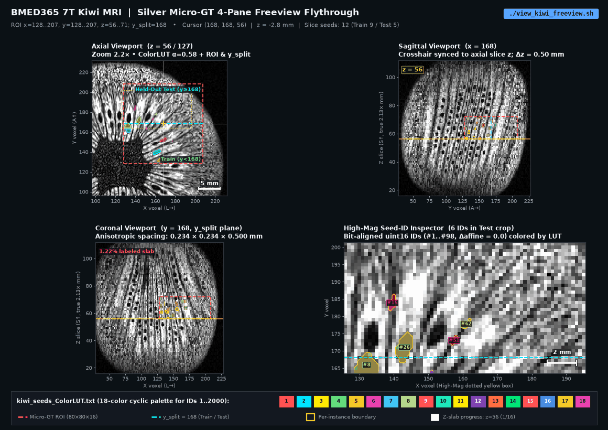
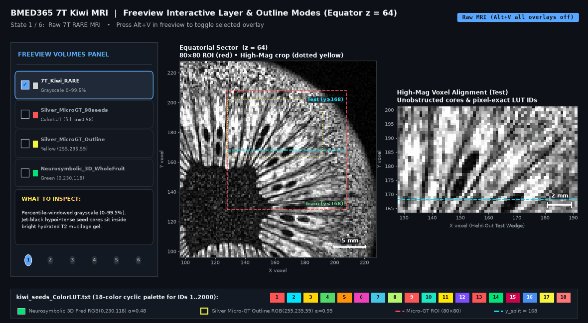
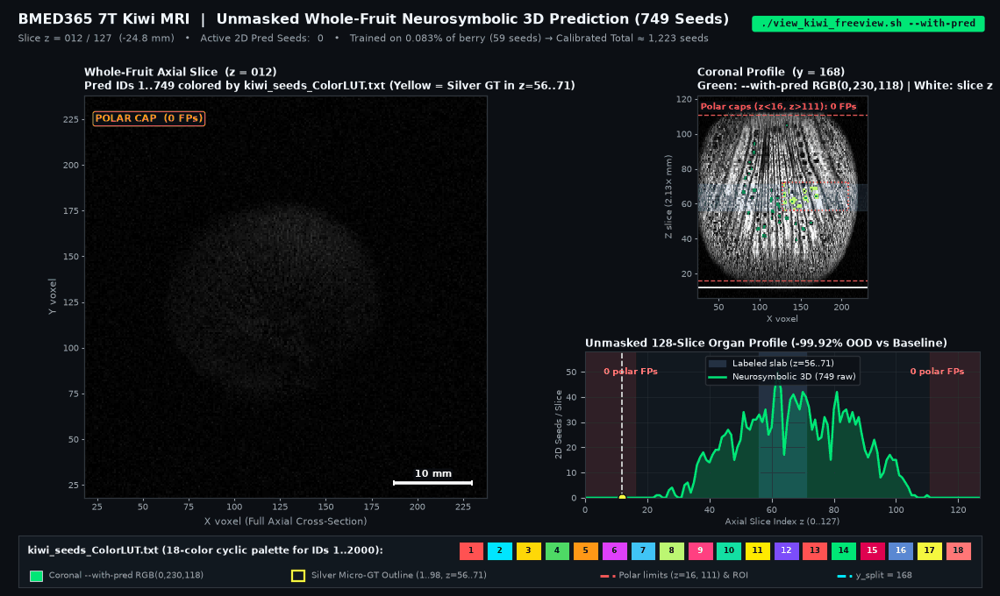
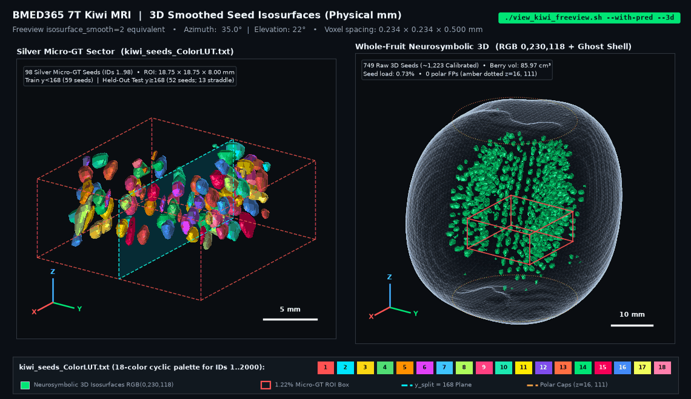

# Differentiable Neurosymbolic AI for Semi-Verifiable 3D Biomedical Instance Segmentation ("Thesis + Code" Package)

> **BMED365 (Spring 2027) — Lab 4 Technical Report Series**  
> University of Bergen (UiB) & Mohn Medical Imaging and Visualization Centre (MMIV)

This folder contains a self-contained, Master's-thesis-level **IMRAD technical report** in LaTeX / BibLaTeX (`bibtex` backend) together with **six modular PyTorch companion notebooks** (`00`–`05`) and shared library (`kiwi_ns_lib.py`) — starting with an exploratory pre-segmentation geometric representation study (`00`) followed by the five report notebooks (`01`–`05`) that generate **every single figure, metric, ablation table, and whole-organ biomarker** in the report.

- **Compiled Technical Report (Clickable PDF, TOC, DOIs, Back-References & Appendices A–F):** [`neurosymbolic-kiwi-report.pdf`](./neurosymbolic-kiwi-report.pdf)
- **LaTeX Source & Verified Peer-Reviewed Bibliography (33 entries):** [`neurosymbolic-kiwi-report.tex`](./neurosymbolic-kiwi-report.tex) | [`references.bib`](./references.bib)
- **Shared PyTorch & Quantitative Imaging Library (`kiwi_ns_lib.py`):** [`notebooks/kiwi_ns_lib.py`](./notebooks/kiwi_ns_lib.py) ([annotated PDF](./notebooks/kiwi_ns_lib_py.pdf) | [LaTeX](./notebooks/kiwi_ns_lib_py.tex))
- **Single-Notebook Fast Walkthrough (Course Companion):** [`../../notebooks/07-kiwi-neurosymbolic-ai.ipynb`](../../notebooks/07-kiwi-neurosymbolic-ai.ipynb) ([printable PDF](../../notebooks/07-kiwi-neurosymbolic-ai_ipynb.pdf) | [LaTeX](../../notebooks/07-kiwi-neurosymbolic-ai_ipynb.tex))

---

## Thesis–Code Reproducibility Map

Every figure (`figures/fig01..09_*.png`) and quantitative table (`results/nb01..05_*.json`) in `neurosymbolic-kiwi-report.pdf` is generated directly by Companion Notebooks `01`–`05`, preceded by Companion Notebook `00` exploring canonical isotropic reslicing & polar N–S alignment ($f = f_2 \circ f_1$, `figures/fig00a..e_*.png`, `results/nb00_canonical_transform_audit.json`), all importing [`notebooks/kiwi_ns_lib.py`](./notebooks/kiwi_ns_lib.py) ([annotated PDF](./notebooks/kiwi_ns_lib_py.pdf) | [LaTeX](./notebooks/kiwi_ns_lib_py.tex)):

| Report Section | Companion Notebook | Printable Export | Launch in Colab | Figures & Tables | JSON Output | Measured Runtime (MPS) |
| :--- | :--- | :---: | :---: | :--- | :--- | :---: |
| **Pre-Study (`00`)** (Isotropic Reslicing, N–S Alignment $f = f_2 \circ f_1$ & 3-Seed OOD) | [`00_isotropic_reslicing_and_polar_alignment.ipynb`](./notebooks/00_isotropic_reslicing_and_polar_alignment.ipynb) | [PDF](./notebooks/00_isotropic_reslicing_and_polar_alignment_ipynb.pdf) · [TeX](./notebooks/00_isotropic_reslicing_and_polar_alignment_ipynb.tex) | [](https://colab.research.google.com/github/arvidl/BMED365-2027/blob/main/Lab4-Comp-Imag/Kiwi-challenge/docs/neurosymbolic-report/notebooks/00_isotropic_reslicing_and_polar_alignment.ipynb) | Figs. 0a–0e (Axis, Pullback, Labels, Mercator, 3-Seed OOD & $f^{-1}$) | [`nb00_canonical_transform_audit.json`](./results/nb00_canonical_transform_audit.json) | `301.2 s` |
| **Sec. 2.1.1 & 3.1** (GT Audit & Priors) | [`01_data_geometry_and_prior_audit.ipynb`](./notebooks/01_data_geometry_and_prior_audit.ipynb) | [PDF](./notebooks/01_data_geometry_and_prior_audit_ipynb.pdf) · [TeX](./notebooks/01_data_geometry_and_prior_audit_ipynb.tex) | [](https://colab.research.google.com/github/arvidl/BMED365-2027/blob/main/Lab4-Comp-Imag/Kiwi-challenge/docs/neurosymbolic-report/notebooks/01_data_geometry_and_prior_audit.ipynb) | Figs. 1–3, Table 3 | [`nb01_prior_audit.json`](./results/nb01_prior_audit.json) | `27.4 s` |
| **Sec. 3.2** (Theory & Math) | [`02_instancenorm_trap_and_ltn_math.ipynb`](./notebooks/02_instancenorm_trap_and_ltn_math.ipynb) | [PDF](./notebooks/02_instancenorm_trap_and_ltn_math_ipynb.pdf) · [TeX](./notebooks/02_instancenorm_trap_and_ltn_math_ipynb.tex) | [](https://colab.research.google.com/github/arvidl/BMED365-2027/blob/main/Lab4-Comp-Imag/Kiwi-challenge/docs/neurosymbolic-report/notebooks/02_instancenorm_trap_and_ltn_math.ipynb) | Figs. 4–5, Table 4 | [`nb02_instancenorm_and_ltn.json`](./results/nb02_instancenorm_and_ltn.json) | `7.2 s` |
| **Sec. 3.3** (Multi-Seed Ablation) | [`03_multiseed_ablation_and_calibration.ipynb`](./notebooks/03_multiseed_ablation_and_calibration.ipynb) | [PDF](./notebooks/03_multiseed_ablation_and_calibration_ipynb.pdf) · [TeX](./notebooks/03_multiseed_ablation_and_calibration_ipynb.tex) | [](https://colab.research.google.com/github/arvidl/BMED365-2027/blob/main/Lab4-Comp-Imag/Kiwi-challenge/docs/neurosymbolic-report/notebooks/03_multiseed_ablation_and_calibration.ipynb) | Figs. 6–7, Tables 5–6 | [`nb03_multiseed_ablation.json`](./results/nb03_multiseed_ablation.json) | `555.1 s` |
| **Sec. 3.4** (Interpretability & Whole-Organ) | [`04_mechanistic_interpretability_and_biomarkers.ipynb`](./notebooks/04_mechanistic_interpretability_and_biomarkers.ipynb) | [PDF](./notebooks/04_mechanistic_interpretability_and_biomarkers_ipynb.pdf) · [TeX](./notebooks/04_mechanistic_interpretability_and_biomarkers_ipynb.tex) | [](https://colab.research.google.com/github/arvidl/BMED365-2027/blob/main/Lab4-Comp-Imag/Kiwi-challenge/docs/neurosymbolic-report/notebooks/04_mechanistic_interpretability_and_biomarkers.ipynb) | Figs. 8–9, Tables 7–8 | [`nb04_mechanistic_and_whole_organ.json`](./results/nb04_mechanistic_and_whole_organ.json) + [`kiwi_neurosymbolic_pred_labels.nii.gz`](./results/kiwi_neurosymbolic_pred_labels.nii.gz) | `99.3 s` |
| **Sec. 3.5** (Mass-Effect Stress Tests) | [`05_axiom_stress_tests_and_clinical_translation.ipynb`](./notebooks/05_axiom_stress_tests_and_clinical_translation.ipynb) | [PDF](./notebooks/05_axiom_stress_tests_and_clinical_translation_ipynb.pdf) · [TeX](./notebooks/05_axiom_stress_tests_and_clinical_translation_ipynb.tex) | [](https://colab.research.google.com/github/arvidl/BMED365-2027/blob/main/Lab4-Comp-Imag/Kiwi-challenge/docs/neurosymbolic-report/notebooks/05_axiom_stress_tests_and_clinical_translation.ipynb) | Fig. 10, Table 9 | [`nb05_stress_test.json`](./results/nb05_stress_test.json) | `55.4 s` |

> **Runtime & Colab note:** All six notebooks (`00`–`05`) were executed end-to-end locally on Apple Silicon MPS via `uv` (`301.2 s` / `5.0 min` for `NB 00` including 3-seed + whole-organ OOD ablation; `744.5 s` / `12.4 min` for report notebooks `01`–`05`). Each notebook includes an automatic bootstrap cell that fetches `kiwi_ns_lib.py` and the 7 T NIfTI data from GitHub `main` when opened in Google Colab (`CUDA -> MPS -> CPU`); live Colab cloud execution has not yet been tested directly.

---

## Technical Appendices Inside the Report

To keep the main IMRAD text accessible to biomedicine MSc students and high-school/sophomore readers alike, **Appendices A–F** explain every conceptual and mathematical notion from first principles with worked numerical examples:

- **Appendix A:** 7 T MRI Acquisition Physics, $T_1$/$T_2$ Relaxation, RARE Spin-Echo Contrast, $B_1$ Shading, and Anisotropic Partial-Volume Averaging
- **Appendix B:** 3D U-Nets, BatchNorm vs. `InstanceNorm3d` (Worked Proof of Coordinate Erasure), 3D SSL, `AdamW`/Cosine Annealing, and Additive Bayesian Log-Odds Fusion
- **Appendix C:** 3D Grayscale Mathematical Morphology (`grey_closing`), Anisotropic Distance Transforms, Marker-Controlled Watershed, $K$-Means, and Matérn Hard-Core Packing
- **Appendix D:** Continuous Real Logic, Fuzzy Triangular Norms (Product / Łukasiewicz / Gödel), and Exact Derivative Derivation of LTN $p$-Mean Quantifiers ($25\times$ Hard-Counterexample Mining)
- **Appendix E:** 3D Dice vs. IoU, Hungarian Bipartite Matching, Panoptic Quality ($\text{PQ} = \text{SQ} \times \text{RQ}$), Error Taxonomy, Calibration Shift, and Whole-Organ Ratio Estimation
- **Appendix F:** Software Artifact Layout, `kiwi_ns_lib.py` API Reference, and Reproducibility Guide

---

## Reproducing Locally

### 1. Run the Companion Notebooks (`uv`)
From the repository root (`BMED365-2027/`):
```bash
uv sync
uv run jupyter lab Lab4-Comp-Imag/Kiwi-challenge/docs/neurosymbolic-report/notebooks/
```
Select the `bmed365-2027` (`python3`) kernel.

### 2. Interactive 3D Superimposition in FreeSurfer 8.2.0 `freeview` (macOS)
Both `data/kiwi_micro_gt_labels.nii.gz` (silver-standard 98-seed reference) and `results/kiwi_neurosymbolic_pred_labels.nii.gz` (unmasked whole-fruit 749-seed prediction) share the exact `256 × 256 × 128` lattice and bit-identical `sform` affine as the raw 7 T MRI. Launch them interactively with a custom high-contrast ColorLUT ([`scripts/kiwi_seeds_ColorLUT.txt`](../../scripts/kiwi_seeds_ColorLUT.txt)):
```bash
# Default: 7T MRI + Silver Micro-GT (toggleable Neurosymbolic prediction & yellow outline)
./Lab4-Comp-Imag/Kiwi-challenge/scripts/view_kiwi_freeview.sh

# Show both Silver Micro-GT and Whole-Fruit Neurosymbolic 3D prediction + 3D seed isosurfaces
./Lab4-Comp-Imag/Kiwi-challenge/scripts/view_kiwi_freeview.sh --with-pred --3d

# Start in crisp outline-only mode (unobstructed dark seed cores)
./Lab4-Comp-Imag/Kiwi-challenge/scripts/view_kiwi_freeview.sh --outline

# Edit a personal working copy in git-ignored MyStuff/kiwi-gt/ (and re-run any notebook via gt_nii_override=...)
./Lab4-Comp-Imag/Kiwi-challenge/scripts/view_kiwi_freeview.sh --gt MyStuff/kiwi-gt/kiwi_gt_manual_v1.nii.gz
```

#### Animated Freeview-Style Illustrations (No FreeSurfer Required)
For quick inspection directly on GitHub, Linux, Windows, or Google Colab, four annotated animations reproduce each mode of `view_kiwi_freeview.sh` using the exact same NIfTI volumes and 18-color cyclic [`kiwi_seeds_ColorLUT.txt`](../../scripts/kiwi_seeds_ColorLUT.txt) palette (regenerable via `uv run python Lab4-Comp-Imag/Kiwi-challenge/scripts/generate_kiwi_freeview_gifs.py`):

1. **4-Pane Synchronized Micro-GT Flythrough** (`./view_kiwi_freeview.sh`, `z = 56..71`, `-layout 2`, `-cc`, high-mag `#ID` inspector):

   

2. **Interactive Layer & Outline Modes at Equator `z = 64`** (`./view_kiwi_freeview.sh --outline` & `Alt+V` layer toggle):

   

3. **Unmasked Whole-Fruit 128-Slice Neurosymbolic 3D Prediction** (`./view_kiwi_freeview.sh --with-pred`, 749 raw seeds, 0 polar FPs):

   

4. **3D Smoothed Seed Isosurfaces Turntable in Physical Millimeter Space** (`./view_kiwi_freeview.sh --with-pred --3d`):

   

### 3. Recompile the LaTeX / BibLaTeX Report (TeX Live 2025)
```bash
cd Lab4-Comp-Imag/Kiwi-challenge/docs/neurosymbolic-report
pdflatex neurosymbolic-kiwi-report.tex
bibtex neurosymbolic-kiwi-report
pdflatex neurosymbolic-kiwi-report.tex
pdflatex neurosymbolic-kiwi-report.tex
```
