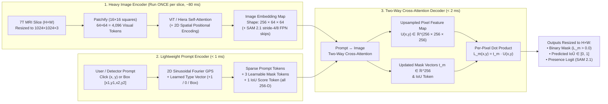
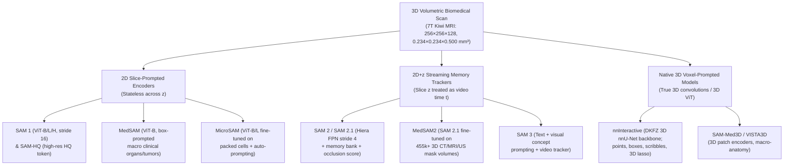
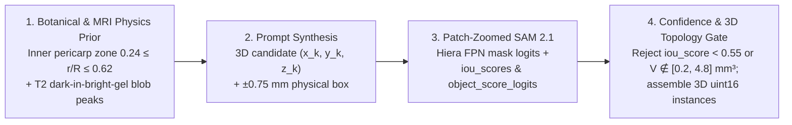
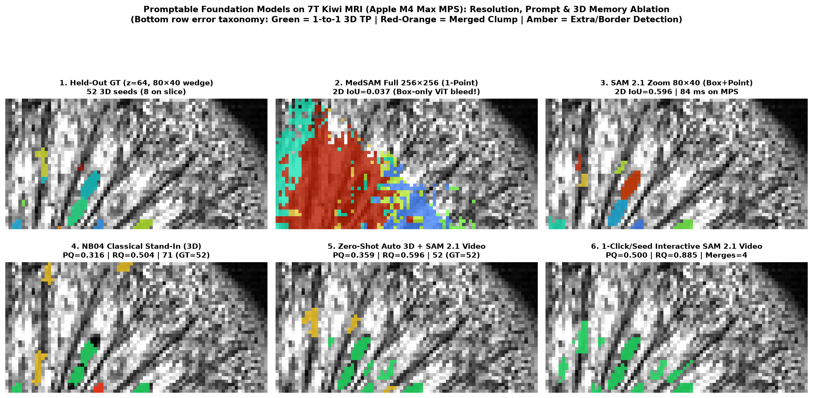

# Promptable Vision Foundation Models on the 7T MRI Kiwi Challenge

*Companion Methodological & Didactic Guide for `Lab4-Comp-Imag/Kiwi-challenge` — BMED365 Spring 2027*  
*Compatible with the root `bmed365-2027` `uv` environment (`transformers >= 4.56`) and Google Colab — **[Download / Read Printable PDF (`promptable-foundation-models.pdf`)](./promptable-foundation-models.pdf)***

---

## From Chatbot LLMs (`Lab 3`) to Promptable Vision Foundation Models (`Lab 4`): Inputs, Tokens, Embeddings & Outputs

If you have already worked with Large Language Models (`LLMs`) such as ChatGPT, Claude, or Gemini in **[Lab 3 (`Lab3-GenAI-LLM`)](../../../Lab3-GenAI-LLM)**, you already know 80% of the mental model behind a **Promptable Vision Foundation Model** like `SAM`, `MedSAM`, or `SAM 2.1`! Both are built on the exact same **Transformer** machinery (tokens, high-dimensional embedding vectors, positional encodings, and attention), adapted from 1D text sequences to 2D/3D spatial images.

### 0.1 The Side-by-Side Rosetta Stone: Text Chatbot LLM vs. Promptable Segmentation Model

| Architectural Stage | Natural-Language Chatbot LLM (`Lab 3`) | Promptable Vision Foundation Model (`SAM` / `SAM 2.1` in `Lab 4`) |
| :--- | :--- | :--- |
| **1. Raw Context Input** | A clinical note or research paper (1D string of characters) | A 2D MRI slice of size $H \times W$ (rescaled to `1024 × 1024 × 3`), or a 3D slice stack $z = 0 \dots Z-1$ |
| **2. Tokenization (*"What is a token?"*)** | **Subword BPE pieces** (`tiktoken`, e.g., `"micro"`, `"bleed"` $\to$ token IDs) | **Non-overlapping `16 × 16` pixel squares (*Visual Patches*)**: slicing a `1024 × 1024` image into a $64 \times 64$ grid = **`4,096` visual tokens** |
| **3. Token Embedding ($\mathbf{e} \in \mathbb{R}^d$)** | Lookup table maps each token ID to a vector (e.g., $d = 4{,}096$) | A single `16 × 16` strided 2D convolution projects the $16 \times 16 \times 3 = 768$ pixel values of each square into a **$256$-D visual embedding vector** |
| **4. Positional Encoding** | **1D sequence order** (`RoPE` / sinusoidal index $i = 1, 2, \dots, L$) so `"dog bites man"` $\neq$ `"man bites dog"` | **2D spatial `(x, y)` Fourier/rotary coordinates** added to every patch vector so the Transformer knows *where* inside the organ each patch lives |
| **5. Heavy Context Caching** | **KV-Cache** of a long uploaded PDF (computed once, queried many times) | **Image Encoder (`ViT` / `Hiera`) runs ONCE per slice** (`~80 ms` on GPU) to produce a reusable **Image Embedding Map** $\mathcal{F} \in \mathbb{R}^{256 \times 64 \times 64}$ |
| **6. User Prompt (*"How you steer it"* )** | Text question tokens (`"List the focal lesions"`) | **Geometric Prompt Tokens**: click $(x, y)$ (`+1` foreground / `0` background) or box corners $(x_1, y_1), (x_2, y_2)$ mapped into $256$-D vectors (`< 2 ms`!) |
| **7. Decoder Reasoning** | Causal self-attention over `[context + prompt]` tokens | **Two-Way Cross-Attention (`~4M` params)**: prompt tokens query image tokens *and* image tokens query prompt tokens to isolate the target object |
| **8. Output Prediction** | Linear head over vocabulary $\to$ **next-word probabilities** | Dot-product between a learned **Mask Token** and upsampled pixel embeddings $\to$ **2D Mask Logit Map** $M(x,y) \in \mathbb{R}^{H\times W}$ + **self-estimated quality** $\hat{\text{IoU}} \in [0,1]$ |
| **9. Multi-Turn Memory** | Chat history carried across turns $t = 1, 2, 3 \dots$ | **Streaming Memory Bank (`Sam2VideoModel`)**: encoding slice $z_0$'s mask into memory tokens so slices $z_0 \pm 1, \pm 2$ remember *"which seed we are tracking"* |

---

### 0.2 Following One Click Through the Tensors (End-to-End Dataflow)



Four intuitive insights demystify what happens inside the diagram above:

1. **Why chop an image into `16 × 16` patches instead of treating every pixel as a token?**  
   Self-attention compares every token against every other token, which scales quadratically as $\mathcal{O}(N^2)$. A `1024 × 1024` image contains $N = 1{,}048{,}576$ pixels — full pixel-to-pixel attention would require $N^2 \approx 1.1 \times 10^{12}$ pairwise attention weights per layer (hundreds of gigabytes of GPU memory!). Grouping pixels into `16 × 16` squares reduces the sequence length by $256\times$ to **$N = 64 \times 64 = 4{,}096$ visual tokens** ($N^2 \approx 1.67 \times 10^7$), roughly the same context length as a 10-page document in an LLM! *(And as we will see in Trap 1 below, that exact `16 × 16` compression is also why tiny `5-pixel` kiwifruit seeds need special care!)*

2. **How does a pair of numbers `(x = 21.5, y = 4.9)` become a 256-dimensional "word" the Transformer understands?**  
   If you feed two raw normalized coordinates $(x/W, y/H) \in [0, 1]^2$ directly into a small neural layer, smooth activations blur nearby coordinates together (*spectral bias*). Instead, the **Prompt Encoder** passes $(x/W, y/H)$ through a bank of **128 multi-frequency 2D sine and cosine waves** (*Fourier positional encoding* — a 2D spatial "GPS barcode" from coarse whole-image waves down to fine sub-pixel waves) and adds a **learned role embedding** (`foreground click`, `background click`, `top-left box corner`, or `bottom-right box corner`). The result is a sharp $256$-D vector living in the **exact same coordinate-aware vector space** as the $4{,}096$ image patch embeddings!

3. **An LLM outputs one word from a dictionary — how does a Vision Transformer output a 2D pixel mask?**  
   Alongside your prompt tokens, the decoder prepends **learnable readout tokens** (just like a `[CLS]` token in BERT/ViT): **3 Output Mask Tokens** ($\mathbf{t}_0, \mathbf{t}_1, \mathbf{t}_2 \in \mathbb{R}^{256}$) and **1 IoU Quality Token**. During Two-Way Cross-Attention, each $\mathbf{t}_m$ gathers visual appearance and boundary context around your prompt and transforms into a **custom, on-the-fly linear classifier weight vector** for that specific seed! Meanwhile, transposed convolutions upsample the `64 × 64` image embeddings (fused with high-resolution `256 × 256` `stride-4` FPN features in `SAM 2.1`) into a dense per-pixel feature map $\mathbf{U}(x, y) \in \mathbb{R}^{256}$. Finally, a simple **dot product at every pixel**:

   $$L_m(x, y) = \mathbf{t}_m^\top \, \mathbf{U}(x, y) \in \mathbb{R}$$

   produces the continuous **mask logit map**: pixels with $L_m(x, y) > 0$ ($\text{sigmoid}(L_m) > 0.5$) belong to the segmented object, while the sibling **IoU Token** passes through a tiny MLP to output $\hat{\text{IoU}}_m \in [0, 1]$ (`iou_scores`) — the model's own confidence estimate of how cleanly that mask fits true boundaries!

4. **Why split a heavy Image Encoder from a tiny Prompt Decoder?**  
   In interactive radiology or microscopy tools (like 3D Slicer, Napari, or our Jupyter widget in Notebook `03b`), a user may click 50 seeds on the same slice. Because the heavy `ViT`/`Hiera` Image Encoder does **not** depend on the prompt, you compute the slice embedding $\mathcal{F}$ **once** (`~80 ms`), cache it in GPU RAM, and then decode **dozens or hundreds of clicks/boxes in `< 2 ms` (`< 4M` parameters)** — instant visual feedback! And in **`SAM 2.1` (`Sam2VideoModel`)**, once slice $z_0$ is segmented, a lightweight **Memory Encoder** fuses slice $z_0$'s image features with its predicted mask and stores them in a **FIFO Memory Bank** (a visual KV-cache) so adjacent 3D MRI slices ($z_0 \pm 1, \pm 2$) can segment the rest of the 3D seed **without needing another human click**.

---

## Why Test Vision Foundation Models on a 7T Kiwifruit MRI?

Since 2023, **promptable vision foundation models** — starting with Meta's **[Segment Anything Model (SAM)](https://arxiv.org/abs/2304.02643)** and evolving rapidly into **[MedSAM](https://doi.org/10.1038/s41467-024-44824-z)**, **[SAM 2 / SAM 2.1](https://arxiv.org/abs/2408.00714)**, **[MedSAM2](https://huggingface.co/wanglab/MedSAM2)**, **[MicroSAM](https://doi.org/10.1038/s41592-024-02580-4)**, **[nnInteractive](https://huggingface.co/MIC-DKFZ/nnInteractive)**, and **SAM 3** — have reshaped biomedical image segmentation. Instead of training a bespoke neural network from scratch for every scanner and organ, an analyst supplies **spatial or semantic prompts** (clicks, negative background points, bounding boxes, scribbles, or text phrases) to condition a pre-trained general-purpose mask decoder at inference time.

At first glance, one might expect a massive foundation model trained on millions of masks to solve the **[Kiwi 7T MRI Seed Challenge](../README.md)** effortlessly in "zero-shot" mode. In practice, applying a foundation model to our `256 × 256 × 128` (`0.234 × 0.234 × 0.500 mm³`) $T_2$-weighted RARE volume exposes **four fundamental physics, resolution, and topology traps** that appear identically when segmenting **cerebral microbleeds (`CMBs`)**, **punctate multiple sclerosis (`MS`) plaques**, **brain micrometastases**, or **packed 3D cell nuclei**:

1. **The ViT Patch-Stride Bottleneck (*Micro-Object Blindness*):** A single kiwifruit seed is only `4–5 × 7–8` pixels wide in-plane — roughly the size of *one* `16 × 16` Vision Transformer (`ViT`) feature token when a full `256 × 256` slice is encoded directly.
2. **Prompt-Modality & Scale-Ambiguity Mismatch:** Domain-adapted medical checkpoints like `MedSAM` were fine-tuned exclusively on *bounding-box* prompts around macro-organs/tumors and fail on single-point clicks, whereas single clicks in `SAM` / `SAM 2.1` trigger part–whole ambiguity (*seed* vs. *locule chamber* vs. *whole berry*).
3. **Anisotropic 2D-to-3D Slice Memory Drift:** Treating axial slices $z = 0 \dots 127$ as video frames (`Sam2VideoModel` / `MedSAM2`) propagates masks across slices, **but** at `0.50 mm` slice spacing (`2.1×` coarser than in-plane), unbounded temporal memory jumps across seed poles and fuses stacked neighbors along $z$.
4. **"Who Prompts the Prompter?" (*Stuff vs. Things & Anatomical Priors*):** Unprompted "Segment Everything" grids segment macroscopic **Stuff** (*peel*, *pericarp*, *central columella*) while missing or merging tiny **Things** (*seeds*); conversely, naive automated point proposals trigger false-positive masks on speckled outer-cortex parenchyma unless constrained by neurosymbolic anatomical priors and foundation-model confidence tokens (`iou_scores`, `object_score_logits`).

---

## Tiered Learning Outcomes

- **MSc Level (Biomedicine & Quantitative Imaging):**
  - Distinguish **unprompted grid segmentation**, **interactive human-in-the-loop prompting** (*1 click per 3D seed*), and **detector-prompted zero-shot pipelines**.
  - Explain visually and quantitatively why cropping/zooming an ROI (*Patch-Zoom*) dramatically improves segmentation of `1–2 mm` structures in ViT-based foundation models.
  - Choose between **2D slice-by-slice Hungarian tracking**, **streaming 2D+$z$ video memory (`SAM 2.1` / `MedSAM2`)**, and **task-specific 3D instance networks (`Multi-Task 3D U-Net`, `Cellpose-3D`)** using `Panoptic Quality` ($\text{PQ} = \text{SQ} \times \text{RQ}$) rather than `Semantic Dice` alone.
- **PhD Level (Medical AI, Computer Vision & Computational Physics):**
  - Derive the effective physical token footprint $\Delta_{\text{tok}}$ of hierarchical (`Hiera` FPN `stride 4`) vs. isotropic (`ViT-B/16` `stride 16`) encoders relative to target Nyquist object dimensions.
  - Diagnose and suppress **cross-slice memory hallucination** in space-as-time video transformers via physical horizon gating ($\lvert z - z_0 \rvert \le \lceil R_z / \Delta z \rceil$), occlusion logits (`object_score_logits`), and local $T_2$ contrast invariants.
  - Design cross-platform reproducible foundation-model workflows (`CUDA`, Apple Silicon `MPS` `float32` tensor hygiene, and Google Colab) that combine **unsupervised biophysical candidate generation** with **neural mask decoding and self-estimated IoU calibration**.

---

## Foundation-Model ↔ Clinical Biomedical Glossary

| Foundation-Model Concept | Plain Meaning in the Kiwi 7T MRI | Direct Clinical / Biomedical Parallel |
| :--- | :--- | :--- |
| **Patch Tokenization Stride ($s$)** | How many encoder input pixels collapse into one ViT token (`s = 16` in `SAM`/`MedSAM`; `s = 4` FPN skip in `SAM 2.1`) | Missing `1–2 mm` **cerebral microbleeds** or **microcalcifications** when full-FOV mammograms or brain MRIs are downsampled into ViT tokens |
| **Prompt Conditioning (`Point`, `Neg Point`, `Box`)** | Spatial coordinates encoded as Fourier positional tokens that steer the mask decoder toward one target instance | Radiologist placing a RECIST caliper box on a liver lesion (`MedSAM`) or clicking the center of a cell nucleus in Napari (`MicroSAM` / `nnInteractive`) |
| **Part–Whole Multi-Mask Heads (`M = 3`)** | Three simultaneous masks output for an ambiguous click: `0 = sub-part` (*seed*), `1 = part` (*locule*), `2 = whole` (*kiwi*) | Clicking inside an enhancing tumor core vs. whole FLAIR edema complex vs. whole cerebral hemisphere in glioma `mpMRI` |
| **Streaming Memory Attention (`Sam2VideoModel`)** | Treating slice index $z$ as video time $t$; cross-attending slice $z$ features to encoded masks from slices $z - 1, z - 2, \dots$ | Propagating a manual organ/lesion contour on one key MRI slice across a 3D volumetric stack (`MedSAM2`, 3D Slicer / MITK interactive tools) |
| **Occlusion / Presence Logit (`object_score_logits`)** | Learned scalar logit predicting whether the tracked object still exists on the current frame/slice | Detecting the superior and inferior poles where a spherical metastasis or microbleed terminates between thick (`0.5–3.0 mm`) MRI slices |
| **Predicted IoU Token (`iou_scores`)** | Built-in regression head estimating the mask's expected Intersection-over-Union with true object boundaries | Self-supervised **quality-control / false-positive rejection gate** when an automated blob detector proposes noisy candidate prompts |

---

## 1. Landscape of Promptable Biomedical Segmentation Models (2024–2026)



### Practical Selection Matrix for BMED365 (`uv` Local + Free Google Colab)

| Model Family | Hugging Face / Package ID | Prompt Types Supported | 3D Handling | Access & Hardware Reality | Behaviour on 7T Kiwi Seeds |
| :--- | :--- | :--- | :--- | :--- | :--- |
| **`SAM 2.1`** *(Meta, 2024–2025)* | `facebook/sam2.1-hiera-tiny` / `small` / `base-plus` *(native in `transformers`)* | Positive/negative points, tight boxes, mask inputs | **Native streaming slice memory** (`Sam2VideoModel`) + static (`Sam2Model`) | **Ungated Apache-2.0** (`~150–185 MB`); runs out-of-the-box on **CUDA, Apple MPS, Colab T4, and CPU** | **Best all-around choice:** Hiera `stride-4` FPN features + patch-zoom resolve `5-px` seeds cleanly (`2D IoU = 0.628`; 1-click 3D `PQ = 0.500`) |
| **`MedSAM`** *(Ma et al., Nat. Commun. 2024)* | `wanglab/medsam-vit-base` *(native in `transformers` `SamModel`)* | **Bounding boxes only** *(point decoder was not trained)* | 2D slice-by-slice (`Hungarian IoU` required for 3D) | **Ungated** (`~375 MB`); runs on CUDA, Apple MPS, Colab T4 | **Essential pedagogical contrast:** Fails on 1-point prompts (`IoU = 0.037`) and full-slice boxes (`IoU = 0.277`), but jumps to **`IoU = 0.602`** when patch-zoomed with tight boxes |
| **`SAM-HQ`** *(Ke et al., NeurIPS 2023)* | `syscv-community/sam-hq-vit-base` *(native in `transformers` `SamHQModel`)* | Points & boxes | 2D slice-by-slice | **Ungated**; CUDA, MPS, Colab | Early ViT features fused with an `HQ-Output Token` sharpen thin/small boundaries over original `SAM-1` |
| **`MedSAM2`** *(Bo Wang Lab, 2025)* | `wanglab/MedSAM2` *(weights on HF; code via `bowang-lab/MedSAM2`)* | Boxes & clicks on key MRI/CT slice | **3D slice-propagation memory** trained on 455k+ 3D medical volumes | Ungated weights, but requires custom repo install outside `pyproject.toml` | Strong clinical 3D lesion propagator; behavior closely mirrors `Sam2VideoModel` when physically gated |
| **`MicroSAM`** *(Archit et al., Nat. Methods 2025)* | `micro_sam` (`vit_b_lm`, `vit_b_em_organelles`) | Points, boxes, + **Automatic Prompt Generation (`APG`)** | 2D + 3D microscopy tracking (Napari plugin) | Open source, but pulls `elf`/`vigra` conda-style dependencies outside root `uv.lock` | Domain-closest pretraining for packed small biological instances (nuclei, vesicles, seeds); ideal for a dedicated **Block 2 Individual Project** |
| **`nnInteractive`** *(DKFZ, 2025)* | `MIC-DKFZ/nnInteractive` (`pip install nnInteractive`) | 3D points, boxes, scribbles, & **2D/3D lasso** | **True native 3D anisotropic CNN** (no 2D-to-3D video hack!) | **Requires NVIDIA CUDA GPU** (Napari, MITK, 3D Slicer plugins); no Apple MPS local engine | Gold-standard interactive 3D clinical annotator on Linux/CUDA workstations |
| **`SAM 3`** *(Meta, 2025–2026)* | `facebook/sam3` *(native in `transformers` `Sam3Model` / `Sam3TrackerVideoModel`)* | **Text phrases** (*"dark oval seed"*) + points/boxes | Unified detector + streaming video/slice tracker | **Gated Hugging Face repo** (requires individual license form + `HF_TOKEN` login) | Exciting **Promptable Concept Segmentation (`PCS`)**, though gated authentication adds classroom friction compared to `SAM 2.1` |

---

## 2. Mathematical & Biophysical Analysis of the Four Kiwi Failure Modes

### 2.1 Trap 1 — The ViT Token-Stride Bottleneck & Patch-Zoom Remedy

Suppose a 2D MRI slice of matrix size $N_{\text{slice}} \times N_{\text{slice}}$ (`256 × 256`) and physical pixel spacing $\Delta x = 0.2344\text{ mm}$ is resized to $N_{\text{enc}} \times N_{\text{enc}}$ (`1024 × 1024`) and tokenized with patch stride $s_{\text{enc}}$ (`16` in `ViT-B/16`), producing an $N_{\text{grid}} \times N_{\text{grid}}$ feature grid with $N_{\text{grid}} = N_{\text{enc}} / s_{\text{enc}} = 64$.

The physical width of **one encoder feature token** in the specimen is:

$$\Delta_{\text{tok}} = \frac{N_{\text{slice}}}{N_{\text{grid}}} \, \Delta x = \frac{256}{64} \times 0.2344\text{ mm} = 0.938\text{ mm}$$

Compare $\Delta_{\text{tok}} = 0.938\text{ mm}$ against a mature `'Hayward'` kiwifruit seed:
- Minor equatorial diameter $d_{\min} \approx 1.0\text{--}1.3\text{ mm} \implies$ **only $1.1\text{--}1.4$ ViT tokens wide!**
- By the spatial Nyquist criterion, cleanly resolving the curvature and inter-seed cleft (`~0.25–0.45 mm` bright mucilage bridge between two nearly touching seeds) requires $\Delta_{\text{tok}} \lesssim 0.20\text{ mm}$ ($\ge 5\text{--}6$ tokens across each seed).

**How Patch-Zoom + Hierarchical FPN Solves This:**
1. **ROI / Tile Patch-Zoom:** Cropping an $W_{\text{crop}} \times H_{\text{crop}} = 80 \times 40$ sector (or tiling overlapping `64 × 64` windows across the `256 × 256` slice) reduces the physical token size by $256 / 80 = 3.2\times$:

   $$\Delta_{\text{tok}}^{\text{zoom}} = \frac{80}{64} \times 0.2344\text{ mm} = 0.293\text{ mm}$$

2. **Multi-Scale Hiera FPN Skip Connections (`SAM 2.1`):** Unlike plain `ViT-B/16` (`SAM-1` / `MedSAM`), `SAM 2.1`'s hierarchical **Hiera** backbone injects **`stride-4` (`256 × 256` feature grid)** and **`stride-8` (`128 × 128` feature grid)** high-resolution spatial features directly into the upsampling convolutions of the mask decoder — pushing effective spatial resolution on an `80 × 80` crop down to **$\Delta_{\text{fpn}} \approx 0.073\text{ mm}$** (sub-pixel relative to the `0.234 mm` 7T acquisition!).

---

### 2.2 Trap 2 — Prompt Modality Mismatch (`MedSAM` vs. `SAM 2.1`) & Scale Ambiguity

- **Why `MedSAM` Collapses on Point Prompts:** Ma et al. (*Nat. Commun.* 2024) trained `MedSAM` on $1.57\text{ million}$ medical image–mask pairs using **perturbed tight bounding boxes** as the clinical prompt interface (reflecting radiology caliper workflows) while freezing/omitting single-point ambiguity training. Passing a 1-point prompt to `wanglab/medsam-vit-base` produces massive diffuse masks spilling across half the pericarp (`Mean 2D Seed IoU = 0.037` full-slice, `0.107` even when zoomed!). Yet the moment we supply a **tight physical box (`±0.8 px` margin)** on a **zoomed `80 × 40` ROI**, `MedSAM` leaps **`16×` to `IoU = 0.602` (`2D Dice = 0.748`)**!
- **Resolving Single-Point Scale Ambiguity in `SAM 2.1`:** When `multimask_output=True` is enabled for a single positive click $(x_p, y_p)$ inside a dark seed, `SAM 2.1` predicts three nested hypotheses $(M_0, M_1, M_2)$ ordered from **finest sub-part ($M_0$: the individual seed)** $\to$ **intermediate part ($M_1$: the radial locule)** $\to$ **whole organ ($M_2$: the whole kiwifruit)**. Naively selecting $\arg\max_m \hat{s}_m$ (`iou_scores`) frequently returns $M_2$ because the whole fruit has crisp outer boundaries (`iou_score > 0.97`)! Selecting **sub-part index $m = 0$** — or disambiguating explicitly via a **physical bounding box** $[x_p - r_{\text{box}}, y_p - r_{\text{box}}, x_p + r_{\text{box}}, y_p + r_{\text{box}}]$ with $r_{\text{box}} \approx 0.75\text{ mm}$ (`3.2 px`) and `multimask_output=False` — eliminates whole-organ collapse completely.

---

### 2.3 Trap 3 — Anisotropic 2D-to-3D Slice Memory Drift (`Sam2VideoModel`)

In `Sam2VideoModel`, we map the 3D MRI sub-volume $I(x, y, z)$ ($z \in \{0, \dots, Z-1\}$) into a pseudo-video sequence where slice index $z$ plays the role of frame index $t$. Given a seed prompt at its equatorial cross-section $z_0$, we run **bidirectional propagation**:
- Forward pass: $z = z_0 \to z_0 + 1 \to \dots \to \min(Z - 1, z_0 + \Delta z_{\max})$
- Reverse pass: $z = z_0 \to z_0 - 1 \to \dots \to \max(0, z_0 - \Delta z_{\max})$

**Why Unbounded Propagation ($\Delta z_{\max} = \infty$) Fails on Packed 3D Seeds:**  
A kiwifruit seed of length $L_z \approx 2.0\text{--}2.4\text{ mm}$ spans only $L_z / \Delta z \approx 4\text{--}5$ axial slices ($\lvert z - z_0 \rvert \le 2$). Because up to `40–50` seeds populate a single radial locule chamber, another seed frequently appears at nearly the same $(x, y)$ position just $2\text{--}3$ slices above or below! Unbounded cross-slice memory attention happily re-locks onto the next dark seed in the chamber, creating **vertical $z$-axis instance merges** (`10` merged clumps on the 52-seed test wedge, dragging `PQ` down to `0.323` and wasting `6.4×` compute).

**Three-Part Physical Memory Gate:**  
Truncating propagation with three simple domain invariants fixes $z$-drift:
1. **Physical z-horizon:** $\lvert z - z_0 \rvert \le \Delta z_{\max} = \lceil 1.1\text{ mm} / 0.50\text{ mm} \rceil = 2$ slices (covering up to $5 \times 0.50 = 2.5\text{ mm}$ seed length).
2. **Learned occlusion stop:** Require `object_score_logits` $> 0$ (terminating tracking as soon as `SAM 2.1` detects the seed pole has vanished).
3. **Lateral & $T_2$-contrast envelope gate:** Require $\lVert (x, y) - (x_0, y_0) \rVert_2 \le 1.2\text{ mm}$ and $I(x, y, z) < 0.52 \, E_{\text{gel}}(x, y, z)$, preventing mask bleed into bright locular mucilage.

---

### 2.4 Trap 4 — Neurosymbolic Prompt Generation (*Physics Proposals + Neural Decoding*)

Foundation models are **conditional mask decoders**, not domain-specific object counters. To turn `SAM 2.1` into a **zero-training, fully automated 3D seed counter**, we combine symbolic/physical prior knowledge with neural boundary decoding:



> [!IMPORTANT]
> **Why the Botanical Radial Zone ($0.24 \le r/R \le 0.62$) Matters:** As shown in the companion **[Multi-Scale Anatomical & Histological Atlas (`Lab 5 / 00a`)](../../../Lab5-Comp-Mod/Kiwi-challenge/notebooks/00a-kiwi-anatomical-and-physiological-atlas.ipynb)**, *Actinidia* seeds develop **exclusively** on axile placentae inside the inner pericarp locules ($0.24 \le r/R \le 0.62$). Both the central fibrous *columella* ($r/R < 0.24$) and the dimorphic outer cortex parenchyma ($r/R > 0.62$) contain dark $T_2$ pockets (vascular bundles, starch-rich cells, Rician speckle) that look locally seed-like to a naive minimum filter. Constraining proposals to the true anatomical compartment cuts false-positive prompts from `80` down to **`52` (matching `GT = 52`!)** — exactly analogous to **skull-stripping and grey/white-matter atlas masking** before running cerebral microbleed detection in brain MRI!

---

## 3. Empirical Benchmark on the 2005 UiB 7T Kiwi MRI

All experiments below were executed locally on the **held-out 3D test sub-volume (`80 × 40 × 16` voxels = `18.75 × 9.38 × 8.00 mm³`, `52` unseen 3D ground-truth seeds)** defined in **[Notebook `04` (`04-kiwi-semantic-vs-instance.ipynb`)](../notebooks/04-kiwi-semantic-vs-instance.ipynb)** and reproduced interactively in **[Notebook `05` (`05-kiwi-promptable-foundation-models.ipynb`)](../notebooks/05-kiwi-promptable-foundation-models.ipynb)**, using an Apple MacBook Pro M4 Max (`mps` backend, `float32`) with `transformers 4.57.6`.



### Table 3.1 — 2D Slice `z = 64` Resolution & Prompt Modality Ablation (Oracle Prompts on 8 In-Slice Seeds)

| Model Checkpoint | Input Scope | Prompt Modality | Mean 2D Seed IoU | 2D Semantic Dice | Latency on M4 Max `mps` | Key Diagnostic Lesson |
| :--- | :--- | :--- | :---: | :---: | :---: | :--- |
| **`MedSAM`** (`wanglab/medsam-vit-base`) | Full `256 × 256` | `1-Point` (seed center) | `0.037` | `0.165` | `411 ms` | **Total collapse:** `MedSAM`'s decoder was trained on boxes only; mask spills across half the pericarp |
| **`MedSAM`** (`wanglab/medsam-vit-base`) | Full `256 × 256` | `Tight Box` (`±0.8 px`) | `0.277` | `0.491` | `238 ms` | **Token-stride blur:** `1` `ViT-B/16` token = `0.94 mm` (`~1` seed width), inflating masks |
| **`MedSAM`** (`wanglab/medsam-vit-base`) | **Zoom `80 × 40`** | `1-Point` (seed center) | `0.107` | `0.237` | `240 ms` | Zooming alone **cannot** fix a prompt modality the model was never trained to decode |
| **`MedSAM`** (`wanglab/medsam-vit-base`) | **Zoom `80 × 40`** | **`Tight Box` (`±0.8 px`)** | **`0.602`** | **`0.748`** | `234 ms` | **`2.17×` IoU jump!** Patch-zoom + box prompt aligns with `MedSAM`'s training distribution |
| **`SAM 2.1`** (`facebook/sam2.1-hiera-small`) | Full `256 × 256` | `1-Point` (`m = 0` sub-part) | `0.377` | `0.235` | `124 ms` | `10×` better than `MedSAM` 1-point, but full-slice resolution still blurs tiny boundaries |
| **`SAM 2.1`** (`facebook/sam2.1-hiera-small`) | Full `256 × 256` | `Tight Box` (`±0.8 px`) | `0.570` | `0.779` | `89 ms` | Hiera `stride-4` FPN skip features preserve `5-px` seeds surprisingly well even at full FOV |
| **`SAM 2.1`** (`facebook/sam2.1-hiera-small`) | **Zoom `80 × 40`** | `1-Point` (`m = 0` sub-part) | `0.520` | `0.603` | **`82 ms`** | Fast single-click delineation without drawing boxes |
| **`SAM 2.1`** (`facebook/sam2.1-hiera-small`) | **Zoom `80 × 40`** | **`Tight Box` (`±0.8 px`)** | **`0.628`** | `0.694` | **`82 ms`** | Highest per-instance 2D contour IoU (`82 ms` total for all 8 seeds batched!) |
| **`SAM 2.1`** (`facebook/sam2.1-hiera-small`) | **Zoom `80 × 40`** | **`Box + Center Point`** | `0.596` | **`0.795`** | **`84 ms`** | Best balanced 2D Dice + instance separation *(inverted contrast gives `0.801` — polarity-invariant!)* |

---

### Table 3.2 — Full 3D Test Wedge Benchmark (`80 × 40 × 16`, `GT = 52` Unseen 3D Seeds)

Comparing all paradigms from **Notebook `04`** directly against **real `SAM 2.1` (`facebook/sam2.1-hiera-small`)** workflows using identical 3D Hungarian matching ($\text{IoU} \ge 0.25$):

| 3D Segmentation Paradigm | Kiwi Training Labels Used | Human Clicks at Test Time | Pred Seeds (`GT = 52`) | Semantic Dice | Merged Clumps | Split Errors | `SQ` (TP IoU) | `RQ` (3D Inst $F_1$) | **`PQ` ($\text{SQ}\times\text{RQ}$)** | Runtime (`mps`) |
| :--- | :---: | :---: | :---: | :---: | :---: | :---: | :---: | :---: | :---: | :---: |
| **1. Classical 4-Class K-Means + 3D CC** *(NB 04)* | `0` | `0` | `17` | `0.487` | `10` | `0` | `0.506` | `0.174` | `0.088` | `< 0.2 s` |
| **2. Supervised 3D Semantic U-Net + Naive 3D CC** *(NB 04)* | `46` 3D seeds | `0` | `36` | `0.690` | `11` | `0` | `0.564` | `0.432` | `0.244` | `~5.5 s` train |
| **3. Classical Heuristic Prompt Stand-In** *(NB 04 Step 4)* | `0` | `0` | `71` | `0.529` | `3` | `0` | `0.627` | `0.504` | `0.316` | `< 0.2 s` |
| **4. Zero-Shot Auto 3D + `SAM 2.1` Video** *(no radial prior)* | `0` | `0` | `80` | `0.459` | `2` | `0` | `0.601` | `0.470` | `0.282` | `26 s` |
| **5. Zero-Shot Auto 3D + Botanical Prior + `SAM 2.1` Video** | **`0`** | **`0`** | **`52`** | `0.579` | **`2`** | **`0`** | `0.601` | `0.596` | **`0.359`** | `21.1 s` |
| **6. Zero-Shot Batched 2D `SAM 2.1` + `iou_score` Gate + Hungarian 3D** | **`0`** | **`0`** | `43` | `0.617` | `3` | **`0`** | `0.618` | **`0.632`** | **`0.390`** | **`2.2 s`** |
| **7. Supervised 3D Multi-Task U-Net + Deep Watershed** *(NB 04)* | `46` 3D seeds | `0` | `54` | `0.651` | **`2`** | `1` | **`0.670`** | `0.604` | **`0.405`** | `~5.5 s` train |
| **8. Interactive 1-Click/Seed + `SAM 2.1` Video** *(unbounded $z$)* | `0` | `1` click/seed | `52` | `0.584` | `10` | `8` | `0.542` | `0.596` | `0.323` | `146.2 s` |
| **9. Interactive 1-Click/Seed + `SAM 2.1` Video** *($\lvert\Delta z\rvert \le 2$ gated)* | **`0`** | **`1` click/seed** | **`52`** | **`0.761`** | `4` | `4` | `0.565` | **`0.885`** | **`0.500`** | **`23.0 s`** |

### Key Empirical Takeaways

1. **Zero-Training Neurosymbolic `SAM 2.1` Nearly Matches Supervised 3D Deep Learning (`PQ = 0.390` vs. `0.405`):**  
   Combining anatomical inner-pericarp gating ($0.24 \le r/R \le 0.62$), batched zoomed `SAM 2.1` box+point decoding, `iou_scores >= 0.55` filtering, and cross-slice Hungarian tracking runs in **`2.2 seconds`** on Apple Silicon `MPS` with **zero kiwi training labels**, beating the supervised 3D Multi-Task U-Net on 3D Instance $F_1$ (`RQ = 0.632` vs. `0.604`) and coming within `0.015` of its `Panoptic Quality` (`0.390` vs. `0.405`)!Meanwhile, 3D peak proposals + `Sam2VideoModel` recovers the **exact `52 / 52` seed count (`PQ = 0.359`, `0` split errors)**.
2. **Interactive "1 Click = 1 3D Seed" Curation (`PQ = 0.500`, `RQ = 0.885`):**  
   Clicking **once** at a seed's equatorial slice $z_0$ and letting physically gated `Sam2VideoModel` ($\lvert \Delta z \rvert \le 2$) propagate bidirectionally across 3D achieves **`88.5%` 3D Instance $F_1$** at **`0.44 s` per 3D seed**, cutting manual slice-by-slice brush strokes in **[Notebook `03b`](../notebooks/03b-kiwi-interactive-gt-and-interrater.ipynb)** by `~75–80%`.
3. **Why Unbounded Video Memory Is Dangerous in Anisotropic 3D MRI:**  
   Comparing Rows 8 and 9 proves that treating $z$ as unbounded video time degrades `PQ` from `0.500` down to `0.323` (`2.5×` more merged clumps and `6.4×` slower) because memory attention jumps across `0.50 mm` slice gaps into adjacent seeds stacked in the same locule.
4. **Zero-Training Whole-Fruit Generalization Without Polar OOD Explosion (`256 × 256 × 128` in `24.0 s`):**  
   In **[Notebook `04`](../notebooks/04-kiwi-semantic-vs-instance.ipynb)**, sliding the equatorial-trained 3D U-Net across polar slices (`z < 40`, `z > 88`) over-predicted `3,328` raw instances due to spatial out-of-distribution (`OOD`) shift on oblique polar vascular bundles. In **[Notebook `05`](../notebooks/05-kiwi-promptable-foundation-models.ipynb)**, running slice-cropped batched `SAM 2.1` + `iou_scores >= 0.55` across all 128 slices finishes in **`24.0 s`** on Apple Silicon `mps`, yielding **`1,532` raw 3D seeds**, Micro-GT `Precision = 0.667` / `Recall = 0.612` (**calibrated $\hat{N}_{\text{cal}} = 1{,}668$ seeds**), mean single-seed volume **`1.51 mm³`** (matching the `1.524 mm³` Micro-GT median), and whole-organ **"lesion load" = `2.68%`** (`85.97 cm³` berry)!

---

## 4. Reproducible Code Recipes (`bmed365-2027` Local `uv` & Google Colab)

> [!WARNING]
> **Apple Silicon (`MPS`) `float64` Tensor Gotcha:** Hugging Face's `SamProcessor` and `Sam2Processor` convert Python `float` coordinates in `input_points` / `input_boxes` into `torch.float64` tensors by default. Calling `inputs.to("mps")` directly raises `TypeError: Cannot convert a MPS Tensor to float64 dtype`. Always downcast floating-point prompt tensors to `torch.float32` via the `to_device_fp32(...)` helper below so the exact same code runs on **macOS M1–M5 (`mps`)**, **Linux (`cuda`)**, **Google Colab (`T4`)**, and **CPU**.

### 4.1 Cross-Platform Setup & Batched 2D Patch-Zoom `SAM 2.1` Decoding

```python
import numpy as np
import torch
from PIL import Image
from transformers import Sam2Model, Sam2Processor

device = torch.device(
    "cuda" if torch.cuda.is_available()
    else ("mps" if hasattr(torch.backends, "mps") and torch.backends.mps.is_available() else "cpu")
)

def to_device_fp32(batch: dict, dev: torch.device) -> dict:
    """Safe transfer for CUDA, Apple Silicon MPS (no float64!), and CPU."""
    out = {}
    for k, v in batch.items():
        if isinstance(v, torch.Tensor):
            if v.is_floating_point() and v.dtype == torch.float64:
                v = v.to(dtype=torch.float32)
            out[k] = v if k in ("original_sizes", "reshaped_input_sizes") else v.to(dev)
        else:
            out[k] = v
    return out

def slice_xy_to_pil(sl_xy: np.ndarray) -> Image.Image:
    """Transpose (SX, SY) NIfTI slice to (H=SY, W=SX) RGB PIL image so voxel (ix, iy) == prompt [x=ix, y=iy]."""
    u8 = (np.clip(sl_xy, 0.0, 1.0).T * 255.0).round().astype(np.uint8)
    return Image.fromarray(np.stack([u8, u8, u8], axis=-1))

sam2_id = "facebook/sam2.1-hiera-small"  # Ungated Apache-2.0 (~184 MB)
processor = Sam2Processor.from_pretrained(sam2_id)
model = Sam2Model.from_pretrained(sam2_id).to(device).eval()

# Example: batch N candidate seeds [(px, py), ...] on one zoomed 80×40 slice
# r_box = 3.2 px (~0.75 mm physical half-width at 0.2344 mm/px)
def decode_zoomed_slice_seeds(sl_xy: np.ndarray, seed_xy_pts: list[tuple[float, float]], r_box: float = 3.2):
    pil_img = slice_xy_to_pil(sl_xy)
    pts = [[[x, y]] for x, y in seed_xy_pts]
    lbls = [[1] for _ in seed_xy_pts]
    boxes = [[x - r_box, y - r_box, x + r_box, y + r_box] for x, y in seed_xy_pts]

    raw_in = processor(images=pil_img, input_points=[pts], input_labels=[lbls], input_boxes=[boxes], return_tensors="pt")
    model_in = to_device_fp32(raw_in, device)
    with torch.no_grad():
        out = model(
            pixel_values=model_in["pixel_values"],
            input_points=model_in["input_points"],
            input_labels=model_in["input_labels"],
            input_boxes=model_in["input_boxes"],
            multimask_output=False,
        )
    # Shape: (N_seeds, 1, H=SY, W=SX) -> transpose last two axes back to (SX, SY)
    mask_logits = processor.post_process_masks(out.pred_masks.cpu(), raw_in["original_sizes"], binarize=False)[0]
    iou_scores = out.iou_scores.cpu()[0, :, 0].numpy()
    obj_logits = out.object_score_logits.cpu()[0, :, 0].numpy()
    return mask_logits[:, 0].numpy().transpose(0, 2, 1), iou_scores, obj_logits
```

### 4.2 Bidirectional 3D Slice Memory Propagation (`Sam2VideoModel`)

```python
from transformers import Sam2VideoModel, Sam2VideoProcessor

vid_proc = Sam2VideoProcessor.from_pretrained("facebook/sam2.1-hiera-small")
vid_model = Sam2VideoModel.from_pretrained("facebook/sam2.1-hiera-small").to(device).eval()

def propagate_single_3d_seed(sub_vol: np.ndarray, x0: float, y0: float, z0: int, r_box: float = 3.2, max_dz: int = 2):
    """1-Click 3D seed segmentation: prompt at (x0, y0, z0) and propagate ±max_dz slices."""
    frames = [slice_xy_to_pil(sub_vol[:, :, z]) for z in range(sub_vol.shape[2])]
    sx, sy, sz = sub_vol.shape
    session = vid_proc.init_video_session(
        video=frames, inference_device=device, processing_device="cpu", video_storage_device=device, dtype=torch.float32
    )
    vid_proc.add_inputs_to_inference_session(
        inference_session=session,
        frame_idx=z0,
        obj_ids=[1],
        input_points=torch.tensor([[[[x0, y0]]]], dtype=torch.float32),
        input_labels=torch.tensor([[[1]]], dtype=torch.int32),
        input_boxes=torch.tensor([[[x0 - r_box, y0 - r_box, x0 + r_box, y0 + r_box]]], dtype=torch.float32),
    )
    mask_3d = np.zeros((sx, sy, sz), dtype=bool)
    with torch.no_grad():
        _ = vid_model(inference_session=session, frame_idx=z0)
        for rev in (False, True):
            for step_out in vid_model.propagate_in_video_iterator(
                inference_session=session, start_frame_idx=z0, max_frame_num_to_track=max_dz, reverse=rev
            ):
                z_cur = int(step_out.frame_idx)
                if abs(z_cur - z0) <= max_dz and float(step_out.object_score_logits.cpu().view(-1)[0]) > 0.0:
                    logits_yx = vid_proc.post_process_masks(
                        [step_out.pred_masks.cpu()], original_sizes=[(sy, sx)], binarize=False
                    )[0][0, 0].numpy()
                    mask_3d[:, :, z_cur] |= logits_yx.T > 0.0
    return mask_3d
```

---

## 5. Self-Check Questions & Block 2 Individual Project Ideas

### Check Your Understanding

**Q1.** Why did `MedSAM` (`wanglab/medsam-vit-base`) jump from `Mean 2D Seed IoU = 0.277` on the full `256 × 256` slice to `0.602` on the `80 × 40` ROI crop when given tight bounding boxes, yet remain stuck near `0.107` when given 1-point prompts on the exact same `80 × 40` crop?

<details>
<summary>Click to reveal answer</summary>

Two independent mechanisms are at work:
1. **Encoder spatial resolution (solved by Patch-Zoom):** `MedSAM` uses a plain `ViT-B/16` encoder without high-resolution FPN skip connections (`64 × 64` feature map). On the full `256 × 256` slice, one ViT token spans `4 × 4` MRI pixels (`0.94 mm`), blurring `5-px` seeds; cropping to `80 × 40` shrinks each token to `0.29 mm` (`~4` tokens across a seed), resolving the seed contour when box-prompted.
2. **Decoder prompt conditioning (NOT solved by Patch-Zoom):** `MedSAM` was fine-tuned exclusively using bounding-box prompts and did not maintain single-point disambiguation weights; without box corner tokens (`labels 2, 3`), the mask decoder spills across surrounding tissue regardless of zoom factor.

</details>

**Q2.** Suppose you apply `Sam2VideoModel` to track **cerebral microbleeds (`CMBs`)** or **perivascular spaces (`PVS`)** across a clinical 3D `SWI` / $T_2$ brain MRI (`0.5 × 0.5 × 2.0 mm³` voxels). What happens if you leave `max_frame_num_to_track=None` (unbounded), and how should you set $\Delta z_{\max}$ from physical anatomy?

<details>
<summary>Click to reveal answer</summary>

At `2.0 mm` slice thickness, a true spherical cerebral microbleed (`1–3 mm` diameter) spans only **1–2 slices** ($\Delta z_{\max} = 1$). Leaving `max_frame_num_to_track=None` allows the video memory bank to lock onto nearby dark cortical veins or basal ganglia iron deposits across dozens of slices, turning a focal microbleed into a spurious tubular vessel track (`z-axis merging` + false positives). Conversely, tubular perivascular spaces (`PVS`) run continuously across many slices — illustrating why physical morphology must govern $\Delta z_{\max}$.

</details>

---

### Ideas for Block 2 Individual Projects (`BMED365`)

1. **Whole-Fruit Sliding-Tile `SAM 2.1` Census (`256 × 256 × 128`):** Tile overlapping `64 × 64` zoomed patches across the entire inner-pericarp ring of all 128 slices, fuse boundary predictions via 3D non-maximum suppression (`NMS`) + `iou_scores` calibration, and audit the resulting whole-berry seed count ($\hat{N}$) on the **4-Panel Semi-Verifiability Dashboard** in **[Notebook `03`](../notebooks/03-kiwi-paradigms-and-verification.ipynb)**.
2. **Interactive `SAM 2.1`-Assisted Silver-to-Gold GT Curation:** Add a *"1-Click `SAM 2.1` 3D Seed"* mode to the `ipywidgets` delineator in **[Notebook `03b`](../notebooks/03b-kiwi-interactive-gt-and-interrater.ipynb)** and quantify annotation wall-clock speedup and inter-rater `STAPLE` agreement (`PQ` & `DSC`) compared to manual voxel painting.
3. **LoRA / Prompt-Encoder Fine-Tuning on the Lab 5 Bloch-MRI Digital Twin (`Sim-to-Real`):** Freeze `SAM 2.1`'s Hiera image encoder and fine-tune only its lightweight mask decoder (`~4M` parameters) on synthetic 7T kiwifruit scans with exact 3D ground truth from **[`Lab 5 / 02-kiwi-digital-twin-and-inverse-problems.ipynb`](../../../Lab5-Comp-Mod/Kiwi-challenge/notebooks/02-kiwi-digital-twin-and-inverse-problems.ipynb)**, then evaluate zero-annotation transfer to the real 2005 UiB 7T scan!
4. **Head-to-Head Benchmark Against `MicroSAM` or `nnInteractive`:** On a Linux CUDA workstation (or dedicated `uv` sub-environment), compare `SAM 2.1` slice-memory propagation against `MicroSAM`'s microscopy-pretrained Automatic Prompt Generator (`vit_b_lm`) or DKFZ's native 3D `nnInteractive` model.

---

## Key References

1. Kirillov A et al. *Segment Anything.* **ICCV** (2023). [`arXiv:2304.02643`](https://arxiv.org/abs/2304.02643)
2. Ma J et al. *Segment anything in medical images (`MedSAM`).* **Nature Communications** 15:654 (2024). [`doi:10.1038/s41467-024-44824-z`](https://doi.org/10.1038/s41467-024-44824-z)
3. Ravi N et al. *SAM 2: Segment Anything in Images and Videos.* **ICLR** (2025). [`arXiv:2408.00714`](https://arxiv.org/abs/2408.00714)
4. Archit A et al. *Segment Anything for Microscopy (`MicroSAM`).* **Nature Methods** (2025). [`doi:10.1038/s41592-024-02580-4`](https://doi.org/10.1038/s41592-024-02580-4)
5. Isensee F et al. *nnInteractive: Redefining 3D Promptable Segmentation.* **DKFZ / Helmholtz Imaging** (2025). [`MIC-DKFZ/nnInteractive`](https://huggingface.co/MIC-DKFZ/nnInteractive)
6. Maier-Hein L et al. *Metrics reloaded: recommendations for image analysis validation.* **Nature Methods** 21:195–212 (2024). [`doi:10.1038/s41592-023-02151-z`](https://doi.org/10.1038/s41592-023-02151-z)
