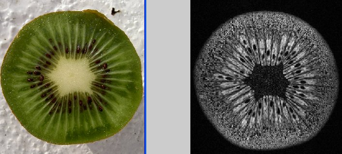

# Lab 5: The Computational Kiwi Challenge — Morphogenesis, Inverse Problems & a 7T MRI Digital Twin

*BMED365 — Computational Imaging, Modeling and AI in Biomedicine (Spring 2027)*  
*Arvid Lundervold — runs locally with `uv` (`bmed365-2027` kernel) or in Google Colab*

---

## Why — and How — Do We "Mathematize" a Kiwifruit? Relevance to Computational Biomedicine

### 1. From *"What Is Inside?"* (`Lab 4`) to *"How Did Nature Build It?"* (`Lab 5`)

On 17 February 2005, an intact `'Hayward'` kiwifruit (*Actinidia chinensis* var. *deliciosa*, hexaploid $2n = 6x = 174$) was placed inside the preclinical **7 Tesla Bruker Pharmascan** MRI scanner at the University of Bergen — amusingly archived in the hospital-style DICOM header with `PatientSex = F`.

In **[Lab 4 (`Lab4-Comp-Imag/Kiwi-challenge`)](../../Lab4-Comp-Imag/Kiwi-challenge/README.md)**, we approached that 3D scan the way a **radiologist or quantitative image analyst** approaches a brain MRI: we converted 128 DICOM slices to NIfTI, accounted for anisotropic voxels (`0.234 × 0.234 × 0.500 mm³`), and segmented and counted **~1,440 dark seeds** ("focal lesions") inside an **`85.97 cm³`** organ.

Yet pause for a moment and look closely at what the 7T scanner revealed inside that fruit:
- Why did the berry stop growing right around **`86 cm³`**, and why does cross-sectional flesh area slice-by-slice track local seed density so tightly (`r = 0.85`–`0.94`)?
- Why was `PatientSex = F` biologically literal — how did a single Y-chromosome gene on male vines prevent an ovary from forming in the first place?
- How did a microscopic floral ring — with **no ruler, no CAD blueprint, and no central choreographer** — count out **`33` evenly spaced radial seed chambers** (*locules*), while its diploid ($2x$) wild cousin counts out **`~22`**?
- Why do the ~1,440 seeds maintain a strict **`~0.95 mm` "personal space"** without colliding, why does losing seeds on one side flatten that side of the fruit while normal 3-fold seed jitter leaves the berry nearly circular, and why do mature seeds look **jet-black** next to **`~190×` brighter** mucilage gel at `TE = 63.9 ms`?

Answering *"what is there?"* is **Computational Imaging (`Lab 4`)**. Asking *"what physical and genetic laws built this 3D organ, and what happens if we perturb them?"* is **Mechanistic Computational Modeling (`Lab 5`)**.

---

### 2. Why Should a Biomedicine Student or Clinician Care About a Fruit?

At first glance, modeling a kiwifruit in a graduate biomedicine course might sound playful. In fact, it is a deliberate pedagogical bridge into **frontline human computational medicine** for three reasons:

1. **Evolution reuses the exact same mathematics across kingdoms.** Multicellular plants and humans are separated by ~1.5 billion years of evolution, yet living tissues in both kingdoms must obey the same laws of chemical kinetics, mass conservation, fluid mechanics, and diffusion:
   - **Receptor saturation ($E_{\max}$ / Hill curves):** Auxin/cytokinin signals from kiwifruit seeds saturate pericarp growth via the exact algebraic law used in **clinical pharmacodynamics** and **renal nephron-endowment scaling**.
   - **Bistable gene switches (ODEs):** Kiwifruit's Y-linked ***Shy Girl* (`SyGI`)** toggle switch locks floral primordia into male vs. female fate using the same positive-feedback nonlinear dynamics by which **`SRY`/`SOX9` vs. `WNT4`/$\beta$-catenin** commits the **human embryonic gonad**.
   - **Fluid-pressure mechanics (ODEs):** Water influx driven by osmotic starch-to-sugar conversion inflates the berry via the same hydrostatic/osmotic balance (**Starling forces**) governing **glomerular filtration, cerebral edema, tumor interstitial pressure, and polycystic kidney (`ADPKD`) cyst expansion**.
   - **Turing symmetry breaking & paracrine morphogens (PDEs):** Short-range activation coupled to long-range inhibition spaces **33 kiwifruit chambers** by the exact mathematical instability (`BMP`–`SOX9`–`WNT`) that spaces **5 human digits** (and causes **polydactyly** when a limb bud widens), while seed hormone diffusion mirrors **hypoxic tumor `VEGF` angiogenesis gradients** and **wound healing**.
2. **Zero clinical jargon, zero privacy barriers — 100% real 7T MRI physics.** Everyone has sliced a kiwifruit at the breakfast table, so your physical intuition works from minute one. At the same time, water protons inside the fruit obey the **exact same Bloch spin-echo relaxation and quadrature Rician noise physics** as a human brain, heart, or kidney inside a clinical scanner.
3. **Closing the `Imaging ↔ Modeling` Digital Twin loop.** Modern precision medicine is moving rapidly from static snapshots to **patient-specific Digital Twins**: segmenting a patient's heart, tumor, or brain from 3D MRI (`Lab 4`), running individualized biophysical PDEs forward in time to test therapies *in silico* (`Lab 5`), solving **regularized inverse problems** to infer hidden internal pathology from surface data (just like **ECG imaging `ECGi`** or **EEG source localization**), and synthesizing physics-accurate **virtual phantoms** (`BrainWeb`, `XCAT`) with known ground truth to validate clinical AI algorithms.

---

### 3. *How* Do We Mathematize a Living Organ? (A 5-Step Craft)

Mathematical equations in biology papers often look intimidating because authors only publish the finished formula, hiding the intuitive scaffolding that produced it. Across this module, we practice **mathematization** as a transparent, repeatable **five-step craft**:

1. **Climb the complexity ladder one rung at a time (*"as simple as possible, but no simpler"*):** Never start with a heavy 3D partial differential equation if a one-line **algebraic curve** already answers your whole-organ question! We move up a rung (**Algebra $\to$ Time ODEs $\to$ 1D/2D Spatial PDEs $\to$ 3D Point Processes & Inverse Problems**) *only* when the biology demands time history or spatial geometry.
2. **Write verbal balance sheets before writing Greek letters:** Every equation begins as plain English — e.g., *"rate of change equals production minus clearance"* ($\frac{dy}{dt} = \text{In} - \text{Out}$) or *"diffusion compares a cell to the average of its immediate neighbors"* ($\nabla^2 c$). If equations feel rusty, start with **[Step 0 (`00-kiwi-math-primer-for-biomedicine.ipynb`)](./notebooks/00-kiwi-math-primer-for-biomedicine.ipynb)**, which translates every symbol into plain clinical English and 5-line visual Python toys.
3. **Anchor every variable in real physical units (`mm`, `cm³`, `days`, `MPa`, `ms`):** Assigning honest units turns abstract math into **falsifiable science** that can be overlaid directly onto calibrated NIfTI voxel coordinates from the 2005 7T scanner.
4. **Probe counterfactuals & audit where the model breaks:** A mechanistic model lets us run *in silico* experiments we never performed in 2005 — knocking out `SyGI` (*CRISPR hermaphrodites*), changing ploidy ($2x \to 4x \to 6x$), blocking pollination on one side (*flat-sided fruit*), or scanning an unripe Day-40 berry — while honestly identifying geometric simplifications (**the Sim-to-Real gap**).
5. **Turn the forward model around (`Inverse Inference & Synthetic Benchmarking`):** Once you can simulate `Genes/Seeds → Anatomy → 7T MRI`, you can run that pipeline backward to reconstruct hidden internal deficits from noisy outer contours (`Tikhonov regularization`) and generate synthetic 3D 7T MRI phantoms with exact seed coordinates to benchmark `Lab 4`'s segmentation pipelines!

---

## Progressive Modeling Ladder & Explicit Human Biomedical Parallels

The modeling starts with zero-calculus algebraic equations and steps progressively up to coupled ODEs, spatial reaction–diffusion PDEs, 3D spatial point processes, ill-posed inverse problems, and synthetic MRI physics:

| Stage / Module | Botanical Mechanism in *Actinidia* | Mathematical Formulation | Direct Human Biomedical Parallel | Empirical Check on Our 2005 7T MRI |
|:---|:---|:---|:---|:---|
| **Stage 1** *(NB 01)* | Seed-derived auxin/cytokinin trophic scaling (*Pyke & Alspach, 1986*) | **Algebraic saturation:** $V(N) = V_{\text{basal}} + V_{\max}\frac{N}{K_N + N}$ | **Pharmacodynamic $E_{\max}$ / Hill curves**; nephron endowment vs. kidney mass; placental perfusion | Predicts **`86.1 cm³`** at $\hat{N}=1{,}440$ vs. measured **`85.97 cm³`**; slice area $A(z)$ tracks local seed density (**`r = 0.851`**, $p = 5.8\times 10^{-30}$) |
| **Stage 2A** *(NB 01)* | `XY` floral sex switch: Y-linked ***Shy Girl* (`SyGI`)** represses carpel fate (*Akagi et al., 2018, 2019*) | **Bistable nonlinear ODEs** (Hill repression + positive feedback) | **Mammalian gonadal fate (`SRY`/`SOX9` vs. `WNT4`/$\beta$-catenin)**; toggle switches ([`05-cell-signaling`](../notebooks/05-cell-signaling.ipynb)) | Explains why our fruit-bearing scan literally had DICOM tag `PatientSex = F` (`XXXXXX`) |
| **Stage 2B** *(NB 01)* | 160-day berry growth, Stage II starch fill, Stage III sugar osmosis (*Hall et al., 2013*) & seed dehydration | **Lockhart viscoplastic ODEs** + **7T Bloch $T_2$ spin-echo** (`TE = 63.9 ms`) | **Starling filtration & edema** ([`06-kidney-filtration`](../notebooks/06-kidney-filtration.ipynb)), `ADPKD` renal cyst expansion, & tumor growth ([`02-tumor-growth`](../notebooks/02-tumor-growth.ipynb)) | Reproduces mature volume (**`86.9 cm³`**) and explains why lignified seeds turn **jet-black** while mucilage gel stays **`~190×` brighter** |
| **Stage 3A** *(NB 01 & 02)* | Spontaneous emergence of **`~33` radial locules**; ploidy shift ($2x \to 4x \to 6x$) | **1D Ring Schnakenberg Turing PDE** & Jacobian dispersion $\text{Re}\,\lambda(q)$ | **Embryonic digit spacing & polydactyly** (`BMP`–`SOX9`–`WNT` Turing network); polyploid cardiomyocyte/hepatocyte hypertrophy | Polar-unwrapped `z = 64` 7T ring exhibits **`33` radial chambers**, matching hexaploid $6x$ Turing mode **`K* = 33`** (vs. `22` in $2x$, `28` in $4x$) |
| **Stage 3B** *(NB 01)* | Local pericarp expansion from diffusing seed hormones; flat-sided poorly pollinated fruit | **2D Screened-Poisson PDE:** $(\nabla^2 - \ell^{-2})c = -\frac{\alpha}{D}S(x,y)$ | **Tumor `VEGF` angiogenesis gradients** & **wound-healing growth-factor PDEs** ([`08-wound-healing`](../notebooks/08-cybernetics-of-wound-healing.ipynb)) | Shows **developmental canalization** (`±3.5%` circularity) in our well-pollinated 2005 berry vs. **`ΔR = 9.4 mm`** flat-sided asymmetry under unilateral seed loss |
| **Module 2** *(NB 02)* | Ovule steric exclusion & placental spacing in 3D locules | **3D Spatial Point Processes:** Clark–Evans $R$, NN CDF $G(r)$, Ripley's $\Delta L(r)$, Matérn Hard-Core | **Tumor–immune spatial point-process statistics** (`CD8+` T-cell exclusion/clustering) in **IMC** ([`Lab4/03-imc-intro`](../../Lab4-Comp-Imag/notebooks/03-imc-intro.ipynb)) | Curated 98 Micro-GT seeds exhibit a **`0.945 mm` hard-core floor** and **Clark–Evans `R = 1.192`** ($p = 0.0025$), rejecting 3D Poisson CSR |
| **Module 3** *(NB 02)* | Non-invasive reconstruction of hidden seed deficits from outer fruit contour | **Ill-posed Fredholm / Green's operator `SVD`** + **Tikhonov ($L_2$) L-curve** | **Electrocardiographic Imaging (`ECGi`)**, **EEG/MEG brain source localization**, & MR elastography | `cond(G) = 1.3e6`: naive $\mathbf{G}^{-1}\mathbf{y}$ blows up (`>470,000%` error), whereas **Morozov Tikhonov** reconstructs hidden deficits to **`5.2%` error** |
| **Module 4** *(NB 02)* | Whole-organ synthetic ground-truth benchmark (`Lab 5 → Lab 4`) | **3D Generative Anatomy + Bruker 7T RARE Bloch equation + Rician k-space noise** | **`BrainWeb` MS lesion phantoms**, **`XCAT` cardiac phantoms**, & *in silico* FDA validation of clinical AI | Generates a `192 × 192 × 88` synthetic 7T MRI with exact $N_{\text{true}} = 750$ seeds (`3D F1 = 0.99`) and validates Lab 4's sector ratio calibration |

---

## Notebooks

No data files are duplicated in this folder: Notebook `00` is 100% self-contained with zero external files (`< 5 s` runtime), while locally Notebooks `01` and `02` read the 2005 7T NIfTI volume and curated 3D Micro-GT directly from [`../../Lab4-Comp-Imag/Kiwi-challenge/data/`](../../Lab4-Comp-Imag/Kiwi-challenge/data/) (and on Google Colab, `resolve_lab4_kiwi_file(...)` downloads them automatically from `main`).

| Notebook | Description | 1-Click Notebook |
|:---------|:------------|:-----------------|
| [00-kiwi-math-primer-for-biomedicine.ipynb](https://github.com/arvidl/BMED365-2027/blob/main/Lab5-Comp-Mod/Kiwi-challenge/notebooks/00-kiwi-math-primer-for-biomedicine.ipynb) | **Step 0 (Visual Mathematical Primer / "Rosetta Stone"):** Intuition-first guide for biomedicine students, clinicians, and less-mathematically-inclined learners — translates mathematical shorthand ($\sum, \int, \frac{dy}{dt}, \nabla^2 c, \arg\min, \text{Re}\,\lambda$) into plain clinical English & 1-line `NumPy` code across **6 visual toy simulations**: (1) receptor saturation & Hill switches ($n=1$ vs. $n=4$), (2) 4-line Euler ODE balance sheets & Waddington bistable valleys, (3) neighbor-average $\nabla^2 c$, decay length $\ell = \sqrt{D/k}$, & Turing "local cheerleader + fast firefighter" peaks, (4) random raindrops (`CSR`) vs. hard-core "personal space" & $G(r)$, (5) frosted-glass inverse blow-up & static + interactive `ipywidgets` Tikhonov $\lambda$ slider, and (6) $T_2$ spin-echo decay & Rician MRI noise floor |  |
| [01-kiwi-growth-and-morphogenesis.ipynb](https://github.com/arvidl/BMED365-2027/blob/main/Lab5-Comp-Mod/Kiwi-challenge/notebooks/01-kiwi-growth-and-morphogenesis.ipynb) | **Part 1 (Algebra → ODEs → Spatial PDEs):** Explicit MSc/PhD learning outcomes & Botanical ↔ Biomedical glossary; intuitive + rigorous derivations with parameter/unit tables; algebraic seed-hormone saturation & 128-slice axial MRI scaling (`r = 0.85`, `0.94` in seed zone); `XY` floral sex-determination switch (`SyGI` vs. carpel); Hall's 160-day turgor/starch/sugar ODEs + 7T Bloch $T_2$ contrast (`190×` gel/seed ratio); 1D Ring Turing PDE (`K = 33` locules); 2D screened-Poisson paracrine hormone PDE; static 4-regime pollination snapshot + interactive `ipywidgets` lab & `
` Q&A checkpoints |  |
| [02-kiwi-digital-twin-and-inverse-problems.ipynb](https://github.com/arvidl/BMED365-2027/blob/main/Lab5-Comp-Mod/Kiwi-challenge/notebooks/02-kiwi-digital-twin-and-inverse-problems.ipynb) | **Part 2 (Advanced Math, Inverse Problems & Digital Twin):** Explicit MSc/PhD learning outcomes & quantitative glossary; analytical Turing Jacobian dispersion $\text{Re}\,\lambda(q)$ across $2x/4x/6x$ ploidy (`22 → 28 → 33` carpels); 3D spatial point-process statistics (`R = 1.19`, $G(r)$, Ripley's $\Delta L(r)$) on the 98 Micro-GT seeds; Hadamard ill-posedness, `SVD` filter factors & Morozov Tikhonov L-curve; **Generative 3D Bloch-MRI Digital Twin** with Rician k-space noise, Hungarian 3D instance matching, **Sim-to-Real gap** analysis, `
` Q&As, & Block 2 project ideas |  |

> **Runtime Notes:** All three notebooks are pure CPU (`NumPy`, `SciPy`, `scikit-image`, `nibabel`, `matplotlib`, `ipywidgets`) and execute end-to-end in **`~4–18 seconds`** each (`< 1.5 GB` RAM).

---

## Open Science, Reproducible Research & Multi-Scale Kiwifruit Datasets

Modern computational biomedicine stands on the **[FAIR Guiding Principles](https://doi.org/10.1038/sdata.2016.18)** (**F**indable, **A**ccessible, **I**nteroperable, **R**eusable). One of the hidden superpowers of using *Actinidia* as a model organ in `BMED365` is that **every spatial and temporal scale** — from `1.7 Å` atomic crystal structures and Y-chromosome gene sequences, to 160-day developmental transcriptomes, `0.23 mm` 7T MRI volumes, and **human clinical gastrointestinal MRI trials** — is **100% open-access** with zero patient-privacy (`REK`/`GDPR`) barriers:

| Scale & Modality | Open Dataset / Permanent Accession (Clickable) | What It Contains | How It Fits Into `BMED365` (`Labs 0–5` & Block 2 Projects) |
|:---|:---|:---|:---|
| **1. 3D Organ MRI & Reproducible Silver-GT** *(`mm` scale)* | **[UiB 2005 7T Bruker Kiwifruit Dataset](../../Lab4-Comp-Imag/Kiwi-challenge/data/)** *(in-repo: 128 DICOMs, `RAS+` NIfTI, BIDS-style JSON sidecar, `98`-seed 3D Micro-GT & [`curate_micro_gt.py`](../../Lab4-Comp-Imag/Kiwi-challenge/scripts/curate_micro_gt.py))* + **[Zenodo Open Fruit X-Ray Micro-CT Benchmarks](https://zenodo.org/search?q=fruit%20micro-CT)** | Non-destructive 7T $T_2$-RARE volume (`256×256×128`, `0.234×0.234×0.500 mm³`) + deterministic 3D instance labels; open micro-CT fruit stacks on Zenodo | **FAIR benchmark template** for **[Lab 4](../../Lab4-Comp-Imag/Kiwi-challenge/README.md)** (DICOM→NIfTI, 3D segmentation, `STAPLE`, 3D `U-Net`) and **Lab 5** (forward PDE validation, 3D point processes, & `Sim-to-Real` Digital Twin testing) |
| **2. Genomes, Ploidy & Sex-Switch Loci** *(`bp` scale)* | **[NCBI GenBank `LC260493.1` (*SyGI* / *Shy Girl*)](https://www.ncbi.nlm.nih.gov/nuccore/LC260493.1)** (*Akagi et al., 2018*, [PMID: 29622566](https://pubmed.ncbi.nlm.nih.gov/29622566/)); **[Ensembl Plants *A. chinensis* `Red5`](https://plants.ensembl.org/Actinidia_chinensis/Info/Index)** (*Pilkington et al., 2018*, [PMID: 29945559](https://pubmed.ncbi.nlm.nih.gov/29945559/), [Zenodo `1297303`](https://zenodo.org/records/1297303)); **[Kiwifruit Genome Database (`KGD`)](http://kiwifruitgenome.org/)** & **NGDC [`PRJCA037936`](https://ngdc.cncb.ac.cn/bioproject/browse/PRJCA037936)** (hexaploid *A. deliciosa*) | Coding sequence of the Y-linked cytokinin response regulator `SyGI` (`ARR22/24`-like), plus chromosome-scale diploid $2x$ (`Red5`) and haplotype-resolved hexaploid $6x$ (`'Hayward'`) assemblies | Grounds **`NB 01` Stage 2A** (`XY` bistable toggle switch & CRISPR hermaphrodites) and **`NB 02` Module 1** ($2x \to 4x \to 6x$ polyploid Turing carpel scaling) in real genomic sequences and gene-dosage tracks |
| **3. Developmental Time-Series Multi-Omics** *(`0–160 DAA`)* | **[NCBI BioProject (*Actinidia* Fruit Development RNA-seq)](https://www.ncbi.nlm.nih.gov/bioproject/?term=Actinidia+fruit+development+RNA-seq)** & **[NCBI GEO (*Actinidia chinensis*)](https://www.ncbi.nlm.nih.gov/gds/?term=Actinidia+chinensis)** | Multi-timepoint RNA-seq across anthesis, cell division, Stage II starch accumulation, Stage III $\beta$-amylase starch $\to$ sugar osmotic conversion, and ethylene softening | Connects **`NB 01` Stage 2B** (Hall's 160-day turgor/starch/sugar ODEs) to real gene-expression trajectories — ideal for **tabular/time-series ML (`Labs 0–2`)** + **mechanistic ODE parameter fitting (`Lab 5`)** |
| **4. 3D Atomic Protein Structures & Inhibitors** *(`1.7 Å` scale)* | **[RCSB PDB `2ACT`](https://www.rcsb.org/structure/2ACT)** (native **actinidin / `Act d 1`** cysteine protease), **[PDB `1AEC`](https://www.rcsb.org/structure/1AEC)** (covalent **E-64** inhibitor complex), **[PDB `4BCT`](https://www.rcsb.org/structure/4BCT)** (`Act d 2` thaumatin-like allergen), **[UniProt `P00785`](https://www.uniprot.org/uniprotkb/P00785/entry)** & **[AlphaFold `AF-P00785-F1`](https://alphafold.ebi.ac.uk/entry/P00785)** | High-resolution X-ray & AlphaFold 3D structures of kiwifruit's primary protease/allergen — a classic structural homolog of **human lysosomal cathepsins B/K/L** | Bridges macroscopic organ modeling to **structural bioinformatics, Michaelis–Menten / `IC50` enzyme inhibition (`NB 00`), clinical allergy cross-reactivity, and covalent drug design** |
| **5. Human Clinical GI MRI & Nutrition Trials** *(`Translational Bridge`)* | **Nottingham Human Gut MRI Crossover Trial** (*Wilkinson-Smith et al., 2019*, [PMID: 30706488](https://pubmed.ncbi.nlm.nih.gov/30706488/)); **Multicenter Rome IV RCT** (*Gearry et al., 2023*, [PMID: 36537785](https://pubmed.ncbi.nlm.nih.gov/36537785/)); **[ClinicalTrials.gov (`kiwifruit`)](https://clinicaltrials.gov/search?intr=kiwifruit)** & **[USDA FoodData Central](https://fdc.nal.usda.gov/)** | Clinical $T_1$/$T_2$ abdominal MRI quantifying human small-bowel water trapping ($T_1\text{AC}$, `SBWC`) and colonic volume expansion after eating green kiwifruit (`2 fruits × 2/day`) | **Full-circle clinical punchline:** the *exact same* mucilage/pectin osmotic water-trapping and $T_1/T_2$ MRI relaxation physics we model inside the berry (`NB 01` Stage 2B) is measured inside the **human gastrointestinal tract** by clinical MRI! |

> **Reproducible Research Template for Your MSc / PhD Thesis:** Notice how the Kiwi Challenge across `Lab 4` and `Lab 5` implements end-to-end reproducibility without proprietary black boxes:
> 1. **Immutable raw data + machine-readable metadata:** Raw 2005 Bruker DICOM slices + BIDS-style `.json` acquisition sidecars (`TR`, `TE`, `ETL`, voxel spacing).
> 2. **Auditable conversion & curation scripts:** Explicit `DICOM → RAS+ NIfTI` conversion ([`00-kiwi-dicom-to-nifti.ipynb`](../../Lab4-Comp-Imag/Kiwi-challenge/notebooks/00-kiwi-dicom-to-nifti.ipynb)) and deterministic Silver-GT generation ([`curate_micro_gt.py`](../../Lab4-Comp-Imag/Kiwi-challenge/scripts/curate_micro_gt.py)) rather than unrecorded manual clicks.
> 3. **Pinned software environment & deterministic seeds:** Cross-platform `pyproject.toml` + `uv.lock` (`Python 3.12`) + `np.random.seed(42)` + self-bootstrapping Google Colab execution.

---

## Ideas for Block 2 Individual Projects (`BMED365`)

Students looking for a self-contained **Computational Modeling + Imaging + Open Data** topic for their [Individual Project](../../Individual-project/README.md) can extend these notebooks in several directions (detailed in Section 6 of Notebook `02`):

1. **Finite-Strain Morphoelasticity ($\mathbf{F} = \mathbf{F}_e\mathbf{F}_g$):** Couple differential pericarp growth with stiff *columella* mechanics — directly analogous to **human cerebral cortical gyrification** (brain folding) and cardiac remodeling.
2. **Physics-Informed Neural Networks (`PINNs`) in PyTorch:** Estimate unknown hormone diffusion length $\ell$ and receptor saturation $K_c$ directly from 3D MRI contours by minimizing PDE + boundary losses.
3. **Zero-Annotation `Sim-to-Real` 3D Deep Learning:** Train a 3D `U-Net` purely on synthetic Bloch-MRI Digital Twins (`Module 4`) and evaluate zero-shot transfer on the real 2005 7T MRI scan (`Lab 4`).
4. **Comparative Ploidy Modeling ($2x$ Golden vs. $6x$ Green Kiwifruit):** Combine Ensembl/`KGD` genome tracks (`Scale 2`) with Turing and growth ODEs to predict locule count, seed load, carbohydrate dynamics, and MRI $T_2$ contrast across *Actinidia* ploidy series.
5. **Multi-Scale Omics-to-MRI or Translational Human Gut MRI Modeling:** Fit Stage 2B's starch-to-sugar osmotic ODEs to public developmental RNA-seq time series (`Scale 3`), or build a compartmental GI water-transport + $T_1/T_2$ MRI signal model reproducing the Nottingham human colonic MRI trial (*Wilkinson-Smith et al., 2019*, `Scale 5`).
