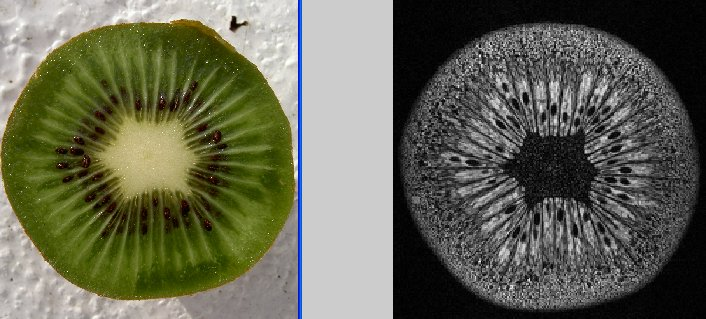

# Computational Modeling of the Kiwifruit (Part 1): Math Primer, Multi-Scale Atlas & Morphogenesis

*Companion Methodological & Didactic Guide for `Lab5-Comp-Mod/Kiwi-challenge` (`Notebooks 00, 00a & 01`) — BMED365 Spring 2027*  
*Pure CPU (`NumPy`, `SciPy`, `nibabel`, `bmed365-2027` `uv` & Google Colab) — **[Download / Read Printable PDF (`foundations-atlas-and-morphogenesis.pdf`)](./foundations-atlas-and-morphogenesis.pdf)** | **[Continue to Part 2 (`inverse-problems-and-digital-twin.md`)](./inverse-problems-and-digital-twin.md)***

---

## Start Here — A Non-Technical Introduction: Big Ideas, Definitions & Visual Intuition

> **Who This Section Is For:** Mathematical models in biology papers often look intimidating because authors show only the finished equations while hiding the physical intuition behind them. Before introducing a single derivative or differential equation, this opening section gives a **plain-English tour** of how we read the kiwifruit's multi-scale anatomy and simulate how living tissue builds a 3D organ — written for biomedicine and health-science master's students with moderate math background.

### Why "Mathematize" a Kiwifruit in a Biomedicine Course?

In **[Lab 4 (Computational Imaging)](../../../Lab4-Comp-Imag/Kiwi-challenge/README.md)**, we approached our 2005 7 Tesla MRI scan of an intact `'Hayward'` kiwifruit the way a radiologist approaches a brain MRI: we asked **"What is inside?"** — measuring an `85.97 cm³` fruit containing roughly `1,440` dark seeds.

In **Lab 5 (Computational Modeling)**, we flip the camera around and ask: **"How did nature build this 3D organ, and what happens if we perturb the biological rules?"**
- Why did the berry stop growing right around `86 cm³`, and why does the thickness of each slice track how many seeds sit in that slice?
- Why was the scanner's hospital-style DICOM tag `PatientSex = F` literally true — how does a single Y-chromosome gene decide whether a flower grows an ovary or remains male?
- How does a microscopic ring of cells — with no ruler and no CAD blueprint — spontaneously count out **33 evenly spaced radial seed chambers**?
- Why does the bright white central core of a cut kiwifruit turn **dark** in 7T MRI, while the translucent jelly around the seeds shines **190× brighter** than the seeds?

This is not just botanical trivia. Plants and humans diverged 1.5 billion years ago, yet living tissues in both kingdoms obey the **exact same physical and mathematical laws**: drug-receptor saturation (clinical pharmacodynamics), bistable genetic sex switches (human `SRY`/`SOX9` vs. `WNT4`), fluid-pressure expansion (glomerular filtration, edema, and polycystic kidney cysts), Turing self-organization (how five human fingers space out in an embryonic limb bud), and spin-echo MRI water physics (even extending directly to human clinical gastrointestinal MRI trials of kiwifruit!).

### Visual Intuition: Four Big Ideas Before Any Equations

```mermaid
flowchart TB
    subgraph A["(A) Optical vs. 7T T2-MRI Contrast Inversion"]
        A1["Optical photo:<br/>Fibrous core looks BRIGHT WHITE<br/>(Mie light scattering)"] -->|"7T Spin-Echo MRI<br/>(TE = 63.9 ms)"| A2["7T T2 MRI:<br/>Core & dry seeds turn DARK;<br/>watery gel shines 190x brighter!"]
    end

    subgraph B["(B) Bistable Cell-Fate Valleys & Turgor Growth"]
        B1["One Y-gene nudge (SyGI)<br/>tips flower into Male vs. Female valley"] --> B2["Lockhart viscoplastic expansion:<br/>grows only when pressure > yield<br/>(mild drought cuts volume 42%!)"]
    end

    subgraph C["(C) Self-Organizing Chambers (Turing Ring)"]
        C1["Uniform floral ring with<br/>1.5% random noise (no blueprint!)"] -->|"Slow local 'cheerleader'<br/>+ fast 'firefighter'"| C2["Spontaneously crystallizes into<br/>33 evenly spaced radial chambers"]
    end

    subgraph D["(D) Hormone Diffusion & Developmental Canalization"]
        D1["Full pollination (noisy seeds)<br/>diffusive smoothing -> round berry"] --- D2["One-sided seed loss -> flat side<br/>(ΔR = 9.4 mm asymmetry)"]
    end
```



### Plain-English Definitions of Every Concept, Model & Method

| Concept / Term | Plain-English Meaning & Everyday / Clinical Analogy |
| :--- | :--- |
| **The 5-Step Craft of "Mathematization"** | Never jump straight to giant equations. Climb a ladder one rung at a time: **Algebra** (endpoint size) → **Time ODEs** (growth over days) → **Spatial PDEs** (2D/3D shape). Write every balance sheet in plain English first ("change = in minus out") and keep honest physical units (`mm`, `cm³`, `days`, `MPa`). |
| **Receptor Saturation & Hill Switch** | Think of **musical chairs on cell receptors**. A gentle curve (exponent `n = 1`) acts like a *dimmer switch*: adding seeds initially grows the fruit rapidly, then saturates once receptors are mostly full (just like clinical drug $E_{\max}$ curves). A steep curve (`n = 3–4`) acts like a *digital light switch* (like oxygen binding hemoglobin, or turning a gene sharply ON/OFF). |
| **Ordinary Differential Equation (`ODE`)** | A bookkeeping rule for how a quantity changes over time — like an **IV drip into a leaky bucket** ("rate of change = infusion minus clearance"). In Python, simulating an ODE is just stepping forward day-by-day in a loop. |
| **Bistability & Waddington Valleys** | When a gene reinforces itself (*positive feedback*), the system gains **two deep valleys** separated by a knife-edge hilltop. A tiny nudge from one Y-chromosome gene (*Shy Girl*, `SyGI`, in kiwifruit; `SRY` in human embryos) tips the flower or gonad irreversibly into Male vs. Female fate. |
| **Viscoplastic Turgor Growth (`Lockhart`)** | A rubber balloon stretches elastically and shrinks back when deflated. Growing cells expand **viscoplastically**: internal water pressure (*turgor*) must push past a stiffness threshold (*yield*) before cell walls stretch permanently — the exact physics behind expanding polycystic kidney (`ADPKD`) cysts and vascular remodeling. |
| **Osmotic Buffering (Starch → Sugar)** | If a mid-summer berry stored 60 g of loose sugar molecules, osmotic pressure would burst its cells! Instead, it packs carbon into insoluble **starch granules** inside *amyloplasts* (just like human liver cells store glucose as **glycogen**), then cleaves them into sweet soluble sugars right before harvest. |
| **Optical vs. 7T $T_2$ Spin-Echo Contrast** | Think of water molecules as tiny spinning bells rung by the MRI scanner. In watery jelly (*locular mucilage*), bells ring a long time (bright MRI). In dense fibrous core (*columella*) or woody seed coats (*testa*), bells bump into stiff fibers and fade immediately (dark MRI) — just like glistening white human tendons look dark on clinical $T_2$ MRI. |
| **The Laplacian ("Compare With Neighbors")** | That upside-down triangle ($\nabla^2$) simply compares a cell's value against the **average of its immediate neighbors**. On a peak, neighbors are lower so diffusion pulls the peak down; in a valley, neighbors are higher so diffusion fills it in. |
| **Turing Instability (Reaction–Diffusion)** | Alan Turing proved in 1952 that pairing a **slow local activator** ("cheerleader") with a **fast long-range inhibitor** ("firefighter") turns uniform noise into evenly spaced stripes or spots — spacing **33 chambers** in a hexaploid kiwifruit by the same math that spaces **5 fingers** on a human hand. |
| **Paracrine Reach & Developmental Canalization** | Hormones secreted by seeds diffuse outward before decaying over a characteristic reach (a few millimeters). This smoothing blurs away small local variations in seed count so the fruit stays round (**canalization**), unless an entire side lacks seeds and collapses flat. |
| **Multi-Scale Kiwi Anatomy (`NB 00a`)** | From outside in: hairy brown skin (**exocarp**), green fleshy wall with giant sac cells (**outer pericarp**), radial chambers filled with watery **locular mucilage** holding dark lignified **seeds**, supplied by **amphicribral vascular bundles** around the central white fibrous **columella**. |
| **4-Phase `BBCH` Clock & Human Gut MRI** | Kiwifruit develops across 4 phases (`0–180` days after flowering): cell division → starch fill & seed blackening → sugar sweetness (our Feb 2005 scan!) → ethylene softening. Remarkably, the exact same pectin water-trapping and $T_1$/$T_2$ MRI physics appears inside the human gut in clinical kiwifruit MRI trials! |

### Recommended Starting Resources (Reviews, Visual Guides, Open Data, Videos & Podcasts)

| Format | Curated Learning Resource (Clickable) |
| :--- | :--- |
| **Accessible Science & Landmark Papers** | • **[Guo et al., *Front. Plant Sci.* (2013)](https://pmc.ncbi.nlm.nih.gov/articles/PMC3797463/)** — open-access histological atlas of kiwifruit vascular & carpel anatomy (`PMC3797463`)<br>• **[Richardson et al., *BMC Plant Biol.* (2011)](https://pmc.ncbi.nlm.nih.gov/articles/PMC3261216/)** — standardized `BBCH` growth, starch, and sugar curves (`PMC3261216`)<br>• **[Akagi et al., *The Plant Cell* (2018)](https://doi.org/10.1105/tpc.17.00787)** (*Shy Girl* sex switch) · **[Hall et al., *J. Exp. Bot.* (2013)](https://doi.org/10.1093/jxb/ert317)** (biophysical kiwi growth model)<br>• **[Turing (1952)](https://doi.org/10.1098/rstb.1952.0012)** (chemical morphogenesis) · **[Raspopovic et al., *Science* (2014)](https://doi.org/10.1126/science.1252960)** (human digit Turing network)<br>• **[Wilkinson-Smith et al. (2019)](https://pubmed.ncbi.nlm.nih.gov/30706488/)** & **[Gearry et al. (2023)](https://pubmed.ncbi.nlm.nih.gov/36537785/)** — clinical human gut MRI & Rome IV kiwifruit trials |
| **Interactive Tutorials & Explainers** | • **[Karl Sims: *Reaction–Diffusion Tutorial*](https://www.karlsims.com/rd.html)** — crystal-clear visual introduction to Turing patterns with animations<br>• **[Quanta Magazine: *Biologists Home In on Turing Patterns*](https://www.quantamagazine.org/biologists-home-in-on-turing-patterns-20130325/)** — non-technical story linking math to embryonic hands and skin<br>• **[MRIQuestions.com: *What is $T_2$ Relaxation?*](https://mriquestions.com/t2-relaxation.html)** — clinician-friendly Q&A explaining spin-echo MRI contrast without heavy physics |
| **Open-Science Data Portals** | [`Ensembl Plants` (*A. chinensis*)](https://plants.ensembl.org/Actinidia_chinensis/Info/Index) · [`GenBank LC260493.1` (*SyGI*)](https://www.ncbi.nlm.nih.gov/nuccore/LC260493.1) · [`RCSB PDB 2ACT` (Actinidin protease)](https://www.rcsb.org/structure/2ACT) · [`AlphaFold P00785`](https://alphafold.ebi.ac.uk/entry/P00785) |
| **Videos & Podcasts** | • **[3Blue1Brown: *Differential Equations Playlist*](https://www.youtube.com/playlist?list=PLZHQObOWTQDNPOjrT6KVlfJuKtYTtzqH6)** — best visual intuition on Earth for ODEs, phase portraits, and PDEs<br>• **[NEJM AI Grand Rounds Podcast](https://ai-podcast.nejm.org/)** — translational discussions on quantitative physiology, imaging, and computational medicine |

---

## 1. The Mathematical "Rosetta Stone" (`Notebook 00`)

Almost every intimidating equation in computational biomedicine is compact shorthand for a one-line `NumPy` array operation or a short time-stepping `for`-loop. **[Notebook `00`](../notebooks/00-kiwi-math-primer-for-biomedicine.ipynb)** (`< 5 s`, pure CPU) translates six core building blocks directly into Python:

| Math Symbol | Plain Biomedical Reading | 1-Line Python / `NumPy` Equivalent | Where Used in Lab 5 |
| :--- | :--- | :--- | :--- |
| $\sum_i x_i$, $\mathbb{E}[x]$ | Total or average across voxels / slices | `np.sum(x)`, `np.mean(x)` | Whole-fruit volume $V_{\text{MRI}}$, mean spacing |
| $\int x(t)\,dt$ | Area Under the Curve (`AUC`) | `np.trapezoid(x, t)` | Cumulative phloem carbon import |
| $\frac{x^n}{K^n + x^n}$ | Dimmer ($n=1$) or digital switch ($n\ge 3$) | `x**n / (K**n + x**n)` | Stage 1 size $V(N)$ & Stage 2A `SyGI` switch |
| $\frac{dy}{dt} = \text{In} - \text{Out}$ | Rate of change (Euler update) | `y = y + dt * (k_in - k_out * y)` | Stage 2A sex fate & Stage 2B 160-day growth |
| $\nabla^2 c$ | Compare cell to immediate neighbors | `c_left + c_right - 2*c_me` | Stage 3A Turing ring & Stage 3B diffusion |
| $\arg\min_x (\dots)$ | Pick $x$ minimizing error + penalty | `np.linalg.solve(G.T@G + lam*L.T@L, G.T@y)` | Part 2 Tikhonov inverse problem |

> **The "Three Test Numbers" Trick for Reading Any Hill Function (Zero Algebra!):** For $f_{\text{act}}(x) = \frac{x^n}{K^n + x^n}$: plug in $x = 0 \implies 0$ (OFF), $x = K \implies 0.50$ ($K = \text{EC}_{50}$), and $x \gg K \implies 1$ (100% saturated). Exponent $n=1$ gives a smooth graded curve (*seed-count saturation*), whereas $n=3\text{--}4$ snaps abruptly across $x = K$ (*bistable `SyGI` switch*).

---

## 2. Multi-Scale Anatomical, Histological & Physiological Atlas (`Notebook 00a`)



Bridging Lab 4 imaging and Lab 5 modeling requires knowing *what* every bright and dark zone in the 2005 7T Bruker scan represents microscopically (**[Notebook `00a`](../notebooks/00a-kiwi-anatomical-and-physiological-atlas.ipynb)**):

| Zone ($r/R$) | Histology ($\mu\text{m}$ scale) | Optical Appearance | 7T $T_2$ MRI (`TE = 63.9 ms`) | Human Clinical Parallel |
| :--- | :--- | :--- | :--- | :--- |
| **1. Exocarp** (`0.96–1.00`) | Suberized periderm + air-filled *trichomes* | Thin brown fuzzy rind | **Very dark rim** (suberin + air susceptibility dephasing) | Stratum corneum / Glisson's or renal capsule |
| **2. Outer Pericarp** (`0.62–0.96`) | Dimorphic parenchyma (`500–800 μm` sac cells + starch *amyloplasts*) | Vivid green ($6x$) or gold ($2x/4x$) flesh | **Medium-bright speckled grey** ($T_2 \approx 68\text{--}95\text{ ms}$) | Renal cortex / glandular organ parenchyma |
| **3. Vascular Bundles** | Outer collateral & placental **amphicribral** bundles (*Guo et al., 2013*) | Pale pinpoints | Fine dark striations along septa | Portal triads / arcuate renal arterial tree |
| **4. Locular Gel** (`0.24–0.62`) | Hydrated pectic mucilage hydrogel in `K = 33` chambers | Translucent pale jelly | **Brightest foreground** ($T_2 \approx 120\text{ ms}$, `190×` seed) | CSF / fluid-filled cysts / synovial fluid |
| **5. Mature Seeds** (`0.24–0.62`) | Lignified sclereid *testa* + dormant dehydrated embryo | Glossy black ovals (`~1.5 mm³`) | **Jet-black voids** ($T_2 \approx 9.5\text{--}14\text{ ms}$) | Cerebral microbleeds, calcifications, MS plaques |
| **6. Columella** (`0.00–0.24`) | Dense cellulose/pectin fibrous axial core | **Opaque bright white** (Mie light scattering) | **Dark central blade** ($T_2 \approx 24\text{ ms}$, bound water!) | White tendons, ligaments, menisci, fibrous scar |

### Four Physiological Phases (`0–180 DAA`) & Human Gut MRI Bridge
1. **Phase I (`0–55 DAA`):** Fertilized ovules secrete auxin/cytokinins driving rapid cell division; hydrated white ovules still have long $T_2$ (`< 2×` contrast vs. gel).
2. **Phase II (`55–115 DAA`):** Mitosis stops; phloem carbon is polymerized into osmotically silent **amyloplast starch** (up to `~8%` FW, avoiding a `> 1.1 MPa` osmotic burst — identical to hepatic glycogen storage), while seed coats lignify and dehydrate ($T_2: 95 \to 14\text{ ms}$).
3. **Phase III (`115–160 DAA`, Harvest):** $\beta$-amylase cleaves starch into soluble glucose, fructose, and sucrose (`6% → 14%` °Brix), sustaining turgor to `86 cm³` while creating crisp `190×` gel-to-seed MRI contrast (**our Feb 2005 scan!**).
4. **Phase IV (`160–180+ DAA`, Softening):** Autocatalytic ethylene solubilizes cell-wall pectins (firmness drops `80 N → <10 N`) and the cysteine protease **actinidin** ([PDB `2ACT`](https://www.rcsb.org/structure/2ACT), homolog of human lysosomal cathepsins) peaks.

> **Full-Circle Clinical Punchline:** In the Nottingham human gut MRI crossover trial ([Wilkinson-Smith et al., 2019](https://pubmed.ncbi.nlm.nih.gov/30706488/)) and a multicenter Rome IV RCT ([Gearry et al., 2023](https://pubmed.ncbi.nlm.nih.gov/36537785/)), eating green kiwifruit increased small-bowel water trapping and colonic volume measured by clinical $T_1$/$T_2$ abdominal MRI — driven by the **exact same mucilage osmotic water-trapping and $T_2$ physics** modeled inside the berry!

---

## 3. Quantitative Growth & Morphogenesis Ladder (`Notebook 01`)

From the calibrated 2005 7T NIfTI volume (`256 × 256 × 128`, voxel `0.02747 mm³`), **[Notebook `01`](../notebooks/01-kiwi-growth-and-morphogenesis.ipynb)** extracts $V_{\text{MRI}} = 85.97\text{ cm}^3$ (length `52.5 mm`, equatorial diameter `52.0 mm`) and recall-calibrated $\hat{N}_{\text{cal}} \approx 1{,}440$ seeds (`~2.55%` volume fraction), then climbs four mathematical rungs:

### 3.1 Stage 1 (Algebraic): Seed-Hormone Receptor Saturation & Axial Allometry

$$V_{\text{fruit}}(N) = V_{\text{basal}} + V_{\max}\,\frac{N}{K_N + N}, \qquad \frac{dV_{\text{fruit}}}{dN} = \frac{V_{\max}\,K_N}{(K_N + N)^2}$$

- At $\hat{N} = 1{,}440$, the saturation law predicts **`86.13 cm³`** vs. measured **`85.97 cm³`** (`77.4%` receptor saturation).
- Slice-by-slice cross-sectional area $A_{\text{MRI}}(z)$ correlates strongly with local seed density (**`r = 0.851`**, $p = 5.84\times 10^{-30}$; **`r = 0.944`** inside the seed-bearing core $z \in [14, 49]\text{ mm}$), directly matching the pharmacodynamic $E_{\max}/\text{EC}_{50}$ law.

### 3.2 Stage 2A (ODEs): Bistable `XY` Floral Sex Switch (*Shy Girl* vs. Carpel Fate)

$$\frac{dS}{dt} = \alpha_Y I_Y - \delta_S S, \qquad \frac{dC}{dt} = \frac{\beta_{\text{CK}}}{1 + (S/K_S)^n} + \frac{\beta_{\text{auto}}\,C^n}{K_C^n + C^n} - \delta_C C$$

With Hill cooperativity $n = 3$, Y-linked `SyGI` ($S(t)$, *Akagi et al., 2018*) on male vines (`XXXXXY`, $I_Y = 1$) represses cytokinin-driven carpel identity $C(t) \to 0$, whereas on female vines (`XXXXXX`, $I_Y = 0$) positive auto-feedback locks $C(t) \to 2.42$ (explaining DICOM `PatientSex = F`!) — mirroring human embryonic `SRY`/`SOX9` vs. `WNT4`/$\beta$-catenin commitment.

### 3.3 Stage 2B (Coupled ODEs + Bloch $T_2$): Lockhart Expansion & Starch–Sugar Osmosis

$$\frac{dV}{dt} = \phi(t)\,V\,\max\!\big(0,\, P(t) - Y\big), \qquad P(t) = \Psi_{\text{xylem}} + \kappa_{\text{osm}}\frac{M_{\text{sugar}}(t) + M_0(V)}{V(t)} + \Delta P_{\text{seed}}(N)$$

$$\frac{dM_{\text{starch}}}{dt} = f_{\text{st}}(t)J_{\text{phloem}} - k_{\text{hyd}}(t)M_{\text{starch}}, \qquad \frac{dM_{\text{sugar}}}{dt} = \big(1 - f_{\text{st}}(t)\big)J_{\text{phloem}} + k_{\text{hyd}}(t)M_{\text{starch}} - r_{\text{resp}}M_{\text{sugar}}$$

coupled to $S_{\text{RARE}}(t) \approx \rho\,\exp(-\text{TE}/T_2(t))$ (`TE = 63.9 ms`):
- Predicts **`86.86 cm³`** at Day 160 ($N = 1{,}440$). Because Lockhart growth scales with *excess* pressure $(P - Y)$ above yield threshold $Y = 0.52\text{ MPa}$, a mild `-0.22 MPa` water deficit (`~18%` of $P$) slashes final volume by **`42%` (`86.9 → 50.0 cm³`)** — analogous to renal `GFR` sensitivity!
- Reproduces the jump in 7T gel/seed RARE signal contrast from **`1.59×`** at Day 40 to **`190.3×`** at Day 160.

### 3.4 Stage 3 (Spatial PDEs): 1D Turing Ring (`K = 33`) & 2D Paracrine Canalization

1. **1D Periodic Schnakenberg Turing PDE ($s \in [0, L)$, $D_v \gg D_u$):**
   $$\frac{\partial u}{\partial t} = D_u \frac{\partial^2 u}{\partial s^2} + \gamma_{\text{rxn}}\!\left(a - u + u^2 v\right), \qquad \frac{\partial v}{\partial t} = D_v \frac{\partial^2 v}{\partial s^2} + \gamma_{\text{rxn}}\!\left(b - u^2 v\right)$$
   Starting from `1.5%` random noise, the hexaploid ring spontaneously crystallizes into **`K_Turing = 33` carpel peaks**, matching **`K_MRI = 33`** radial locules on slice `z = 64`!
2. **2D Screened-Poisson Paracrine Diffusion ($\ell = \sqrt{D/\gamma}$):**
   $$\big(\ell^2 \nabla^2 - 1\big) c(x, y) = -\frac{\alpha}{\gamma}\sum_{i=1}^{N_{\text{eq}}} \delta(\mathbf{x} - \mathbf{x}_i), \qquad R_{\text{outer}}(\theta) = R_{\text{core}}(\theta) + g_{\text{basal}} + g_{\max}\frac{\bar{c}(\theta)}{K_c + \bar{c}(\theta)}$$
   Despite `2.9×` wedge-to-wedge seed variation (`14–41` seeds per `15°` sector), outer radius stays within **`3.5%` (`25.32–26.23 mm`)** (*developmental canalization*), whereas unilateral pollination loss collapses the fruit into a flat-sided berry (**`ΔR = 9.4 mm`**).

---

## 4. Minimal Python Recipe & Continue to Part 2

```python
import numpy as np

def step_turing_ring(u: np.ndarray, v: np.ndarray, Du=0.02, Dv=1.0, a=0.1, b=0.9, gamma=280.0, ds=0.1, dt=1e-4):
    """One explicit periodic-ring step of the 1D Schnakenberg Turing PDE (NB 01 Stage 3A)."""
    lap_u = (np.roll(u, -1) + np.roll(u, 1) - 2.0 * u) / (ds ** 2)
    lap_v = (np.roll(v, -1) + np.roll(v, 1) - 2.0 * v) / (ds ** 2)
    u2v = (u * u) * v
    return u + dt * (Du * lap_u + gamma * (a - u + u2v)), v + dt * (Dv * lap_v + gamma * (b - u2v))
```

Ready for analytical polyploid dispersion, 3D spatial point processes on the 98 Micro-GT seeds, ill-posed inverse problems (`SVD` & Tikhonov), and the generative 3D Bloch-MRI Digital Twin? Continue to **[Part 2: `inverse-problems-and-digital-twin.md`](./inverse-problems-and-digital-twin.md)** (**[Printable PDF](./inverse-problems-and-digital-twin.pdf)**)!
