# Computational Modeling of the Kiwifruit (Part 2): Inverse Problems & 3D Bloch-MRI Digital Twin

*Companion Methodological & Didactic Guide for `Lab5-Comp-Mod/Kiwi-challenge` (`Notebook 02`) — BMED365 Spring 2027*  
*Pure CPU (`NumPy`, `SciPy`, `scikit-image`, `bmed365-2027` `uv` & Google Colab) — **[Download / Read Printable PDF (`inverse-problems-and-digital-twin.pdf`)](./inverse-problems-and-digital-twin.pdf)** | **[Back to Part 1 (`foundations-atlas-and-morphogenesis.md`)](./foundations-atlas-and-morphogenesis.md)***

---

## Start Here — A Non-Technical Introduction: Big Ideas, Definitions & Visual Intuition

> **Who This Section Is For:** Part 2 tackles four pillars of quantitative computational medicine: **stability analysis**, **3D spatial statistics**, **ill-posed inverse problems**, and **physics-based Digital Twins**. Before introducing eigenvalues, singular values, or Bloch equations, this opening section translates every idea into plain English and visual intuition — designed for biomedicine master's students with moderate math background.

### From Forward Simulation to Inverse Detective Work & Virtual Phantoms

In **[Part 1](./foundations-atlas-and-morphogenesis.md)**, we ran biology **forward**: starting from genes, seeds, and hormones, we simulated a kiwifruit growing to `86 cm³` with `33` radial chambers. Yet modern computational medicine demands four deeper questions that Part 2 answers directly on our 2005 7T MRI dataset:

1. **"Why does doubling or tripling genome size change the number of organ chambers?"** Wild diploid ($2x$) golden kiwifruit have `~22` radial chambers, whereas our hexaploid ($6x$) green `'Hayward'` berry has `33`. Instead of running endless trial-and-error simulations, **linear stability analysis** lets us predict the winning chamber count directly — the exact math explaining why widening an embryonic limb bud causes *polydactyly* (extra fingers)!
2. **"Are the seeds scattered at random, or do they obey hidden 3D spatial architecture?"** Using the `98` curated 3D seeds from Lab 4, **3D spatial point-process statistics** prove that seeds maintain a strict "personal space" (`~0.95 mm`) at short range while aligning into radial rows at medium range — the exact same spatial statistics used in **Lab 4 Imaging Mass Cytometry (`IMC`)** to quantify whether `CD8+` T cells infiltrate or are excluded from a tumor!
3. **"Can we run physics *backward* to diagnose hidden interior damage from outside measurements?"** Suppose we can measure only the smooth outer skin contour of a fruit (or only chest-surface `ECG` electrodes / scalp `EEG` electrodes in a patient) and want to reconstruct hidden internal deficits. Running blurring backward naively causes tiny measurement noise to explode by **`470,000%`**! **Tikhonov regularization** adds a "smoothness seatbelt" that recovers the hidden cause to within **`5%` error**.
4. **"How can we prove an AI segmentation pipeline works when nobody dissected the 2005 fruit?"** We close the **Lab 5 → Lab 4 Digital Twin loop**: we build a **virtual 3D kiwifruit** with an exact known seed count ($N_{\text{true}} = 750$), simulate a real 7T Bruker scanner (including authentic **Rician MRI noise**), run Lab 4's 3D detector on it, and candidly audit the **Sim-to-Real Gap** between synthetic phantoms and messy biological reality!

### Visual Intuition: Four Advanced Concepts Made Visual

```mermaid
flowchart TB
    subgraph M1["(A) Module 1: Wider Ring Fits More Turing Waves"]
        P1["Diploid 2x -> 22 chambers"] --> P2["Tetraploid 4x -> 28 chambers"] --> P3["Hexaploid 6x -> 33 chambers<br/>(same chemical wavelength!)"]
    end

    subgraph M2["(B) Module 2: Random Raindrops vs. Personal Space"]
        S1["Random (CSR): accidental pairs<br/>(Clark-Evans R = 1.00)"] --- S2["Kiwi seeds: 0.95 mm dead zone<br/>(R = 1.19, p = 0.0025)"]
    end

    subgraph M3["(C) Module 3: Frosted-Glass Inverse Blow-Up vs. Seatbelt"]
        I1["Noisy blurred outer skin<br/>(1% measurement noise)"] -->|"Naive inverse"| I2["472,787% error!<br/>(Noise explodes into spikes)"]
        I1 -->|"Tikhonov seatbelt (λ*)"| I3["5.2% error!<br/>(Clean deficit recovery)"]
    end

    subgraph M4["(D) Module 4: Closing the Lab 5 ↔ Lab 4 Digital Twin Loop"]
        D1["Virtual 3D Kiwi<br/>Exact N_true = 750"] --> D2["7T Bloch T2 +<br/>Complex Rician Noise"] --> D3["Lab 4 Detector Audit:<br/>F1 = 0.99 (Twin) vs ~0.80 (Real)"]
        D3 -.->|"Audit & close Sim-to-Real Gap<br/>(crowding, texture, tilt)"| D1
    end
```



### Plain-English Definitions of Every Concept, Model & Method

| Concept / Method | Plain-English Meaning & Everyday / Clinical Analogy |
| :--- | :--- |
| **Linear Stability & Dispersion Curve** | Imagine tapping a uniform ring of cells with tiny ripples of different wavelengths (`10`, `20`, `33`, or `50` waves around the circle). A **dispersion curve** plots which ripples die out and which grow fastest — telling us mathematically which chamber count wins the race without running hundreds of simulations. |
| **Polyploid Quantization ($2x \to 4x \to 6x$)** | Because a circle can hold only a *whole integer* number of chambers, enlarging the floral ring via genome duplication ($2x \to 4x \to 6x$) lets the same chemical wavelength fit `22 → 28 → 33` chambers (just as widening an embryonic limb bud adds extra fingers in polydactyly). |
| **Spatial Point Process & Complete Spatial Randomness (`CSR`)** | A statistical framework for analyzing 3D coordinates of discrete objects (seeds, cell nuclei, immune cells). **`CSR`** is like **raindrops on pavement**: totally independent drops actually look surprisingly clumpy, with accidental pairs touching next to empty gaps. |
| **Nearest-Neighbor CDF ($G$), Clark–Evans ($R$) & Ripley's ($\Delta L$)** | Three rulers comparing real points to random raindrops: **$G(r)$** asks "what fraction of seeds have a neighbor closer than $r$?" (a flat dead zone near $r=0$ proves personal space); **Clark–Evans $R$** compares mean nearest distance to random ($R>1$ = spaced apart, $R<1$ = clustered); **Ripley's $\Delta L(r)$** scans *every* distance scale simultaneously — revealing short-range repulsion AND medium-range radial row alignment! |
| **Matérn Hard-Core Process** | A generative model for "commuters in an elevator": scatter points randomly, but forbid any two points from sitting closer than a physical exclusion radius (e.g., `~0.95 mm` for kiwi seeds, or `~9 μm` for human lymphocytes). |
| **Forward vs. Inverse Problem & Hadamard Ill-Posedness** | **Forward:** predicting blurred outer contours from known internal seeds (smooth and stable). **Inverse:** inferring hidden internal seeds from noisy outer contours — like **reading sharp text through frosted glass with a slightly noisy camera**. Because blurring wipes out fine details, inverting it amplifies tiny measurement noise catastrophically (*ill-posed*). |
| **Condition Number & Singular Value Decomposition (`SVD`)** | **`SVD`** breaks a blurring matrix into independent patterns sorted from boldest (large singular values) to most blurred-out (tiny singular values). The **condition number** is the ratio of largest to smallest singular value (`~1.3 × 10⁶` here!) — measuring how violently noise gets magnified if you divide by those tiny numbers. |
| **Tikhonov Regularization, L-Curve & Morozov Principle** | Adds a **"smoothness seatbelt"** (tunable weight $\lambda$) that says: *"Fit the outer skin data, but forbid wild jagged spikes inside!"* **Morozov's discrepancy principle** chooses $\lambda^*$ so the model matches the data only down to the known measurement noise level — never overfitting noise. |
| **Bloch Spin-Echo Equation & Rician MRI Noise** | The **Bloch equation** predicts exact MRI brightness from tissue water density ($\rho$) and relaxation times ($T_1, T_2$). Because MRI scanners measure two electrical channels (real + imaginary) and take the square root of their squares, negative thermal noise flips positive — lifting dark seeds and empty air above zero onto a positive **Rician noise floor** (like measuring wind *speed* on a dead-calm day: it is never negative!). |
| **Digital Twin & The "Sim-to-Real Gap"** | A physics-accurate virtual organ (*like McGill's `BrainWeb` or Duke's `XCAT`*) with 100% known ground truth for benchmarking AI detectors. The **Sim-to-Real Gap** measures why an AI that scores `F1 = 0.99` on a clean synthetic twin drops to `~0.80` on real scans (crowded touching seeds, mottled cellular texture, 3D tilt) — showing why **domain randomization** is vital in medical AI! |

### Recommended Starting Resources (Reviews, Visual Guides, Simulators, Videos & Podcasts)

| Format | Curated Learning Resource (Clickable) |
| :--- | :--- |
| **Non-Technical Review Papers** | • **[Laubenbacher et al., *Nature Computational Science* (2024)](https://doi.org/10.1038/s43588-024-00607-6)** — *Digital twins in medicine* (accessible state-of-the-art roadmap for cardiology and oncology)<br>• **[Katsoulakis et al., *npj Digital Medicine* (2024)](https://doi.org/10.1038/s41746-024-01073-0)** — *Digital twins for health: a scoping review*<br>• **[Raspopovic et al., *Science* (2014)](https://doi.org/10.1126/science.1252960)** — *Digit patterning controlled by a BMP–SOX9–WNT Turing network* |
| **Visual Guides, Books & Simulators** | • **[McGill `BrainWeb` Simulated Brain MRI Database](https://brainweb.bic.mni.mcgill.ca/brainweb/)** — classic clinical counterpart to our 3D Kiwi Digital Twin!<br>• **[Baddeley, Rubak & Turner: *Spatial Point Patterns* (`spatstat`)](https://book.spatstat.org/)** — intuitive reference on $G(r)$, $R$, and Ripley's $K/L$<br>• **[MRIQuestions.com](https://mriquestions.com/)** — plain-language Q&A covering spin-echo physics, signal-to-noise ratio, and Rician magnitude noise<br>• **[Karl Sims: *Reaction–Diffusion Tutorial*](https://www.karlsims.com/rd.html)** — visual intuition for Turing wavelengths and domain size |
| **Videos & Podcasts** | • **[Steve Brunton: *Singular Value Decomposition (SVD) Playlist*](https://www.youtube.com/playlist?list=PLMrJAkhIeNNQ0xhyjHz_gRm7OTiCnvCDP)** — crystal-clear visual lectures on SVD, ill-conditioning, and inverse regularization<br>• **[3Blue1Brown: *Differential Equations Playlist*](https://www.youtube.com/playlist?list=PLZHQObOWTQDNPOjrT6KVlfJuKtYTtzqH6)** — intuitive animations of linear stability and eigenvalues<br>• **[NEJM AI Grand Rounds](https://ai-podcast.nejm.org/)** & **[The TWIML AI Podcast](https://twimlai.com/)** — interviews on medical digital twins, inverse imaging, and Sim-to-Real AI |

---

## 1. Module 1 — Analytical Turing Stability & Polyploid Scaling ($2x \to 4x \to 6x$)

Linearizing the 1D Schnakenberg reaction–diffusion PDE from Part 1 around $(u_0, v_0)$ for spatial perturbation wavenumber $q = 2\pi k / L(p)$ yields the $2\times 2$ dispersion Jacobian (**[Notebook `02`](../notebooks/02-kiwi-digital-twin-and-inverse-problems.ipynb)**):

$$\mathbf{J}(q) = \gamma_{\text{rxn}}\begin{pmatrix} f_u & f_v \\ g_u & g_v \end{pmatrix} - q^2\begin{pmatrix} D_u & 0 \\ 0 & D_v \end{pmatrix}, \qquad K^*(p) = \arg\max_{k \in \mathbb{Z}_+} \operatorname{Re}\lambda_+\!\left(\frac{2\pi k}{L(p)}\right)$$

| Taxon / Ploidy Series | Ring Circumference $L(p)$ | Fastest Mode $K^*(p)$ [Carpels] | Unstable Modes ($\operatorname{Re}\lambda_k > 0$) |
| :--- | :---: | :---: | :---: |
| Diploid $2x$ (*A. chinensis*, $2n=58$) | `21.74` | **22** | `35` |
| Tetraploid $4x$ (*A. chinensis*, $2n=116$) | `28.29` | **28** | `42` |
| **Hexaploid $6x$ (`'Hayward'`, $2n=174$)** | **`33.00`** | **33** (*matches 7T MRI!*) | `40` |

Because the hexaploid dispersion curve has a flat plateau across $k \in [30, 36]$ ($\operatorname{Re}\lambda_k \in [0.89, 0.92]$), random molecular fluctuations in early floral buds explain why fruits on the exact same `'Hayward'` vine vary naturally between `30` and `36` radial chambers!

---

## 2. Module 2 — 3D Spatial Point-Process Statistics on 98 Curated Micro-GT Seeds

Within the curated 3D locular domain $\lvert W\rvert = 1{,}099.0\text{ mm}^3$ ($\lambda = 0.0892\text{ seeds/mm}^3$), we test the 98 real 3D seed centroids from Lab 4 against `400` Monte Carlo `CSR` realizations inside the exact same curved domain $W$:

$$G(r) = \frac{1}{n}\sum_{i=1}^{n}\mathbb{I}(d_{\text{NN},i} \le r), \qquad R = \frac{\bar{d}_{\text{NN, obs}}}{\mathbb{E}_{\text{CSR}}[\bar{d}_{\text{NN}}\mid W]}, \qquad \Delta L(r) = \left(\frac{3}{4\pi}K_{\text{obs}}(r)\right)^{1/3} - \bar{L}_{\text{CSR}}(r)$$

- **Hard-Core Steric Exclusion:** Observed $\min d_{\text{NN}} = \mathbf{0.945\text{ mm}}$ and mean $\bar{d}_{\text{NN}} = \mathbf{1.600\text{ mm}}$ vs. `CSR` expectations `0.372 mm` and `1.342 mm`, yielding **Clark–Evans `R = 1.192` (`p = 0.0025`)** — decisively rejecting spatial randomness! *(This exact `0.945 mm` floor directly powers Lab 4 Notebook `06`'s Matérn hard-core clump splitter $d_{\min} \ge 0.88\text{ mm}$.)*
- **Two-Scale Architecture in $\Delta L(r)$:** At short range ($r \in [0.4, 1.8]\text{ mm}$), $\Delta L(r)$ plunges to `-0.88 mm` (steric repulsion); at intermediate range ($r \in [2.3, 4.5]\text{ mm}$), $\Delta L(r)$ climbs *above zero* (`+0.10 mm`), detecting meso-scale tethering along discrete radial placentae!
- **Direct `Lab 4` IMC Tumor–Immune Parallel:** In multiplexed tumor imaging ([`03-imc-intro.ipynb`](../../../Lab4-Comp-Imag/03-imc-intro.ipynb)), the exact same $\Delta L(r)$ signature reveals micro-scale cell-body exclusion ($r < 9\,\mu\text{m}$, $\Delta L < 0$) paired with meso-scale clustering ($r \in [25, 150]\,\mu\text{m}$, $\Delta L \gg 0$) in perivascular cuffs or Tertiary Lymphoid Structures (`TLS`).

---

## 3. Module 3 — Ill-Posed PDE Inverse Problems, `SVD` & Tikhonov Regularization

Let $\mathbf{y} = \mathbf{G}\mathbf{x} + \boldsymbol{\varepsilon}$ denote noisy outer-contour radius measurements generated by the forward paracrine diffusion operator $\mathbf{G} = \mathbf{U}\boldsymbol{\Sigma}\mathbf{V}^\top$ from unknown angular seed density $\mathbf{x}$. Because diffusive smoothing attenuates high-frequency modes exponentially, $\kappa(\mathbf{G}) = \sigma_1/\sigma_M = \mathbf{1.28\times 10^6}$:

$$\hat{\mathbf{x}}_{\text{naive}} = \mathbf{x}_{\text{true}} + \sum_{j=1}^{M}\frac{\mathbf{u}_j^\top \boldsymbol{\varepsilon}}{\sigma_j}\mathbf{v}_j, \qquad \hat{\mathbf{x}}_\lambda = \arg\min_{\mathbf{x}}\!\left\{\lVert \mathbf{G}\mathbf{x} - \mathbf{y}\rVert_2^2 + \lambda\lVert \mathbf{L}\mathbf{x}\rVert_2^2\right\} = \big(\mathbf{G}^\top\mathbf{G} + \lambda\mathbf{L}^\top\mathbf{L}\big)^{-1}\mathbf{G}^\top\mathbf{y}$$

- **Catastrophic Naive Blow-Up vs. Regularized Recovery:** Under realistic `1%` contour noise, $\mathbf{G}^{-1}\mathbf{y}$ explodes to **`472,787.2%` relative error**, whereas second-difference Tikhonov regularization tuned by **Morozov's discrepancy principle** ($\lambda^* = 0.2541$) recovers hidden unilateral seed deficits to **`5.2%` error**!
- **Inference on the 2005 7T Scan:** Inverting our real 2005 equatorial contour yields a flat angular seed index (`0.93–1.12`), independently confirming uniform 360° bee pollination — directly analogous to clinical **Electrocardiographic Imaging (`ECGi`)** and **EEG/MEG source localization**.

---

## 4. Module 4 — Generative 3D Bloch-MRI Digital Twin (`Lab 5 → Lab 4`) & Sim-to-Real Gap

To benchmark Lab 4's 3D segmentation pipelines against exact known ground truth ($N_{\text{true}} = 750$ seeds in a `192 × 192 × 88` 3D phantom), we synthesize tissue signal via the 7T Bruker RARE spin-echo Bloch equation (`TR = 18.52 s`, `TE = 63.9 ms`) and corrupt complex quadrature $k$-space channels before taking the magnitude (**Rician noise**, *Gudbjartsson & Patz, 1995*):

$$S_{\text{Bloch}}(\mathbf{r}) = \rho(\mathbf{r})\,\Big(1 - e^{-\text{TR}/T_1(\mathbf{r})}\Big)\,e^{-\text{TE}/T_2(\mathbf{r})}, \qquad I_{\text{MRI}}(\mathbf{r}) = \sqrt{\big(S_{\text{Bloch}}(\mathbf{r}) + \eta_{\text{Re}}\big)^2 + \eta_{\text{Im}}^2}, \qquad \mathbb{E}[I \mid S = 0] \approx 1.253\,\sigma$$

| Gel SNR | Exact $N_{\text{true}}$ | Raw Detected $\hat{N}$ | 3D Precision | 3D Recall | 3D $F_1$ Score | Sector-Calibrated $\hat{N}_{\text{cal}}$ |
| :---: | :---: | :---: | :---: | :---: | :---: | :---: |
| `32.0` | `750` | `739` | `1.000` | `0.985` | **`0.993`** | `768` |
| `16.0` | `750` | `736` | `1.000` | `0.981` | **`0.991`** | `775` |
| `8.0` | `750` | `736` | `1.000` | `0.981` | **`0.991`** | `786` |
| `4.5` | `750` | `768` | `0.953` | `0.976` | **`0.964`** | `768` |

> **Auditing the "Sim-to-Real Gap" (Why `F1 = 0.99` in Twin vs. `~0.80` on Real 7T Scan):**
> 1. **Crowding & Kissing Pairs:** The phantom used $r_{\text{hc}} = 1.38\text{ mm}$ ($N=750$) so seeds rarely touch, whereas the real berry packs $N \approx 1{,}440$ seeds at $r_{\text{hc}} = 0.945\text{ mm}$ in staggered double rows whose partial-volume halos fuse across `0.50 mm` slices.
> 2. **Heterogeneous Cellular Parenchyma:** Real outer pericarp shows salt-and-pepper giant water-storage idioblasts and dark vascular rays rather than smooth sinusoidal striations.
> 3. **Radial 3D Seed Orientation:** Real seeds tilt radially along tapering locules rather than aligning strictly with $(x, y, z)$ axes.
>
> **Lesson for Medical AI:** Training 3D deep networks on synthetic phantoms requires **domain randomization** (realistic crowding, cellular heterogeneity, and 3D rotations) to generalize safely to clinical scans!

---

## 5. Minimal Python Recipes

```python
import numpy as np

def tikhonov_invert(G: np.ndarray, y: np.ndarray, lam: float) -> np.ndarray:
    """Periodic second-difference Tikhonov inverse solver for y = G @ x + eps (NB 02 Module 3)."""
    M = G.shape[1]
    L = np.roll(np.eye(M), -1, axis=1) + np.roll(np.eye(M), 1, axis=1) - 2.0 * np.eye(M)
    return np.linalg.solve(G.T @ G + lam * (L.T @ L), G.T @ y)

def add_rician_noise(S_clean: np.ndarray, sigma: float, rng=np.random.default_rng(42)) -> np.ndarray:
    """Physically authentic quadrature magnitude MRI noise (creates +1.253*sigma dark-voxel floor)."""
    return np.hypot(S_clean + rng.normal(0.0, sigma, S_clean.shape), rng.normal(0.0, sigma, S_clean.shape))
```
